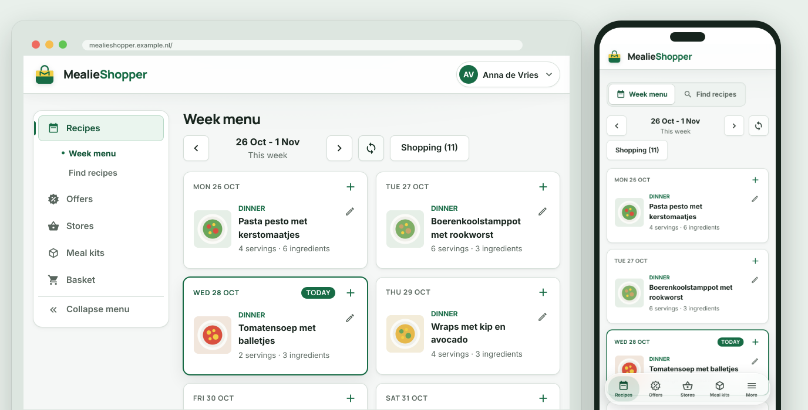
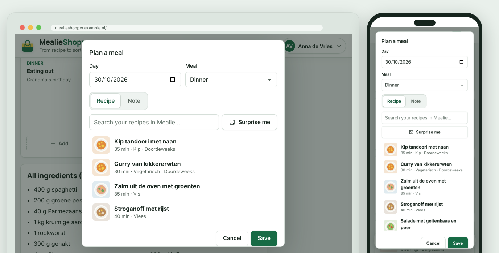
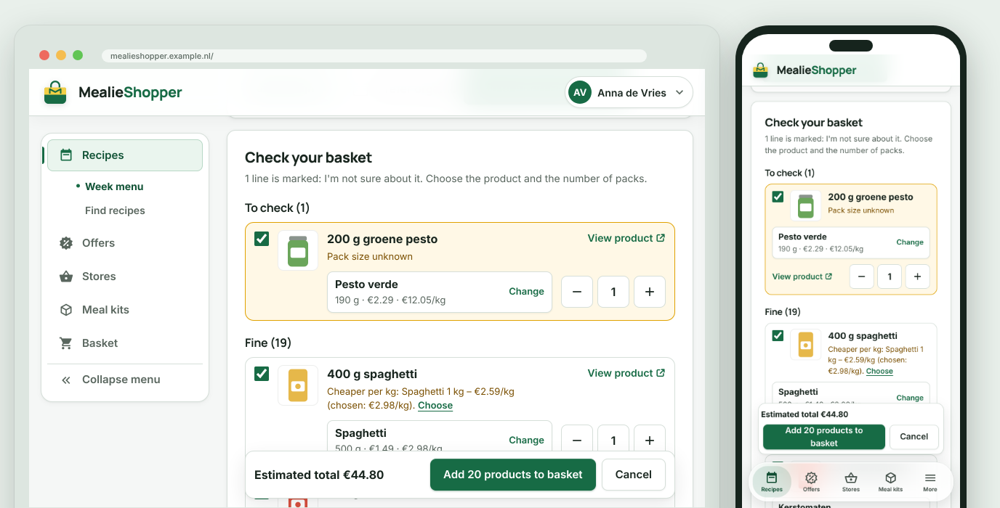
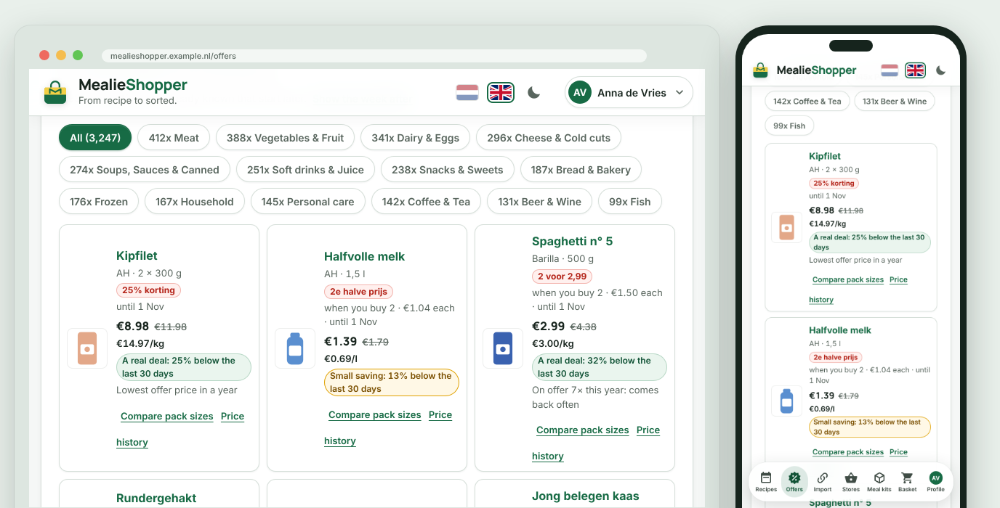
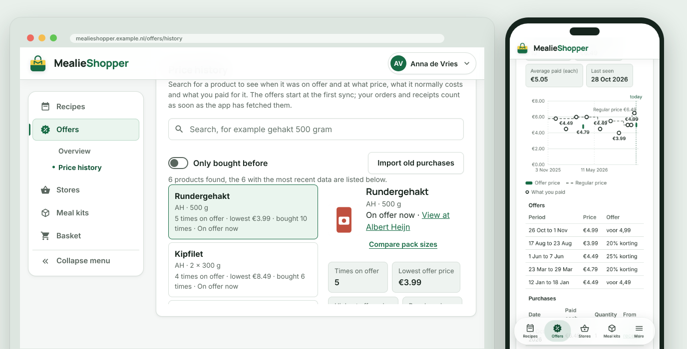
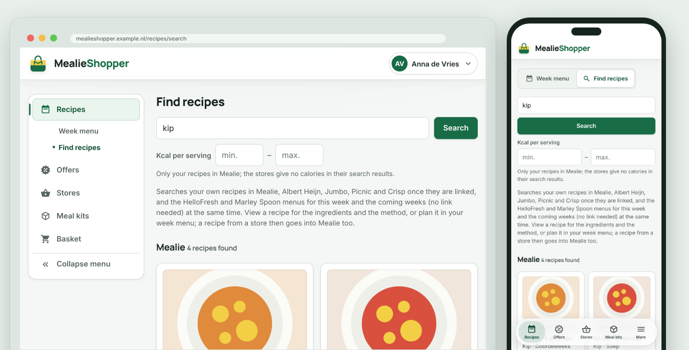
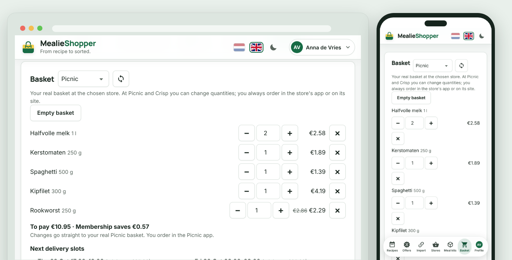
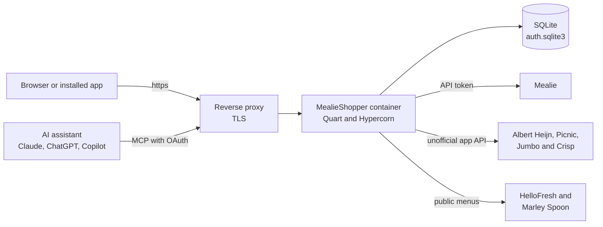
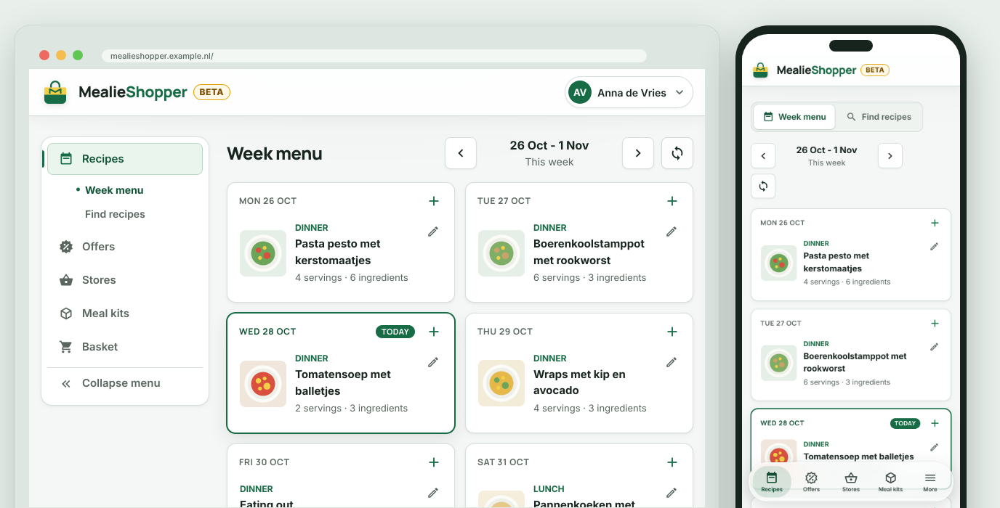

<div align="center">

<picture>
  <source media="(prefers-color-scheme: dark)" srcset="static/brand/mark-white.svg">
  
</picture>

# MealieShopper

**From recipe to sorted.**

Plan your week menu in [Mealie](https://mealie.io) and put it in your basket at [Albert Heijn](https://www.ah.nl), [Picnic](https://picnic.app), [Jumbo](https://www.jumbo.com) or [Crisp](https://crisp.nl), plus searching, saving and importing recipes. For anyone who keeps their recipes in Mealie and hosts the app themselves.

🇬🇧 **English** · 🇳🇱 [Nederlands](README.md)

[](#getting-started)
[](#installation-self-hosted)
[](#home-assistant-add-on)
[](#features)

[](https://github.com/helmerzNL/MealieShopper/commits/beta)
[](https://github.com/helmerzNL/MealieShopper/graphs/commit-activity)
[](LICENSE)
[](https://github.com/helmerzNL/MealieShopper/forks)
[](https://github.com/helmerzNL/MealieShopper/stargazers)
[](https://github.com/helmerzNL/MealieShopper/issues)
[](https://github.com/helmerzNL/MealieShopper/graphs/contributors)

[](https://github.com/helmerzNL/MealieShopper/releases/latest)
[](https://github.com/helmerzNL/MealieShopper/releases)
[](https://buymeacoffee.com/flux76)
[](https://ko-fi.com/flux76)

[User guide](docs/handleiding.en.md) · [Changelog](CHANGELOG.md) · [Report a bug](https://github.com/helmerzNL/MealieShopper/issues/new/choose)

<picture>
  <source media="(prefers-color-scheme: dark)" srcset="docs/screenshots/en/dark.png">
  
</picture>

</div>

---

## Contents

- [Why MealieShopper?](#why-mealieshopper)
- [Features](#features)
- [Screenshots](#screenshots)
- [Getting started](#getting-started)
- [Configuration](#configuration)
- [Running it](#running-it)
- [Data and backups](#data-and-backups)
- [Architecture](#architecture)
- [Stable and beta](#stable-and-beta)
- [Contributing](#contributing)
- [Privacy and security](#privacy-and-security)
- [Support MealieShopper](#support-mealieshopper)
- [License](#license)

## Why MealieShopper?

Planning a week menu in Mealie is nice, but then the retyping starts: looking up every ingredient in your supermarket's app, working out how many packs you need and checking whether the offer is really cheaper. MealieShopper does that for you. It reads your week menu from Mealie, looks up the products for each ingredient at Albert Heijn, Picnic, Jumbo or Crisp, converts servings and pack sizes and, after your check, puts them in your basket; you place the order yourself. Around that you get the offers with an honest verdict, your orders and receipts, and recipes from the stores and meal kits that you plan with one click. It runs in your own container, for your whole household.

## Features

- **Week menu to your basket**: one button looks up the best products at Albert Heijn, Picnic, Jumbo or Crisp for every ingredient in your week menu, works out the servings and pack sizes and adds up the same ingredient from several recipes. You check everything in a list first; only after you confirm does it go into your basket, and you place the order yourself.
- **Planning the week menu**: put a recipe or a note on a day, move or remove a meal, or let Mealie choose with **Surprise me**. Every change goes straight to Mealie.
- **Offers and recipe suggestions**: the offers of Albert Heijn (including your personal Bonus Box), Picnic, Jumbo and Crisp, per week and updated every day, with recipes whose ingredients are on offer.
- **Is it really a deal?**: every offer shows its price per kilo, litre or piece and a verdict against the regular price of the last 30 days. The **Price history** shows per product the offers, the regular price and what you paid yourself, and **Compare pack sizes** points out the cheapest pack. Public historical prices with unknown promotion status appear separately as **Observed prices**, with their sources. They do not count as regular prices. Historical leaflet prices, such as the archive of Albert Heijn and Jumbo since 2009, the administrator imports under **Settings, System**.
- **Search and import recipes**: search Mealie, Albert Heijn, Jumbo, Picnic and Crisp and the menus of HelloFresh and Marley Spoon at the same time, view a recipe and plan it with one click, or import a recipe from a link. Your saved AH recipes, Jumbo recipe lists and favourite Crisp recipes also go into Mealie in one go.
- **Cooking from a recipe**: a recipe is shown in a cooking view with the ingredients next to the numbered steps; tick off what is done and see which step is next. **Start cooking** shows one step at a time full screen, and with **Keep screen on** your screen does not switch off meanwhile.
- **Your stores in one place**: your basket, lists, saved recipes, favourites, orders and AH receipts, kept as a copy of their own that you can search ("when did I last buy coffee?"), even when the store is unavailable. A product on a receipt that the app does not recognise, you link to a product of the store yourself; from then on it does recognise it.
- **AI assistants**: an MCP server, so Claude, ChatGPT or Copilot can look at your week menu, recipes and lists, plan a meal and import a recipe into Mealie; OAuth login, with your own account.
- **For the whole household**: log in with a passkey, or with a password and two-step verification; you invite housemates with a link, and only the administrator links Mealie and the stores. Everyone picks their own preferred supermarket, which Offers and Stores open with.
- **An app on your phone**: install MealieShopper as an app (PWA), in Dutch or English and in a light or dark theme, with your own accent colour; every screen has its own address.
- **Your data, your server**: everything runs in your own container, and your data stays in one folder on your own host.

The full description of every feature is in the [user guide](docs/handleiding.en.md).

## Screenshots

| Planning a meal | Checking before the basket |
|:---:|:---:|
|  |  |
| **Offers** | **Price history** |
|  |  |
| **Find recipes** | **Picnic basket** |
|  |  |

<sub>Every image shows the same page on a computer and on a phone, with demo data. All screens, with an explanation, are in the [user guide](docs/handleiding.en.md#what-it-looks-like).</sub>

## Getting started

- 🌐 **Web:** open the address of your own installation.
- 📱 **iPhone / iPad** and 🤖 **Android:** see [Install as an app](#install-as-an-app).
- 🐳 **Self-hosted:** see [Installation](#installation-self-hosted), with Docker or as a [Home Assistant add-on](#home-assistant-add-on).

### Install as an app

MealieShopper is a PWA: you can install it and it then opens without a browser bar. On a phone you then get a floating, glass menu bar at the bottom with six items. As in a native app, you don't zoom with two fingers in the app and the title bar stays at the top, also when you drag down; in the browser you can zoom as usual. The menu bar looks like your other apps: floating glass on an iPhone, the Android bar on an Android device. Under Settings, Preferences you choose yourself and set the glass effect.

- **iPhone and iPad (Safari):** Share, then `Add to Home Screen`.
- **Android (Chrome):** menu, then `Install app`.
- **Windows and macOS (Edge or Chrome):** the install icon in the address bar.

Installing only works over HTTPS (except on `localhost`). To look at the menu bar without installing, open `?tabbar=1` after the address on your phone (`?tabbar=0` turns it off again).

### Installation (self-hosted)

You need a computer or NAS with Docker. You don't have to configure anything: on the first start MealieShopper guides you through security and the links itself.

#### Docker Compose (for example Unraid)

1. Create a folder for your data, for example `/mnt/user/appdata/mealieshopper`.
2. Use the included [`docker-compose.yml`](docker-compose.yml). It publishes the app on port `5959` and keeps your data in `/mnt/user/appdata/mealieshopper`.
3. Want to set something? Copy [`.env.unraid.example`](.env.unraid.example) to `.env.unraid` and change what you need. The file is optional (Docker Compose 2.24 or newer).
4. Start:

   ```bash
   docker compose up -d
   ```

5. Open `http://<address of your server>:5959` and follow the setup guide.

The image is at `ghcr.io/helmerznl/mealieshopper:latest` and is built for `linux/amd64` and `linux/arm64`, so it also runs on an ARM NAS (such as some Synology models) and on a Raspberry Pi.

#### Docker

```bash
docker run -d --name mealieshopper -p 8000:8000 \
  -v /mnt/user/appdata/mealieshopper:/data \
  ghcr.io/helmerznl/mealieshopper:latest
```

Then open `http://localhost:8000`. To build it yourself: `docker build -t mealieshopper .`.

#### Home Assistant add-on

Do you run Home Assistant OS or a Supervised installation? Then you can install MealieShopper as an add-on, without Docker commands:

1. Go to **Settings > Add-ons > Add-on store**, open the menu at the top right (⋮) and choose **Repositories**.
2. Add `https://github.com/helmerznl/mealieshopper` and install **MealieShopper**.
3. Click **Start** and open `http://<address of Home Assistant>:5959` (or **Open web UI**). The setup guide does the rest.

It is the same image as the Docker version (`linux/amd64` and `linux/arm64`). The add-on's data folder is `/data`, so Home Assistant includes the database and `secret.key` in its backups. All options (Mealie address and token, public address, AI keys and so on) are optional and sit on the add-on's **Configuration** tab; they are the same values as the environment variables under [Configuration](#configuration). There is no ingress: the app has its own login and an MCP server that need their own address, so open it on port `5959` and do not expose that port directly to the internet. For the development version there is a second add-on, **MealieShopper (beta)** (port `5960`, its own data folder), in the repository `https://github.com/helmerznl/mealieshopper#beta`. The add-on files are in [`homeassistant/`](homeassistant/mealieshopper/DOCS.md).

### First start

On a new installation MealieShopper opens a six-step setup guide: security, linking Mealie, linking Albert Heijn, Jumbo and Picnic, and an overview. What you skip you do later under **Settings** (in the avatar menu, on a phone under **More**). Do the first start on a network you trust, or right after the container is running: as long as no login method is set up, whoever opens the address first can claim the installation. Every step, with screenshots, is in the [user guide](docs/handleiding.en.md#first-start), and how to link Mealie and the supermarkets under [Linking Mealie and supermarkets](docs/handleiding.en.md#linking-mealie-and-supermarkets).

## Configuration

Everything is optional. Set `MEALIESHOPPER_TAG` in `.env` next to `docker-compose.yml` ([`.env.example`](.env.example)); the other values in your environment or in `.env.unraid` ([`.env.unraid.example`](.env.unraid.example) and [`.env.local.example`](.env.local.example) show everything).

| Variable | Required | Default | Description |
|---|:---:|---|---|
| `MEALIESHOPPER_TAG` | ❌ | `latest` | Which build is running: `latest` (stable) or `beta`. Set it in `.env` next to `docker-compose.yml`: the compose file uses it to pull the right image (`:latest` or `:beta`) and passes the same value to the app, which shows a **beta** badge next to the wordmark (and under About) on a beta build. See [Stable and beta](#stable-and-beta). |
| `MEALIESHOPPER_DATA_DIR` | ❌ | `/data` in the image, `./data` locally | Folder for the database and `secret.key`. |
| `MEALIESHOPPER_AUTH_SECRET` (or `JWT_SECRET`) | ❌ | `secret.key` | Your own secret for sessions and encryption. Without it the app creates `secret.key` in the data folder; see *The secret* below. |
| `MEALIESHOPPER_PUBLIC_BASE_URL` | ❌ | detected by the app | The public address (for the preview image, invitation links and the AI connection). An address the administrator enters under Profile, AI apps takes precedence. |
| `RP_ID`, `RP_ORIGINS` (or `RP_ORIGIN`), `RP_NAME` | ❌ | - | Only for passkeys, with a domain name and HTTPS. |
| `MEALIESHOPPER_MCP` | ❌ | on | Initial value of the MCP server for AI assistants (on when login is on). The switch under Profile, AI apps takes precedence. |
| `MEALIESHOPPER_OFFERS_SCHEDULE` | ❌ | on | Set to `false` to turn off the daily task that fetches the offers of all stores. The button under Settings, Link keeps working. |
| `MEALIESHOPPER_OFFERS_SYNC_HOUR` | ❌ | `5` | The hour of the day (0 to 23, the container's time) at which that task fetches the offers. |
| `MEALIESHOPPER_IMAGE_PREFETCH` | ❌ | on | Set to `false` to turn off the background rounds that put the stores' product photos in the cache ahead of time (the `images` folder in the data folder). A photo you open is still fetched and kept. |
| `MEALIESHOPPER_OFFERS_RECIPES` | ❌ | off | With `true` the app shows the **Recipes** subtab under Offers (recipe suggestions from the offers). Off by default: the matches between ingredients and products are not good enough yet. The MCP tools for AI assistants work with this off too. |
| `ANTHROPIC_API_KEY`, `OPENAI_API_KEY` | ❌ | - | An API key from Claude (Anthropic) and/or ChatGPT (OpenAI) to have the matches between ingredients and offers reviewed (see *AI: searching recipes for the offers* in the [user guide](docs/handleiding.en.md#offers-1)). A key entered in the app takes precedence. Without a key nothing happens with AI. |
| `ANTHROPIC_BASE_URL`, `OPENAI_BASE_URL` | ❌ | `https://api.anthropic.com`, `https://api.openai.com/v1` | Another address for the AI requests, with the same API, as with the official SDKs: a proxy such as [LiteLLM](https://docs.litellm.ai/), Azure OpenAI or a local model. `ANTHROPIC_BASE_URL` is without `/v1`, `OPENAI_BASE_URL` with `/v1`. You set the key and the model as always: for LiteLLM a LiteLLM key and the model name from LiteLLM. |
| `HTTPS_PROXY`, `HTTP_PROXY`, `ALL_PROXY`, `NO_PROXY`, `REQUESTS_CA_BUNDLE`, `CURL_CA_BUNDLE`, `SSL_CERT_FILE`, `SSL_CERT_DIR` | ❌ | - | For a proxy and your own certificate. All outgoing traffic (the stores, Mealie, GitHub, the AI provider, HelloFresh, Marley Spoon and data.mealieshopper.nl) goes through the proxy in `HTTPS_PROXY`, `HTTP_PROXY` or `ALL_PROXY`, except the hosts in `NO_PROXY` (host names or single IP addresses, not a range such as `192.168.0.0/16`). `REQUESTS_CA_BUNDLE` (or else `CURL_CA_BUNDLE`) replaces the built-in list of trusted CAs with that file or folder, for example for a Mealie with its own certificate. Put your own CA and the public root certificates in it, or the app no longer trusts the stores and GitHub. Without those two, `SSL_CERT_FILE` and `SSL_CERT_DIR` do the same. |
| `MEALIESHOPPER_UPDATE_CHECK` | ❌ | on | Set to `false` to turn the update check off (Settings, System). By default the app checks GitHub for a newer release and tells the administrator; no information about you or the installation is sent. |
| `MEALIESHOPPER_AUDIT_LOG` | ❌ | on | Set to `false` to turn the audit log off (Settings, Audit log). |
| `MEALIESHOPPER_AUDIT_BODIES` | ❌ | on | Set to `false` and the audit log stores only who, what, when and the outcome, not the requests and answers themselves. |
| `MEALIESHOPPER_AUDIT_BODY_CHARS` | ❌ | `4000` | How many characters of each request and answer the audit log stores; longer texts are cut. |
| `MEALIESHOPPER_AUDIT_RETENTION_DAYS` | ❌ | `30` | After how many days the audit log deletes entries; `0` never deletes on its own. |
| `PASSKEY_AUTH_ENABLED` | ❌ | on | With `false` login is turned off completely (emergency only). |
| `MEALIE_URL`, `MEALIE_API_TOKEN` | ❌ | - | Mealie through the environment; a link made in the app takes precedence. |
| `AH_REFRESH_TOKEN` | ❌ | - | Starting value for the AH link; you normally link in the app. |
| `PICNIC_COUNTRY_CODE` | ❌ | `NL` | Country of your Picnic account: `NL`, `DE` or `FR`. You make the link itself in the app. |
| `PORT` | ❌ | `8000` | Port for `python run.py`. |
| `MEALIESHOPPER_VERSION`, `MEALIESHOPPER_COMMIT` | ❌ | from the build | Override the version number and commit shown under About. |

In the Home Assistant add-on you set these on the **Configuration** tab instead; `docker-entrypoint.py` turns them into the variables above when the container starts.

**The secret.** Without `MEALIESHOPPER_AUTH_SECRET` the app creates a random secret on the first start and keeps it in the data folder (`secret.key`, readable only by the owner). Two separate keys follow from it: one for sessions and one for encrypting your stored links and the two-step secret. If you set `MEALIESHOPPER_AUTH_SECRET` yourself, the key is not on disk next to the database; use a long, fixed, random value (`openssl rand -hex 32`) and don't change it afterwards.

What the audit log keeps and what it hides is in the [user guide](docs/handleiding.en.md#audit-log).

## Running it

| Task | Command |
|---|---|
| Start | `docker compose up -d` |
| Stop | `docker compose down` |
| Update | `docker compose pull && docker compose up -d` |
| Roll back | set `MEALIESHOPPER_TAG` in `.env` to the previous version number (`X.Y.Z`), then `docker compose up -d` |
| Logs | `docker compose logs -f` |

With a new version you don't have to do anything; the database is extended automatically when needed. Under About you can see which version and commit is running. In Home Assistant, the add-on shows the update and you click **Update**. Copy the data folder before you go back to an older version: an older version does not restore a backup that a newer version made in the app.

- **Health check:** `GET /healthz` answers `200` with `{"ok": true}`.
- **Largest upload:** 200 MB, a backup file when restoring or a price archive. The screen sends such a file in parts of 4 MB, each a request of its own, so whatever runs in front of the app (a reverse proxy, a tunnel or CDN such as Cloudflare) does not have to allow a larger request. If you send the whole file in one request through the API yourself (`POST …/stage`), the proxy does have to allow 200 MB; for nginx that is `client_max_body_size 200m`.
- **Update check:** under **Settings, System** the app checks GitHub for a release newer than the version that is running. If there is one, the administrator gets a notice at the top of the screen and a dot on **Settings**, with a link to the release notes. The app asks GitHub at most every six hours (or right away with **Check now**) and sends no information about you or the installation. Turn it off with `MEALIESHOPPER_UPDATE_CHECK=false`. The app never updates itself.

## Data and backups

Everything is in the data folder: `/data` in the container, on the host the folder you mount in `docker-compose.yml` (in the example `/mnt/user/appdata/mealieshopper`), `./data` locally (`MEALIESHOPPER_DATA_DIR`).

| File | What is in it |
|---|---|
| `auth.sqlite3` | settings, passkeys, password, copies of your lists, recipes, orders and receipts at the supermarkets, pictures from Mealie, the saved images of offers you bought |
| `secret.key` | the secret for sessions and for encrypting your links (not when you set `MEALIESHOPPER_AUTH_SECRET` yourself) |

**Include the whole folder in your backups.** Without `secret.key` (or your own `MEALIESHOPPER_AUTH_SECRET`) the stored links and sessions can't be read: you link Mealie and the supermarkets again, and the app shows that as "not linked".

**Making and restoring a backup in the app.** Under **Settings, System, Backup and restore** the administrator makes one file (`mealieshopper-backup-….json`) with all data in one click, and restores it later, for example on a new server. It holds what you built up yourself: the links with Mealie, Albert Heijn, Picnic, Jumbo and the AI keys, the copies of your lists, saved recipes, orders and receipts, your own links of receipt lines to products, the current offers **and the whole history of the (bonus) offers** and the tracked prices, the saved images of offers you bought, the judgements of offers for recipes, the profiles and the AI and MCP choices. After restoring, the app works as it did before the backup.

- **The links are encrypted with a password you choose** (scrypt and Fernet, at least 8 characters). That password is stored nowhere: without it the links in the file can't be read. Untick *Include the links* and the file holds no links and asks for no password; you then link again after restoring. Lost the password? Untick *Restore the links* when restoring: the rest is restored as usual and the links that are there now stay. On the new server the links are encrypted again with that server's key (`secret.key`), so they work even if that key is different.
- **You choose what goes along.** When making a backup you can leave out *the current offers* and *the offer history*, which makes the file smaller. When restoring you untick them, like the links, if you do not want them back. What is not in the file or what you untick stays on the server as it is. The app fetches the current offers again at the next sync; the history it does not.
- **Whatever logs in to MealieShopper is never included:** passkeys, passwords, two-step verification and recovery codes, invitations, sessions, the access of AI assistants (MCP) and `secret.key` itself. A file you email or keep in a cloud drive therefore can't open MealieShopper. The consequence: if you restore onto a new installation, set up logging in first (the setup assistant) and restore the backup after that. The audit log, the stored recipe images (they come back from Mealie by themselves) and the web address you set for the server are not included either.
- **Restoring is all or nothing.** You choose the file, the server checks all of it (every part, every column and every value; images are read again) and shows what it contains: counts and which links. Only after you confirm does the server replace what is there in one go. A refused file changes nothing and isn't kept, and if something goes wrong halfway, nothing has changed. A backup from an older version works; one from a newer version is refused with the message to update first. Profiles of users that don't exist on this installation are skipped. Your users and their login details stay as they are.
- **You see what is happening.** Every phase has a name and, where it can be counted, a number and a bar: making, downloading (with the size), uploading, checking and replacing. Afterwards it says how long each part took. The restore runs on the server: leaving, reloading or closing the page stops nothing, and when you come back to the screen you see the progress again. Until then the uploaded file sits in the data folder as `.restore-<code>` (while uploading `.restore-<code>.part`) and is removed after use or after an hour. After a successful restore the page reloads.
- **Limits:** a backup file can be 200 MB at most (a backup with years of offers is a few megabytes, an imported price archive easily makes it over 100 MB; each saved image of an offer you bought adds roughly 50 to 200 kB). The screen uploads the file in parts of 4 MB, each a request of its own: a reverse proxy, tunnel or CDN in front of MealieShopper (Cloudflare's free plan lets at most 100 MB through per request) therefore does not have to allow a large request. A part that fails, or where nothing happens for 30 seconds, is sent again by itself (the server also gives up such a part after 30 seconds of silence, with a line in the log, so it does not hold up the rest of the app); if the upload really gets no further, the screen says so instead of standing still. Uploading and downloading as a whole have no time limit.
- **This is your own copy of what you entered, not a replacement for a copy of the whole data folder.** That remains the way to keep a whole server. The pattern follows [`backup-restore.md`](https://github.com/Flux76HQ/App-Guidance/blob/main/shared/guidelines/backup-restore.md) of App-Guidance, with two deliberate deviations: the links may be included, encrypted with your password, and the file goes to the server in parts.

**Importing a price archive.** Under **Settings, System, Import price archive** the administrator adds historical prices to the Price history, from the ZIP of a package (such as the leaflet archive of AH, Jumbo, Picnic and Crisp, also the gist for data.mealieshopper.nl) or from a file in the `mealieshopper-price-archive` format, or with **Fetch offers** straight from [data.mealieshopper.nl](https://data.mealieshopper.nl). It adds and is not a backup (only with the box *Replace what came from a price archive before* do earlier archive lines go first); the prices it adds do go into the backup afterwards. The format and the checks are in the [manual](docs/handleiding.en.md#importing-a-price-archive). The other way round, **Export price archive** gives all offers and prices as a ZIP, with one file per store and month, to share in for example a GitHub repository, or in the layout of data.mealieshopper.nl to submit them there; your personal offers are never included (see the [manual](docs/handleiding.en.md#exporting-a-price-archive)).

To erase everything and start over, see [Factory reset](docs/handleiding.en.md#factory-reset) in the user guide.

## Architecture



| Component | Purpose | Data |
|---|---|---|
| `mealieshopper` | The container: the Quart app under Hypercorn with the interface, the API, the MCP server and the daily offers task | `/data` (`auth.sqlite3` and `secret.key`) |
| Mealie | Your recipes and week menu; runs separately and is not included | in Mealie itself |
| Albert Heijn, Picnic, Jumbo, Crisp | Products, baskets, lists, orders and offers | what MealieShopper keeps is in `auth.sqlite3` |

MealieShopper is an unofficial tool and is not affiliated with Mealie, Albert Heijn, Picnic, Jumbo or Crisp.

**Integrations**

| Integration | What for |
|---|---|
| [Mealie](https://mealie.io) | Your recipes and week menu; imported recipes and what you plan end up here. Through the API with a token. |
| [Albert Heijn](https://www.ah.nl) | Lists, saved recipes, products and the basket, through the **unofficial** app API of AH. AH may change it without notice; use it for personal use. |
| [Allerhande](https://www.ah.nl/allerhande) | Searching and importing recipes. |
| [Jumbo](https://www.jumbo.com) | Searching products and filling the cart, through the **unofficial** app API of Jumbo (Auth0 and GraphQL). Jumbo may change it without notice or refuse a server; use it for personal use. |
| [Picnic](https://picnic.app) | Searching products and filling the cart, through the **unofficial** app API of Picnic. Picnic may change it without notice; use it for personal use. |
| [Crisp](https://crisp.nl) | Searching products, filling and changing the basket, recipes, favourites, orders and offers, through the **unofficial** app API of Crisp. Crisp may change it without notice; use it for personal use. |
| [WebAuthn](https://www.w3.org/TR/webauthn-2/) | Logging in with a passkey. |
| [TOTP (RFC 6238)](https://www.rfc-editor.org/rfc/rfc6238) | Two-step verification with an authenticator app. |
| [MCP](https://modelcontextprotocol.io) and [OAuth 2.1](https://datatracker.ietf.org/doc/draft-ietf-oauth-v2-1/) | The link with AI assistants such as Claude, ChatGPT and Copilot. |
| [GitHub Container Registry](https://ghcr.io) | Where the Docker image lives. |

**Components**

| Component | Licence | What for |
|---|---|---|
| [Python](https://www.python.org) | PSF-2.0 | The programming language of the server. |
| [Quart](https://quart.palletsprojects.com) | MIT | The web framework. |
| [Flask](https://flask.palletsprojects.com) | BSD-3-Clause | Used by Quart as the base of the web framework. |
| [Werkzeug](https://werkzeug.palletsprojects.com) | BSD-3-Clause | Used by Quart and Flask for requests, responses and routing. |
| [Hypercorn](https://hypercorn.readthedocs.io) | MIT | The web server in the container. |
| [PyJWT](https://pyjwt.readthedocs.io) | MIT | Signs sessions. |
| [cryptography](https://cryptography.io) | Apache-2.0 OR BSD-3-Clause | Encrypts stored links and verifies passkeys. |
| [cbor2](https://github.com/agronholm/cbor2) | MIT | Reads passkey data. |
| [py_webauthn](https://github.com/duo-labs/py_webauthn) | BSD-3-Clause | Checks passkeys when you create them and sign in. |
| [pyasn1](https://github.com/pyasn1/pyasn1) | BSD-2-Clause | Used by py_webauthn to read passkey certificates. |
| [pyasn1-modules](https://github.com/pyasn1/pyasn1-modules) | BSD-2-Clause | Used by py_webauthn to read passkey certificates. |
| [pyOpenSSL](https://pyopenssl.org) | Apache-2.0 | Used by py_webauthn to check passkey certificates. |
| [HTTPX](https://www.python-httpx.org) | BSD-3-Clause | Talks to Mealie and the supermarkets. |
| [aiosqlite](https://github.com/omnilib/aiosqlite) | MIT | Reads and writes the database without making the server wait. |
| [SQLite](https://sqlite.org) | Public domain | The database. |
| [Material Design Icons](https://pictogrammers.com/library/mdi/) | Apache-2.0 | The icons. |
| [qrcode-generator](https://github.com/kazuhikoarase/qrcode-generator) | MIT | Draws the QR code for two-step verification in your browser. |
| [Inter](https://rsms.me/inter/) and [Manrope](https://github.com/sharanda/manrope) | OFL-1.1 | The typefaces. |

You can see the versions of the Python packages in the app under **About**.

## Stable and beta

MealieShopper has two lines, each with its own branch and container image:

| | Stable | Beta |
| --- | --- | --- |
| Branch | `main` | `beta` |
| Image | `ghcr.io/helmerznl/mealieshopper:latest` (and `X.Y.Z`) | `ghcr.io/helmerznl/mealieshopper:beta` (and `X.Y.Z-beta`) |
| GitHub release | `vX.Y.Z` | pre-release `vX.Y.Z-beta` |
| For whom | everyone; this is the default | anyone who wants to try new features first |

Every change lands in `beta` first. Every push to `beta` immediately builds a new beta image and a pre-release on GitHub, so development carries on without touching the stable version. Only when the beta proves itself is it promoted to `main`, which builds `latest` and the stable release, with the release notes of every version since the previous stable release. A beta can therefore be newer than the stable version, but it can also still contain bugs.



You recognise the beta build by the **beta** badge next to the wordmark; under About, **beta** also follows the version number.

**Running the beta.** Put `MEALIESHOPPER_TAG=beta` in a `.env` file next to `docker-compose.yml` (copy [`.env.example`](.env.example)) and pull the image:

```bash
docker compose pull && docker compose up -d
```

With `docker run`, use `ghcr.io/helmerznl/mealieshopper:beta`. To pin a specific beta, use the tag with the version number, for example `2.72.1-beta`.

If you put the value in `.env.unraid`, Compose does not see it for the image tag; use `docker compose --env-file .env.unraid up -d` instead.

**Keep your stable installation untouched.**

- Use a **separate data folder** for the beta, so your stable data, connections and login are not touched by a beta.
- If you run the beta next to the stable version, also give it a different `container_name` and a port other than `5959` in `docker-compose.yml`.
- To go back to stable, set `MEALIESHOPPER_TAG=latest` and pull again, with the data folder of your stable installation.

**Reporting bugs.** If you run into something in the beta, report it as an [issue on GitHub](https://github.com/helmerznl/mealieshopper/issues) and mention the version number and commit from About.

## Contributing

Contributions are welcome. Pull requests go to the `beta` branch, never to `main`. The working conventions for people and AI assistants alike are in [`CLAUDE.md`](CLAUDE.md) (in Dutch). For bugs and ideas, open an [issue](https://github.com/helmerzNL/MealieShopper/issues/new/choose).

```bash
python -m venv .venv
.venv/bin/pip install -r requirements.txt     # Windows: .\.venv\Scripts\pip
.venv/bin/python run.py                       # Windows: .\.venv\Scripts\python
python -m unittest discover -s tests          # all tests
```

The app listens on `http://localhost:8000`. See [`.env.local.example`](.env.local.example) for the options.

- **Structure:** `mealieshopper/` (Quart app: `app.py`, `auth.py`, `auth_password.py`, `users.py`, `onboarding.py`, `mealie.py`, `ah.py`, `picnic.py`, `jumbo.py`, `audit.py`, `updates.py`, `mcp.py`, `mcp_http.py`, `oauth.py`, `ah_orders.py`, `offers.py`, `offers_schedule.py`, `offer_categories.py`, `about.py`, `i18n.py`), `static/` and `templates/` (the interface, no build step), `tests/`.
- **Texts and languages:** the interface texts are in `static/i18n/nl.js` and `en.js`, one text per line. In the HTML the Dutch text is in the page, with `data-i18n="key"`; in the scripts use `t("key", { name })`, `th(...)` (with markup, values escaped) and `tn("key", count)` (plurals). Adding a language means a file `static/i18n/<language>.js`, a flag and the language in `static/i18n.js` and `mealieshopper/i18n.py`. `tests/test_i18n.py` makes sure both dictionaries are equal.
- **Brand:** colours, typography and PWA settings are in [`docs/huisstijl.md`](docs/huisstijl.md) (in Dutch). Rebuild the image files with `python scripts/build_brand.py` (needs Pillow).
- **Version and release:** the version number is in `VERSION` (just `X.Y.Z`); raise it on a release, run `python scripts/ha_addon.py` (it puts the version in the Home Assistant add-ons under `homeassistant/`; a test fails if you forget), write a heading for the new version in [`CHANGELOG.md`](CHANGELOG.md) and merge to `beta`: the workflow `.github/workflows/release.yml` then creates the pre-release `vX.Y.Z-beta` with that text; promoting `beta` to `main` creates the stable release `vX.Y.Z`, with the text of every version since the previous stable release (`release_notes.py --since`). Every version gets its own GitHub release. The commit comes from the build: the Dockerfile has the build argument `GIT_COMMIT`, and the workflow in `.github/workflows/docker.yml` sets it to `github.sha`. By hand: `docker build --build-arg GIT_COMMIT=$(git rev-parse HEAD) -t mealieshopper .`
- **Branches and container registry:** pull requests go to `beta`, not to `main` (`main` only receives a pull request from `beta`; the check in `.github/workflows/pr-target.yml` enforces it and moves a Dependabot security update, which always arrives on `main`, to `beta`). The workflow builds and pushes on every push to `main` to `ghcr.io/helmerznl/mealieshopper:latest` (and `X.Y.Z`), and on every push to `beta` to `ghcr.io/helmerznl/mealieshopper:beta` (and `X.Y.Z-beta`), for `linux/amd64` and `linux/arm64` (through QEMU and Buildx; also manually through `workflow_dispatch`). To run the development version, use the `beta` tag and a separate data folder.
- **Screenshots:** the images in `docs/screenshots/` were made with Playwright against a running MealieShopper with mocked data and hand-drawn illustrations (no third-party photos), so they are free to use anywhere. Start an empty MealieShopper with login switched off for this (`PASSKEY_AUTH_ENABLED=false`; a few scenarios ask the server for real data, such as the component list under About) and regenerate them with `SHOT_URL=http://localhost:8000 node scripts/screenshots/index.js` (optionally `--only plan,login` and `--lang en`). The consent scenario runs Python with Quart, so the app's environment must be on the `PATH`. The script puts the address of the screen in the address bar of the window. When an error message is on screen, the script reports `LET OP`; the scenarios are in `scripts/screenshots/scenarios/` and the demo data in `scripts/screenshots/demo.js`. You need Node with Playwright installed.

## Privacy and security

- Everything is stored on your own server: no account with us, no analytics, no tracking. The update check only asks GitHub for the latest release, without information about you or your installation, and something only goes to an AI service when the administrator enters their own key and presses the button themselves.
- Your links with Mealie and the supermarkets are stored encrypted in the database. MealieShopper does not keep store passwords or your delivery address.
- An AI assistant you connect yourself (MCP) reads only in your name and with your rights.
- You log in with a passkey, or with a password (scrypt, at least 10 characters) and optional two-step verification; after 5 failed attempts per IP address, logging in is blocked for 15 minutes. Everything about logging in, users and the AI connection is in the [user guide](docs/handleiding.en.md#security).
- As long as no login method is set up, whoever opens the address first can claim the installation. Do the first start on a network you trust, or right after the container is running.
- The IP address used for the block after failed attempts comes from `X-Forwarded-For` of your reverse proxy (one hop). So don't put MealieShopper directly on the internet, but behind a proxy that sets that header itself.
- Passkeys need a domain name and HTTPS. Then set `RP_ID` (the host name only) and `RP_ORIGINS` (the full address), see [`.env.unraid.example`](.env.unraid.example).
- Report a vulnerability privately, as described in [`SECURITY.md`](SECURITY.md), never in a public issue.

## Support MealieShopper

MealieShopper is free. If it is useful to you, a coffee keeps the development going.

<a href="https://buymeacoffee.com/flux76"></a>
<a href="https://ko-fi.com/flux76"></a>

## License

[MIT](LICENSE) © 2026 Flux76

The components MealieShopper uses each have their own licence; see [Architecture](#architecture).

---

<div align="center">
<sub>Made with ❤️ in the Netherlands by <a href="https://flux76.com">Flux76</a></sub>
</div>
