<div align="center">

<picture>
  <source media="(prefers-color-scheme: dark)" srcset="static/brand/wordmark-white.svg">
  
</picture>

**Van recept naar geregeld.**
Je weekmenu uit [Mealie](https://mealie.io) in je [Albert Heijn](https://www.ah.nl)-mandje, plus recepten zoeken, bewaren en importeren.

**Nederlands** · [English](README.en.md)

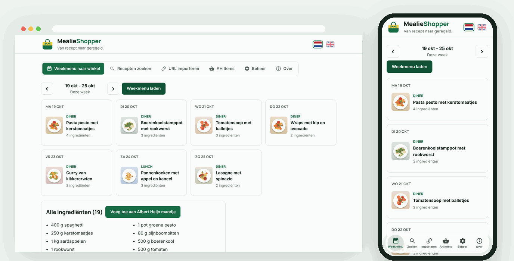

</div>

## Inhoud

- [Wat kan het?](#wat-kan-het)
- [Zo ziet het eruit](#zo-ziet-het-eruit)
- [Snel starten](#snel-starten)
- [Eerste start](#eerste-start)
- [Gebruik](#gebruik)
- [Mealie en Albert Heijn koppelen](#mealie-en-albert-heijn-koppelen)
- [Beveiliging](#beveiliging)
- [Gebruikers en uitnodigen](#gebruikers-en-uitnodigen)
- [AI-assistenten (MCP)](#ai-assistenten-mcp)
- [Configuratie](#configuratie)
- [Data en back-ups](#data-en-back-ups)
- [Updaten](#updaten)
- [Problemen oplossen](#problemen-oplossen)
- [Ontwikkelen](#ontwikkelen)
- [Integraties en componenten](#integraties-en-componenten)
- [Een koffie?](#een-koffie)

## Wat kan het?

- **Weekmenu naar je boodschappen.** Het weekmenu uit Mealie, met de plaatjes van je recepten. Eén knop zoekt voor elk ingrediënt de beste AH-producten, rekent uit hoeveel verpakkingen je nodig hebt en zet ze in je AH-mandje. Twijfelt de app, dan controleer je de regel eerst zelf.
- **Ook voor Picnic en Jumbo.** Koppel je Picnic- of Jumbo-account, dan kies je in de planner naar welke supermarkt het weekmenu gaat. De producten komen direct in je mandje van die winkel; je rondt de bestelling zelf af in de Picnic-app of bij Jumbo.
- **Recepten zoeken en importeren.** Zoek tegelijk in de recepten van Albert Heijn, Jumbo en Picnic en zet ze met één klik in Mealie, of importeer een recept via een link.
- **Je AH-account in MealieShopper.** Je bewaarde recepten en je favoriete lijstjes, bewaard in een eigen kopie zodat ze ook werken als AH even niet meewerkt. Zoeken in je recepten en lijstjes gaat direct.
- **Eén tabblad Mandje.** Je mandje bij Albert Heijn (de boodschappenlijst waar het weekmenu in schrijft), Picnic en Jumbo, met een keuzelijst voor de winkels die gekoppeld zijn. Bij Picnic pas je aantallen aan of leeg je het mandje; Jumbo toont het alleen. Na het vullen vanuit het weekmenu brengt de knop **Mandje bekijken** je erheen.
- **Bestellingen en kassabonnen.** Je AH-mandje, je bestellingen bij Albert Heijn en je kassabonnen uit de winkel, bewaard in een eigen kopie zodat je ze ook zonder verbinding met AH kunt bekijken en doorzoeken ("wanneer kocht ik voor het laatst koffie?"). Ook je AI-assistent kan ze bevragen.
- **Een app op je telefoon.** Installeer MealieShopper als app (PWA). Op een telefoon krijg je een glazen menubalk onderaan, zoals een echte app.
- **Veilig inloggen.** Een passkey (met een domeinnaam en HTTPS), of een gebruikersnaam en wachtwoord met optionele tweestapsverificatie.
- **Meerdere gebruikers.** Jij bent de beheerder en nodigt huisgenoten uit met een link. Zij gebruiken de basisfuncties; alleen jij koppelt Mealie en Albert Heijn en beheert de gebruikers.
- **AI-assistenten.** Een MCP-server, zodat je Claude, ChatGPT of Copilot je weekmenu, recepten en lijstjes kunt laten bekijken en een recept in Mealie kunt laten importeren. Inloggen met OAuth, met je eigen account.
- **Nederlands en Engels.** Wissel met de vlaggetjes; de app onthoudt je keuze.
- **Jij houdt de regie.** Alles draait in je eigen container; je gegevens staan in een SQLite-bestand in je eigen data-map.

## Zo ziet het eruit

Elke afbeelding laat dezelfde pagina zien op een computer en op een telefoon. De recepten en producten zijn voorbeeldgegevens.

### Weekmenu en winkelmandje

Laad je weekmenu uit Mealie. Het aantal verpakkingen wordt uitgerekend met de verpakkingsgrootte van AH, en regels waar de app niet zeker van is, markeert ze zodat je ze controleert voordat het mandje wordt gevuld.

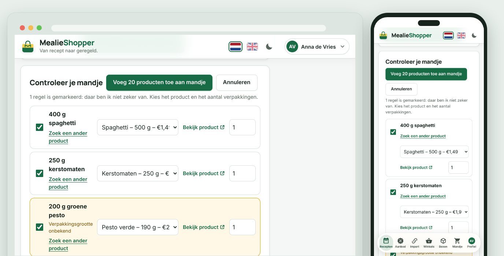

### Recepten zoeken

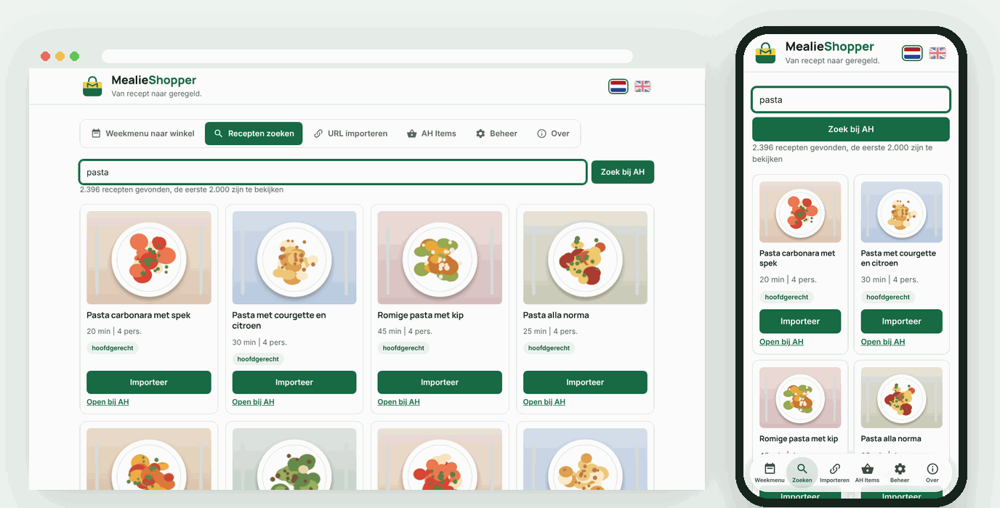

### Winkels: je bewaarde AH-recepten

Je bewaarde Allerhande-recepten staan in MealieShopper, op een telefoon minstens twee naast elkaar. Bovenaan zoek je in je recepten.

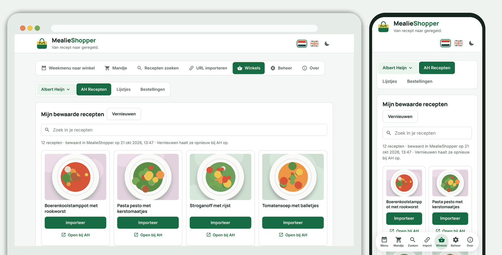

### Winkels: je lijstjes

Je favoriete lijstjes als kaarten. Synchroniseer ze naar MealieShopper, zoek op naam of op een product, en open een lijstje op dezelfde plek. In een geopend lijstje zet je het hele lijstje met één druk op **In mandje** in je winkelmandje, en pas je per product het aantal aan.

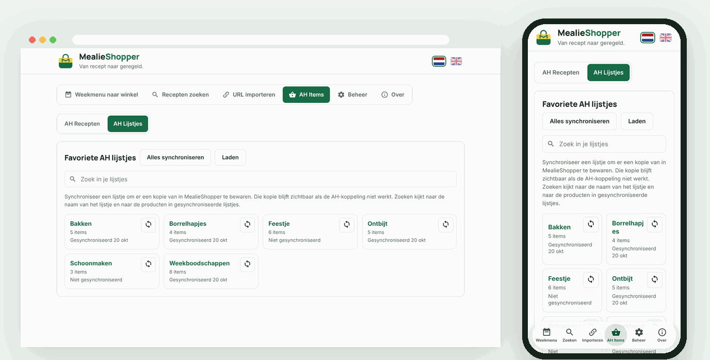

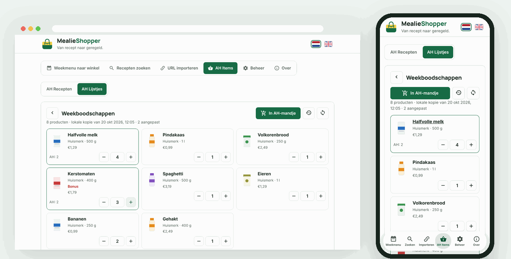

### Winkels: AH-bestellingen en kassabonnen

Je **kassabonnen** uit de winkel, weergegeven zoals op papier: aantal, omschrijving, prijs en bedrag, de bonusregels, het totaal en hoe je betaalde. Alles staat in een lokale kopie; het zoekveld doorzoekt al je aankopen en laat zien wanneer en hoe vaak je iets kocht, en **op welke kassabonnen** een product staat (zoek bijvoorbeeld op "frisdrank"); open je zo'n bon, dan zijn de passende regels geel gemarkeerd. Daarboven staan je **aankomende bestellingen** (nog open, met bezorgmoment) en je **afgelopen bestellingen** (geleverd, voor altijd bewaard); open een bestelling voor de producten. Je AH-mandje staat onder het tabblad Mandje.

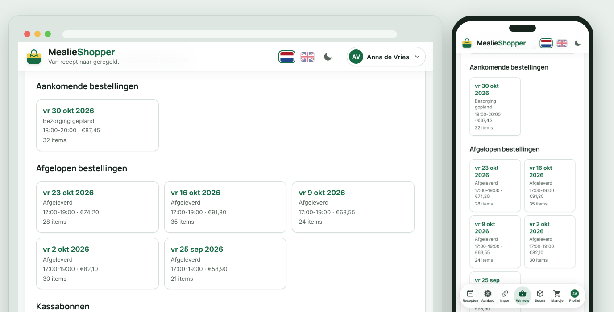

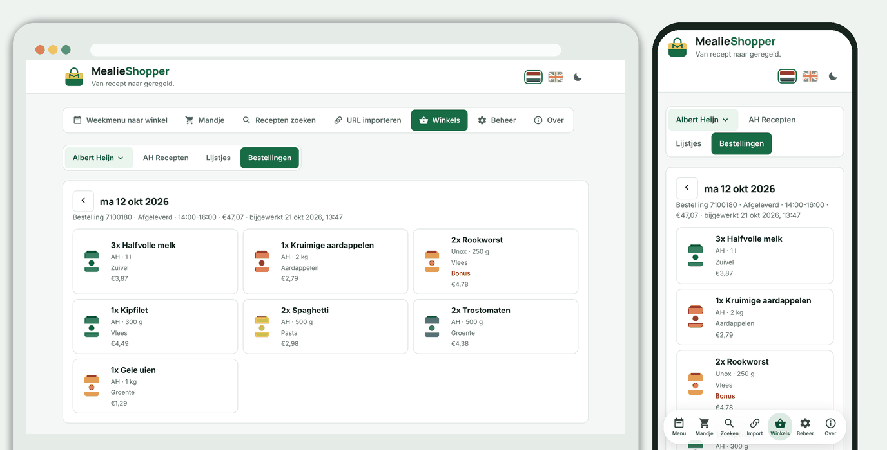

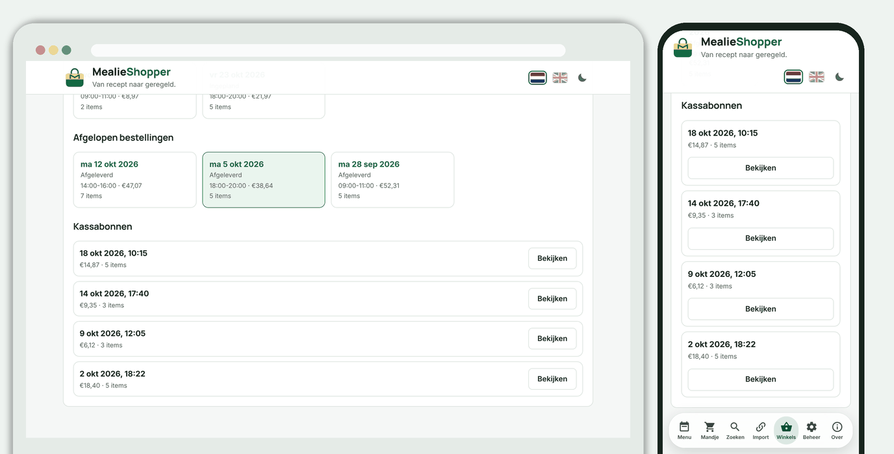

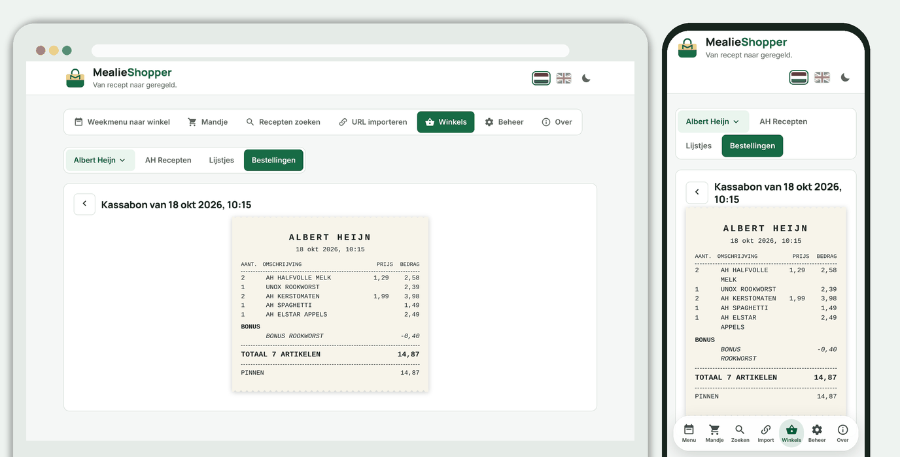

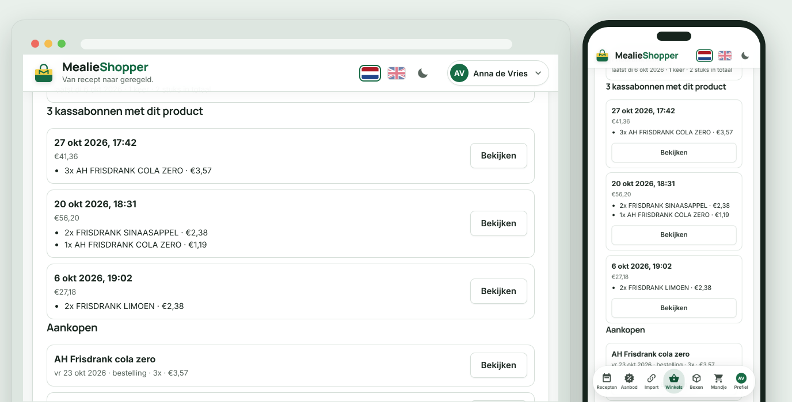

## Snel starten

Je hebt een computer of NAS met Docker nodig. Je hoeft niets in te stellen: MealieShopper loopt je bij de eerste start zelf door de beveiliging en de koppelingen.

### Docker Compose (bijvoorbeeld Unraid)

1. Maak een map voor je gegevens, bijvoorbeeld `/mnt/user/appdata/mealieshopper`.
2. Gebruik de meegeleverde [`docker-compose.yml`](docker-compose.yml). Die publiceert de app op poort `5959` en bewaart je gegevens in `/mnt/user/appdata/mealieshopper`.
3. Wil je iets instellen? Kopieer [`.env.unraid.example`](.env.unraid.example) naar `.env.unraid` en pas aan wat je nodig hebt. Het bestand is optioneel (Docker Compose 2.24 of nieuwer).
4. Start:

   ```bash
   docker compose up -d
   ```

5. Open `http://<adres van je server>:5959` en volg de installatiehulp.

De image staat op `ghcr.io/helmerznl/mealieshopper:latest` en is gebouwd voor `linux/amd64` en `linux/arm64`, dus hij draait ook op een ARM-NAS (zoals sommige Synology-modellen) en op een Raspberry Pi.

### Docker

```bash
docker run -d --name mealieshopper -p 8000:8000 \
  -v /mnt/user/appdata/mealieshopper:/data \
  ghcr.io/helmerznl/mealieshopper:latest
```

Open daarna `http://localhost:8000`. Zelf bouwen kan met `docker build -t mealieshopper .`.

### Lokaal draaien

```bash
python -m venv .venv
.venv/bin/pip install -r requirements.txt     # Windows: .\.venv\Scripts\pip
.venv/bin/python run.py                       # Windows: .\.venv\Scripts\python
```

De app luistert op `http://localhost:8000`. Zie [`.env.local.example`](.env.local.example) voor de opties.

## Eerste start

Op een nieuwe installatie opent MealieShopper een installatiehulp van vier stappen. Een bestaande installatie (met een passkey of wachtwoord) ziet hem niet.

**1. Beveiliging.** De app kijkt hoe je hem opent.

| Je opent MealieShopper via | Wat je kunt kiezen |
|---|---|
| een domeinnaam met HTTPS | een **passkey** (aanbevolen), of gebruikersnaam en wachtwoord |
| een IP-adres, `localhost`, een `.local`-naam of zonder HTTPS | gebruikersnaam en wachtwoord, of bewust **zonder beveiliging** (met een waarschuwing); passkeys werken daar niet |

Na het wachtwoord kun je **tweestapsverificatie** aanzetten met een authenticator-app. Dat is optioneel, net als het wachtwoord zelf. Je krijgt 8 herstelcodes die je één keer te zien krijgt.

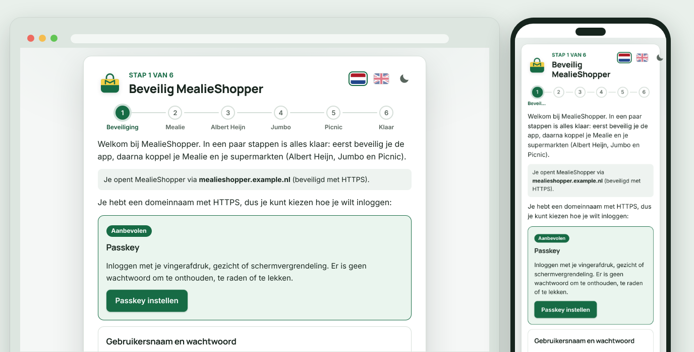

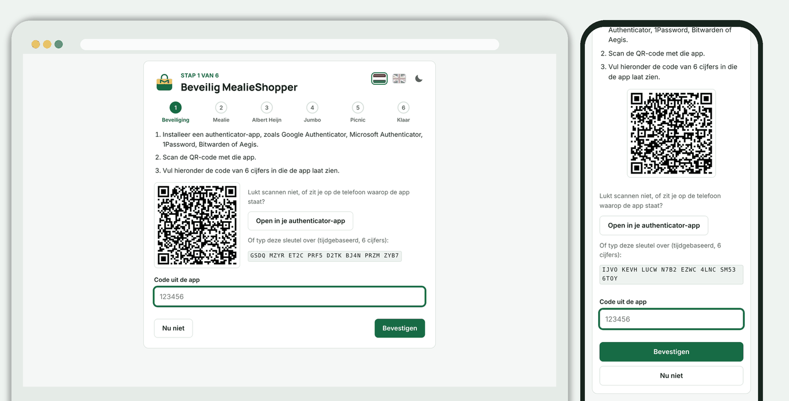

**2. Mealie koppelen.** Vul het adres van je Mealie en een API-token in; MealieShopper controleert ze bij Mealie voordat er iets wordt bewaard.

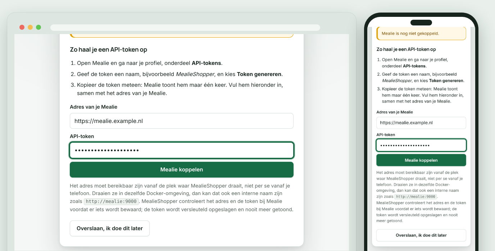

**3. Albert Heijn koppelen.** Uitleg voor de inlog via de browserconsole, met de inlogknop en het plakveld meteen in de stap. Dit kan alleen op een computer; je kunt de stap overslaan en later doen.

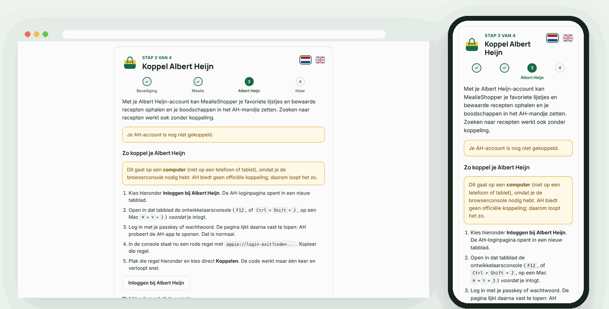

**4. Klaar.** Een overzicht van wat er staat. Ontbreekt er een koppeling, dan brengt een knop je terug naar die stap.

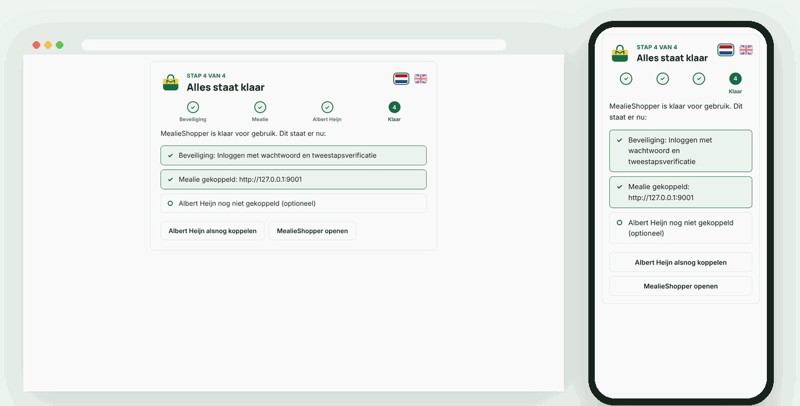

## Gebruik

### Weekmenu naar het AH-mandje

`Weekmenu laden` haalt de week uit Mealie, met de plaatjes. Is Picnic of Jumbo gekoppeld, dan kies je naast de knop naar welke winkel het gaat (bij Jumbo ook: het **mandje** of het **lijstje**). `Voeg toe aan Albert Heijn mandje` zoekt per ingrediënt de beste vijf producten en rekent uit hoeveel verpakkingen je nodig hebt, met de verpakkingsgrootte die AH bij het product geeft: 6 eieren bij "10 stuks" is een doosje, 500 g bij "250 g" zijn er twee, en "2 el" olie is een fles. Het aantal is altijd 1 tot en met 99.

Is de app ergens niet zeker van (onbekende verpakkingsgrootte, gewicht tegen stuks, of meer dan 10 verpakkingen), dan verschijnt een controlelijst. Daar kies je per regel het product en het aantal verpakkingen, vink je aan wat erin moet en bevestig je. Is er nergens twijfel, dan gaat het mandje meteen vol. Naast elk product staat een link naar het product bij AH, zodat je kunt controleren of het klopt.

De plaatjes uit Mealie haalt MealieShopper zelf op met je API-token en bewaart ze in de database. Zo werkt het ook als je Mealie niet rechtstreeks vanaf je telefoon bereikbaar is, en vraagt een volgende keer niets meer aan Mealie.

### Recepten zoeken en importeren

`Recepten zoeken` zoekt tegelijk bij **Albert Heijn** (tot de eerste 2.000 treffers) en, zodra ze gekoppeld zijn, bij **Jumbo** (alle recepten van jumbo.com) en **Picnic** (je bewaarde recepten en het kookboek, op naam; Picnic heeft geen eigen zoekfunctie). De resultaten staan per winkel bij elkaar, met `Meer recepten` voor de volgende pagina; een winkel die niet antwoordt laat de andere gewoon staan. Kies `Importeer` om een recept in Mealie te zetten, of bij Jumbo en Picnic `Bekijken` voor de ingrediënten en de bereiding. Of plak bij `URL importeren` een Allerhande-link, een link naar een Jumbo-recept of een andere receptensite. Het importeren haalt de receptgegevens via de AH-API op en geeft ze als schema.org-recept aan Mealie, omdat AH de websitepagina's voor servers blokkeert.

### Winkels

Het tabblad **Winkels** (voorheen *AH Items*) laat per winkel zien wat MealieShopper bewaart. Is Jumbo gekoppeld, dan staat bovenaan een keuzelijst met **Albert Heijn** en **Jumbo**; bij Jumbo staan hier je receptenlijsten (zie *Jumbo*); alle Jumbo-recepten zoek je bij **Recepten zoeken**.

- **AH Recepten**: je bewaarde Allerhande-recepten. `Ophalen bij AH` (daarna `Vernieuwen`) haalt ze allemaal op en bewaart ze in MealieShopper. Het tabblad toont daarna de lokale kopie en roept AH niet meer aan, tot je zelf vernieuwt; mislukt een vernieuwing, dan blijft de vorige kopie staan. Zoek bovenaan in je recepten.
- **Lijstjes**: bij AH je favoriete lijstjes, bij Jumbo je eigen lijstjes, Favorieten en het boodschappenlijstje (zie *Jumbo*). Met het synchroniseer-icoon (per lijstje, of bovenaan voor alle lijstjes) bewaart MealieShopper een kopie, inclusief productnaam, merk, inhoud, prijs en afbeelding. In een gesynchroniseerd lijstje pas je de aantallen aan met de knoppen `−` en `+` of door het getal te typen. Synchroniseren voegt nieuwe items toe en haalt weg wat bij AH is verdwenen, maar laat een aantal dat je hebt aangepast met rust (de melding zegt hoeveel aangepaste aantallen zijn behouden). Het oorspronkelijke aantal staat er als `Op lijstje: 2` naast. Het icoon met de teruggaande pijl zet alle aangepaste aantallen terug naar de waarden van AH, nadat je een waarschuwing hebt bevestigd. `In mandje` zet het hele lijstje met de aantallen zoals ze nu staan in je AH-mandje. Het zoekveld filtert op de naam van het lijstje en op de producten in gesynchroniseerde lijstjes. Werkt de AH-koppeling niet, dan blijven de gesynchroniseerde lijstjes zichtbaar met een melding.

- **Bestellingen** (bij Jumbo: je afgeronde bestellingen met hun producten, zie *Jumbo*): het synchroniseer-icoon haalt in één keer het mandje, de open en afgeronde bestellingen en de kassabonnen op, en bewaart ze. Elke volgende synchronisatie haalt alleen op wat nieuw is. Een open bestelling wordt bijgewerkt zolang hij open is; is hij geleverd, dan bewaart MealieShopper hem als **afgeleverd**. AH geeft per keer 10 afgeronde bestellingen; MealieShopper bladert door tot je oudste bestelling en bewaart wat is afgeleverd (staat er "nog zonder producten", synchroniseer dan opnieuw). Geannuleerde bestellingen slaat MealieShopper over. Een afgeleverde bestelling verandert niet meer en blijft altijd bewaard, ook als AH hem later niet meer toont. Kassabonnen komen er in porties van 40 bij (staat er "nog op te halen", synchroniseer dan opnieuw). Het **AH-mandje** (tabblad Mandje) is de boodschappenlijst waar `In mandje` naartoe schrijft; het wordt bij het openen van het tabblad opgehaald en blijft als kopie staan. Het is iets anders dan de actieve bestelling bij AH (het bestelmandje van de webwinkel), die vaak leeg is. Het afleveradres bewaart MealieShopper niet, alleen datum en tijdvak.

### Installeren als app

MealieShopper is een PWA: je kunt hem installeren en hij opent dan zonder browserbalk. Op een telefoon krijg je dan een zwevende, glazen menubalk onderaan met zes onderdelen.

- **iPhone en iPad (Safari):** Delen, dan `Zet op beginscherm`.
- **Android (Chrome):** menu, dan `App installeren`.
- **Windows en macOS (Edge of Chrome):** het installatie-icoon in de adresbalk.

Installeren werkt alleen via HTTPS (behalve op `localhost`). Wil je de menubalk bekijken zonder te installeren, open dan `?tabbar=1` achter het adres op je telefoon (`?tabbar=0` zet hem weer uit).

### Donker en licht

Naast de vlaggetjes staat een knop (maan of zon) waarmee je tussen het lichte en het donkere thema wisselt. De keuze blijft in je browser bewaard; zonder keuze volgt de app de instelling van je apparaat.

### Taal

Met de vlaggetjes (rechtsboven, op de inlogpagina en in de installatiehulp) wissel je tussen Nederlands en Engels. De keuze blijft in je browser bewaard; zonder keuze volgt de app je browsertaal. Wat Mealie en Albert Heijn zelf teruggeven (receptnamen, productnamen en hun foutmeldingen) blijft zoals zij het sturen.

## Mealie en Albert Heijn koppelen

Dit staat ook in de installatiehulp, en je kunt het altijd later doen onder **Beheer**.

### Mealie

1. Open Mealie en ga naar je profiel, onderdeel **API-tokens**.
2. Geef de token een naam, bijvoorbeeld *MealieShopper*, en kies **Token genereren**.
3. Kopieer de token meteen: Mealie toont hem maar één keer.
4. Vul in MealieShopper het adres van je Mealie en de token in en kies **Koppelen**.

Het adres moet bereikbaar zijn vanaf de plek waar MealieShopper draait, niet per se vanaf je telefoon. Draaien ze in dezelfde Docker-omgeving, dan kan het een interne naam zijn zoals `http://mealie:9000`. De token wordt versleuteld bewaard en nooit meer getoond. Een koppeling die je in de app maakt gaat voor op `MEALIE_URL` en `MEALIE_API_TOKEN` uit de omgeving.

### Albert Heijn

AH heeft geen officiële koppeling. MealieShopper logt in zoals de AH-app, in je eigen browser (op een computer):

1. Kies `Inloggen bij Albert Heijn`; er opent een nieuw tabblad.
2. Open in dat tabblad de ontwikkelaarsconsole (`F12`) **voordat** je inlogt.
3. Log in met je passkey of wachtwoord. De pagina lijkt daarna vast te lopen, maar in de console staat een rode regel met `appie://login-exit?code=...`.
4. Plak die regel in MealieShopper en kies `Koppelen`. De code werkt maar één keer en verloopt snel; een melding over een verlopen of gebruikte code betekent: opnieuw inloggen.

Met `Koppeling controleren` zie je of de opgeslagen token nog werkt. Onder **AH-routes verkennen** (alleen voor de beheerder) roep je de onofficiële AH-routes voor het mandje (de boodschappenlijst), het bestelmandje, bestellingen en kassabonnen aan en zie je welke werken en welke velden erin zitten. Het rapport bevat geen namen, adressen, prijzen of id's en is veilig te delen; zo zien we hoe AH bestellingen bewaart en blijft het ophalen kloppen. AH kan de token bij elke vernieuwing vervangen; MealieShopper bewaart steeds de nieuwste. Draai daarom één instance en houd de data-map op persistente opslag.

### Picnic

Picnic heeft geen officiële koppeling. MealieShopper logt in zoals de Picnic-app, met je e-mailadres en wachtwoord (alleen de beheerder, onder **Beheer > Winkels > Picnic**):

1. Vul je e-mailadres en wachtwoord in en kies `Inloggen bij Picnic`.
2. Picnic vraagt meestal om een code. Die komt per sms (of per e-mail, via de knop eronder). Vul hem in en kies `Bevestigen`.
3. Zodra er staat dat Picnic gekoppeld is, verschijnt in de planner een keuzelijst met **Albert Heijn** en **Picnic**.

Je wachtwoord wordt niet bewaard, alleen de sessie die Picnic teruggeeft, versleuteld. Picnic kan die sessie bij elk verzoek vernieuwen; MealieShopper bewaart steeds de nieuwste. Is ze verlopen, dan koppel je opnieuw. Anders dan bij AH gaan de producten direct in je echte Picnic-mandje; er wordt nooit een bestelling geplaatst. Picnic bezorgt alleen in bepaalde gebieden. Met `Koppeling controleren` zie je of de sessie nog werkt. Onder **Picnic-routes verkennen** zie je welke onofficiële routes werken en welke velden erin zitten (zonder persoonlijke gegevens, veilig te delen). Onder het tabblad **Mandje** kies je Picnic en pas je aantallen aan, haal je producten weg of leeg je het mandje (na een bevestiging); dat gaat direct naar je echte mandje. Daaronder staan de eerstvolgende beschikbare bezorgmomenten; kiezen doe je zelf in de Picnic-app. Kies bij **Winkels** in de keuzelijst **Picnic**; dan staan er drie tabs. **Recepten** toont je recepten uit de Picnic-app: **Bewaard** (Koken > Bewaard), **Opnieuw bestellen** en het **Kookboek**, als kaarten zoals de AH-recepten. Open een recept voor de ingrediënten en de bereiding, of kies `Importeer` om het in Mealie te zetten. **Favorieten** toont de producten uit de tab Favorieten van de Picnic-app, met een knop om er één in je Picnic-mandje te zetten. MealieShopper zoekt die tab zelf op in de tabbalk van de app. Die tab toont bij Picnic ook voorgestelde producten; MealieShopper neemt alleen de producten onder de kop *Favorieten* en houdt daarvan over wat Picnic in de productpagina als favoriet markeert (de hartjesknop), dus je eigen favorieten. Dat kost een verzoek per product; die gaan een paar tegelijk en worden 30 minuten onthouden (de knop *Laden* vergeet ze). Weet Picnic het niet, dan toont MealieShopper er geen en zegt waarom. Je AI-assistent kan Picnic-producten, je favorieten, je mandje, je leveringen, de bezorgmomenten en je recepten (met naam, id en kooktijd) bekijken, maar het mandje niet vullen. **Bestellingen** (onder dezelfde keuze) toont je aankomende bezorgingen (live opgehaald) en je afgeleverde bestellingen. Met *Synchroniseren* bewaart MealieShopper die laatste lokaal, met hun producten (hooguit 25 bestellingen per keer, de nieuwste eerst), zodat je ze ook zonder verbinding met Picnic kunt bekijken en je AI-assistent ze kan bevragen; je afleveradres wordt niet bewaard. Open er een voor de producten en zet ze met één knop opnieuw in je Picnic-mandje. Kassabonnen en lijstjes zijn er voor Picnic niet.

### Jumbo

Jumbo heeft geen officiële koppeling. MealieShopper logt in zoals de Jumbo-app, in je eigen browser (op een computer, alleen de beheerder, onder **Beheer > Winkels > Jumbo**). Dat werkt net als bij Albert Heijn:

1. Kies `Inloggen bij Jumbo`; er opent een nieuw tabblad.
2. Open in dat tabblad de ontwikkelaarsconsole (`F12`) **voordat** je inlogt.
3. Log in met je Jumbo-account. De pagina lijkt daarna vast te lopen, maar in de console staat een rode regel met `jumbo://callbacks/login?code=...`.
4. Plak die regel in MealieShopper en kies `Koppelen`. De code werkt maar één keer en verloopt snel; een melding over een verlopen of gebruikte code betekent: opnieuw inloggen.

Jouw browser lost de bot-controle van Jumbo op; MealieShopper gebruikt geen headless browser meer. Je wachtwoord wordt niet bewaard, alleen het refresh-token dat Jumbo teruggeeft, versleuteld; Jumbo kan dat bij elke vernieuwing vervangen en MealieShopper bewaart steeds de nieuwste. Draai daarom één instance en houd de data-map op persistente opslag. Zodra Jumbo gekoppeld is, verschijnt het in de keuzelijst in de planner. Net als bij Picnic gaan de producten direct in je echte mandje en wordt er nooit een bestelling geplaatst. Onder **Winkels > Lijstjes** staan na de keuze *Jumbo* al je lijstjes van Jumbo: **Mijn lijstjes** (je eigen lijstjes en Favorieten) en het **boodschappenlijstje** (de losse regels die je in de Jumbo-app op je lijstje zet). Ze werken net als de AH-lijstjes: synchroniseren, zoeken, een aantal aanpassen en met `In mandje` alles in je Jumbo-mandje zetten. Mijn lijstjes hebben producten met pakmaat, prijs en het aantal dat Jumbo bewaart; dat aantal is het beginpunt en jouw aanpassing blijft bij een volgende synchronisatie staan. Het boodschappenlijstje bestaat uit tekst en soms een product; Jumbo kent er geen aantallen bij, dus die zijn lokaal (standaard 1). Afgevinkte regels slaat MealieShopper over, en bij `In mandje` zoekt MealieShopper regels met alleen tekst eerst op in het assortiment van Jumbo. In de planner zet *Jumbo (boodschappenlijstje)* de ingrediënten op het boodschappenlijstje in plaats van in het mandje; wat er al op staat slaat MealieShopper over, en staat het lijstje in de Jumbo-app uit, dan zet MealieShopper het aan. Je eigen lijstjes en Favorieten haalt MealieShopper op met dezelfde opgeslagen aanvragen als jumbo.com; verandert Jumbo die bij een nieuwe versie van de site, dan meldt **Jumbo-routes verkennen** `PersistedQueryNotFound` en moet de code een nieuwe code krijgen (zie `PERSISTED_QUERIES` in `mealieshopper/jumbo.py`: kopieer de `sha256Hash` van `GetCustomerProductLists` en `GetProductList` uit het tabblad Netwerk van je browser). Onder **Winkels > Bestellingen** (keuze *Jumbo*) staan je afgeronde Jumbo-bestellingen: datum, bezorgtijd, totaal en de producten (naam, merk, aantal, bedrag, aanbieding), met een zoekveld over alles wat je kocht. De lijst haalt MealieShopper op met de opgeslagen aanvraag `OnlineOrdersAndStoreReceipts` van jumbo.com (nieuwste eerst, per 10); de producten van een bestelling per synchronisatie voor de 25 nieuwste bestellingen die ze nog missen, dus bij veel bestellingen herhaal je het synchroniseren tot niets meer ontbreekt. Een bestelling die is afgerond blijft bewaard. Je afleveradres, klantnummer en reserveringsnummer bewaart MealieShopper niet. Producten die Jumbo niet meer kent, staan met merk en artikelnummer. Winkelbonnen en lopende bestellingen toont MealieShopper bij Jumbo nog niet; heeft Jumbo winkelbonnen voor je, dan meldt de synchronisatie hoeveel. Voor de producten van een bestelling kent MealieShopper de opgeslagen aanvraag van de site nog niet en probeert daarom gewone aanvragen; weigert Jumbo die, dan blijft de lijst staan en meldt de synchronisatie waarom. Jumbo-recepten zoek je bij **Recepten zoeken**, samen met Albert Heijn en Picnic (zie *Recepten zoeken en importeren*). `Bekijken` toont de ingrediënten (met de hoeveelheden van het recept), de bereiding, de tip en de voedingswaarden; `Importeer` zet het recept in Mealie, als schema.org-recept met de link naar jumbo.com als bron, dus Mealie hoeft de Jumbo-pagina niet op te halen (jumbo.com weert servers). Plak je bij `URL importeren` een receptlink van jumbo.com (`jumbo.com/recepten/...`) en is Jumbo gekoppeld, dan gaat ook dat via de Jumbo-API. Je **receptenlijsten** bij Jumbo staan onder **Winkels > Recepten** (keuze *Jumbo*): kies *Favorieten* of een van je eigen lijstjes (zoals *Kerst*) in de keuzelijst, per 24 met `Meer recepten`, met dezelfde knoppen `Bekijken` en `Importeer`. Je AI-assistent kan Jumbo-producten, je mandje, je lijstjes, je bestellingen, je receptenlijsten en de recepten bekijken, maar niets vullen.

**Jumbo kan een server weigeren.** Jumbo weert soms server- en datacenter-adressen; dat is waarom een eerdere Jumbo-koppeling in v1.2.0 is verwijderd. Onder **Jumbo-routes verkennen** (alleen de beheerder) controleert MealieShopper eerst of Jumbo jouw server toelaat en roept daarna de onofficiële routes aan (het mandje vullen alleen met een lege lijst). Het rapport bevat geen namen, prijzen of id's en is veilig te delen. Meldt de verkenner dat Jumbo je server weigert, dan werkt de koppeling vanaf die plek niet.

## Beveiliging

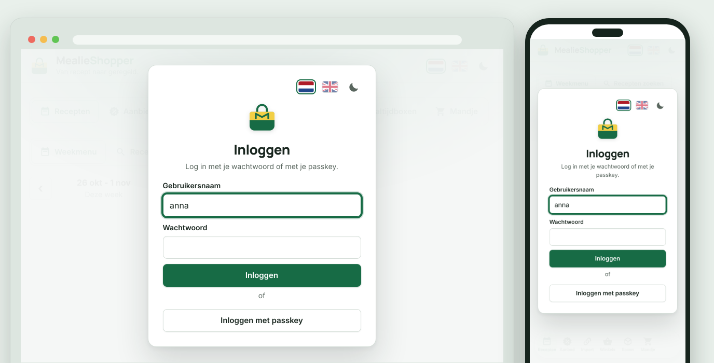

- **Passkey** (domeinnaam met HTTPS): inloggen met je vingerafdruk, gezicht of schermvergrendeling. Voeg extra passkeys toe onder Beheer, Beveiliging; de laatste passkey kan alleen weg als er een wachtwoord is.
- **Wachtwoord**: minstens 10 tekens, met scrypt gehasht en nooit bewaard of gelogd. Na 5 mislukte pogingen per IP-adres (of 25 in totaal) is inloggen 15 minuten geblokkeerd.
- **Tweestapsverificatie** (TOTP, bij inloggen met een wachtwoord): het geheim staat versleuteld in de database, een code werkt één keer, en je krijgt 8 herstelcodes (16 tekens, alleen de SHA-256 staat in de database). Met een passkey heb je geen wachtwoord of tweestapsverificatie nodig; die blokken staan dan ingeklapt.
- **Sessies**: een HttpOnly cookie. Een nieuw wachtwoord of uitgezette tweestapsverificatie logt andere apparaten uit.

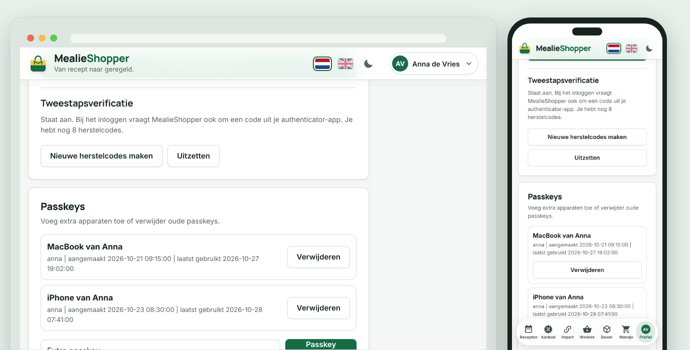

**Het geheim.** Zonder `MEALIESHOPPER_AUTH_SECRET` maakt de app bij de eerste start zelf een willekeurig geheim en bewaart dat in de data-map (`secret.key`, alleen leesbaar voor de eigenaar). Daaruit volgen twee aparte sleutels: een voor de sessies en een voor de versleuteling van je opgeslagen koppelingen en het MFA-geheim. Zet je zelf `MEALIESHOPPER_AUTH_SECRET`, dan staat de sleutel niet op schijf naast de database; gebruik dan een lange, vaste, willekeurige waarde (`openssl rand -hex 32`) en verander hem niet achteraf.

**Goed om te weten**

- Zolang er nog geen inlogmethode is ingesteld, kan wie het adres als eerste opent de installatie claimen. Doe de eerste start op een netwerk dat je vertrouwt, of meteen nadat de container draait.
- Het IP-adres voor de blokkade na mislukte pogingen komt uit `X-Forwarded-For` van je reverse proxy (één stap). Zet MealieShopper dus niet rechtstreeks op internet, maar achter een proxy die dat veld zelf instelt.
- Passkeys vragen een domeinnaam en HTTPS. Zet dan `RP_ID` (alleen de hostnaam) en `RP_ORIGINS` (het volledige adres), zie [`.env.unraid.example`](.env.unraid.example).

## Gebruikers en uitnodigen

De eerste gebruiker, degene die de installatiehulp doorloopt, is de **beheerder**. Die koppelt Mealie en Albert Heijn en beheert de gebruikers. Iedereen die je uitnodigt is een **gebruiker**: die kan het weekmenu, de recepten en de AH-lijstjes gebruiken, producten in het AH-mandje zetten en recepten importeren, maar kan niets koppelen of beheren. Het AH-mandje is dat van het gekoppelde AH-account; Mealie en AH zijn dus gedeeld.

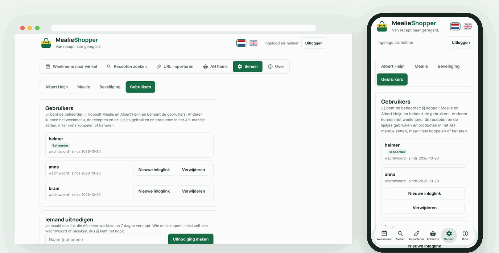

1. Ga als beheerder naar **Beheer, Gebruikers** en kies **Uitnodiging maken** (met of zonder naam).
2. Kopieer de link en stuur hem door. Je ziet hem maar één keer; de link werkt één keer en verloopt na 7 dagen.
3. Wie de link opent, kiest een gebruikersnaam en een wachtwoord of een passkey. Jij kent het wachtwoord dus nooit.

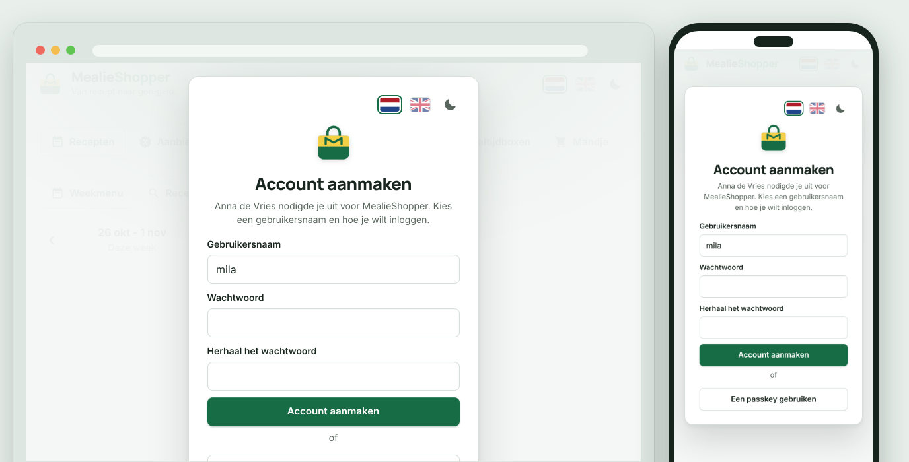

- **Inlog kwijt?** Kies bij die gebruiker **Nieuwe inloglink**. De oude inlog blijft werken tot de nieuwe is ingesteld, en werkt daarna niet meer.
- **Verwijderen** haalt het account en alle inloggegevens weg. De beheerder kan niet worden verwijderd.
- Elke gebruiker heeft eigen inloggegevens, eigen tweestapsverificatie en eigen passkeys onder Beheer, Beveiliging. Een nieuw wachtwoord logt alleen die gebruiker uit.
- Wijzigingen in een lijstje (aantallen) en de lijstjes zelf zijn gedeeld: ze horen bij het AH-account.

## AI-assistenten (MCP)

MealieShopper heeft een [MCP](https://modelcontextprotocol.io)-server op `<adres van MealieShopper>/mcp`. Daarmee kun je in Claude, ChatGPT of GitHub Copilot vragen stellen als *"wat eten we deze week en wat staat er in mijn lijstje Weekboodschappen?"* of *"importeer dit recept in Mealie"*.

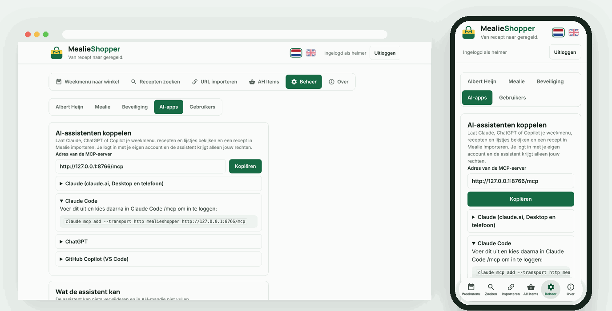

**Wat de assistent kan** (alleen in jouw naam en met jouw rechten):

| Tool | Doet |
|---|---|
| `get_week_menu` | Het weekmenu uit Mealie, met de ingrediënten. |
| `search_allerhande_recipes` | Recepten zoeken bij Allerhande. |
| `list_saved_ah_recipes` | Je bewaarde AH-recepten, eventueel gefilterd. |
| `list_ah_lists`, `get_ah_list`, `search_ah_list_items` | Je AH-lijstjes, de producten erin (met jouw aantallen) en waar een product in staat. |
| `search_ah_products` | Producten zoeken in het AH-assortiment, met prijs en bonus. |
| `get_ah_basket` | Het AH-mandje (de producten op je boodschappenlijst), uit de lokale kopie. |
| `list_ah_orders`, `get_ah_order` | Je bestellingen en de producten van één bestelling, uit de lokale kopie. |
| `list_ah_receipts`, `get_ah_receipt` | Je kassabonnen uit de winkel en de regels van één bon. |
| `search_ah_purchases` | Waar en wanneer je een product kocht, in alle bewaarde bestellingen en kassabonnen. |
| `import_recipe_to_mealie` | Een recept in Mealie importeren. Dit maakt iets nieuws aan en overschrijft niets. |

Er is bewust **geen** tool die je AH-mandje vult of iets verwijdert.

**Instellen**

1. Open als beheerder **Beheer, AI-apps**. Bovenaan staan de instellingen: de schakelaar **MCP-server aan** en het **publieke adres**. Dat adres herkent de app zelf uit hoe je hem opent; staat MealieShopper achter een reverse proxy, controleer dan dat het het publieke https-adres is en vul het anders hier in. ChatGPT en claude.ai halen de server van buiten op, dus het adres moet vanaf internet bereikbaar zijn, met HTTPS. Stuur `/mcp`, `/oauth/*` en `/.well-known/oauth-*` door in je reverse proxy (dat doet een gewone proxy voor de hele site al).
2. Open als gebruiker **Beheer, AI-apps** (daar staat het niet onder de instellingen), kopieer het adres en volg de uitleg voor jouw assistent. Je krijgt het toestemmingsscherm; na **Toestaan** is de assistent gekoppeld.
   - **Claude** (claude.ai, Desktop, telefoon): Instellingen, Connectors, *Aangepaste connector toevoegen*.
   - **Claude Code:** `claude mcp add --transport http mealieshopper https://jouw-adres/mcp`, daarna `/mcp` om in te loggen.
   - **ChatGPT:** ontwikkelaarsmodus aan, een nieuwe connector met het adres en OAuth. Beschikbaarheid hangt van je abonnement af.
   - **GitHub Copilot (VS Code):** `{"servers": {"mealieshopper": {"type": "http", "url": "https://jouw-adres/mcp"}}}` in `.vscode/mcp.json`.

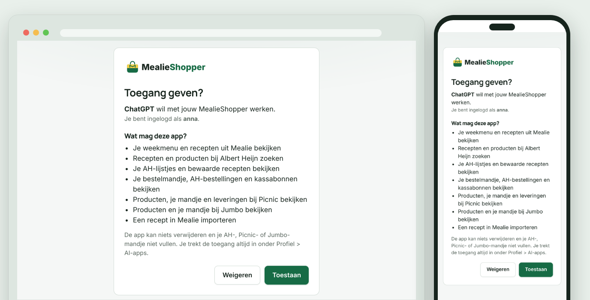

**Beveiliging**

- OAuth 2.1 met PKCE (S256); apps registreren zichzelf (dynamic client registration), alleen publieke clients, en alleen https-, loopback- of app-redirects.
- Elk token hoort bij **de gebruiker die toestemming gaf** en geeft alleen die rechten. Toegangstokens gelden een uur, verversingstokens 30 dagen en worden bij elk gebruik vervangen; een verversingstoken dat twee keer wordt gebruikt, trekt de hele reeks in. Tokens staan alleen gehasht in de database.
- Een nieuw wachtwoord, een uitgezette tweestapsverificatie, een nieuwe inloglink of het verwijderen van de gebruiker maakt de tokens van die gebruiker ongeldig. Onder **Beheer, AI-apps** trek je zelf de toegang van een app in.
- De server staat alleen aan als inloggen aanstaat. De beheerder zet hem met de schakelaar aan of uit; alleen de beheerder kan de instellingen zien en wijzigen. Onder **Wat de assistent kan** zet de beheerder ook elke tool afzonderlijk uit, voor alle gebruikers. Een uitgezette tool is voor assistenten onzichtbaar en wordt geweigerd; ze zien de wijziging bij hun volgende verbinding.
- Wat de assistent leest (receptnamen, productnamen) komt van Mealie en AH; behandel het als gegevens, niet als opdrachten. Daarom kan de assistent niets verwijderen of kopen.

## Configuratie

Alles is optioneel. Zet de waarden in je omgeving of in `.env.unraid` ([`.env.unraid.example`](.env.unraid.example) en [`.env.local.example`](.env.local.example) laten alles zien).

| Variabele | Doel |
|---|---|
| `MEALIESHOPPER_DATA_DIR` | Map voor de database en `secret.key`. In de Docker-image `/data`, lokaal standaard `./data`. |
| `MEALIESHOPPER_AUTH_SECRET` (of `JWT_SECRET`) | Eigen geheim voor sessies en versleuteling. Zonder deze waarde maakt de app `secret.key`. |
| `MEALIESHOPPER_PUBLIC_BASE_URL` | Het publieke adres (voor de voorbeeldafbeelding, uitnodigingslinks en de AI-koppeling). Optioneel: de app herkent het zelf, en een adres dat de beheerder bij Beheer, AI-apps invult gaat voor. |
| `RP_ID`, `RP_ORIGINS` (of `RP_ORIGIN`), `RP_NAME` | Alleen voor passkeys, met een domeinnaam en HTTPS. |
| `MEALIESHOPPER_MCP` | Beginwaarde van de MCP-server voor AI-assistenten (standaard aan, als inloggen aanstaat). De schakelaar bij Beheer, AI-apps gaat voor. |
| `MEALIESHOPPER_UPDATE_CHECK` | Met `false` zet je de updatecheck uit (Beheer, Updates). Standaard kijkt de app op GitHub of er een nieuwere release is en meldt dat aan de beheerder; er gaat geen informatie over jou of de installatie mee. |
| `MEALIESHOPPER_AUDIT_LOG` | Met `false` zet je de auditlog uit (Beheer, Auditlog). Standaard aan. |
| `MEALIESHOPPER_AUDIT_BODIES` | Met `false` bewaart de auditlog alleen wie, wat, wanneer en de uitkomst, niet de verzoeken en antwoorden zelf. Standaard aan. |
| `MEALIESHOPPER_AUDIT_BODY_CHARS` | Hoeveel tekens van elk verzoek en antwoord de auditlog bewaart (standaard 4000; langere teksten worden ingekort). |
| `MEALIESHOPPER_AUDIT_RETENTION_DAYS` | Na hoeveel dagen de auditlog regels wist (standaard 30; `0` wist nooit vanzelf). |
| `PASSKEY_AUTH_ENABLED` | Met `false` staat inloggen helemaal uit (alleen als noodgreep). |
| `MEALIE_URL`, `MEALIE_API_TOKEN` | Mealie via de omgeving; een koppeling uit de app gaat voor. |
| `AH_REFRESH_TOKEN` | Startwaarde voor de AH-koppeling; normaal koppel je in de app. |
| `PICNIC_COUNTRY_CODE` | Land van je Picnic-account: `NL` (standaard), `DE` of `FR`. De koppeling zelf maak je in de app. |
| `PORT` | Poort bij `python run.py` (standaard 8000). |
| `MEALIESHOPPER_VERSION`, `MEALIESHOPPER_COMMIT` | Overschrijven het versienummer en de commit die bij Over staan. |

**Auditlog.** Onder **Beheer, Auditlog** ziet de beheerder wat MealieShopper met Albert Heijn, Picnic en Jumbo bespreekt: elk verzoek met tijd, uitkomst, duur, het verzoek en het antwoord. Ook de verzoeken van AI-assistenten (MCP) staan erin, met de tool, de invoer en het resultaat; bij zo'n verzoek zie je welke winkelverzoeken eruit volgden, en omgekeerd. Je kunt filteren op winkel, alleen fouten tonen en zoeken. Met **Exporteren** (JSON of CSV, met de gekozen filters, hooguit de nieuwste 5000 regels) download je de log, en met **Lijst kopiëren** of **Kopiëren** bij één regel zet je de gegevens op het klembord. Wachtwoorden, tokens, codes, cookies en e-mailadressen worden vóór het opslaan vervangen door `[verborgen]`; headers worden niet bewaard. Antwoorden van winkels kunnen wel persoonlijke gegevens bevatten, zoals je bestellingen: alleen de beheerder ziet de log en regels ouder dan 30 dagen worden gewist. Met **Log wissen** wis je alles, en dat zelf blijft als regel in de log staan. De instellingen staan in de tabel hierboven.

## Data en back-ups

Alles staat in de data-map: `auth.sqlite3` (instellingen, passkeys, wachtwoord, kopieën van je AH-lijstjes en -recepten, je bestelgeschiedenis en kassabonnen, plaatjes uit Mealie) en `secret.key`. **Neem de hele map mee in je back-ups.** Zonder `secret.key` (of je eigen `MEALIESHOPPER_AUTH_SECRET`) zijn de opgeslagen koppelingen en sessies onleesbaar: je koppelt Mealie en Albert Heijn dan opnieuw, en de app laat dat zien als "niet gekoppeld".

## Updaten

```bash
docker compose pull && docker compose up -d
```

Bij een nieuwe versie hoef je niets te doen; de database wordt zo nodig vanzelf aangevuld. Bij Over zie je welke versie en commit er draait.

**Updatecheck.** Onder **Beheer, Updates** kijkt de app op GitHub of er een nieuwere release is dan de versie die draait. Is die er, dan krijgt de beheerder een melding bovenaan het scherm en een bolletje bij **Beheer**, met een link naar de release-notes. De app vraagt dit hooguit om de zes uur aan GitHub (of direct met **Nu controleren**) en stuurt daarbij geen informatie over jou of de installatie mee. Uitzetten kan met `MEALIESHOPPER_UPDATE_CHECK=false`.

## Problemen oplossen

**Direct een `Internal Server Error`, of de auth-database is niet bereikbaar.** Controleer of de appdata-map bestaat en schrijfbaar is, en of je compose de mount `"/mnt/user/appdata/mealieshopper:/data"` heeft. Op Unraid:

```bash
mkdir -p /mnt/user/appdata/mealieshopper
chown -R nobody:users /mnt/user/appdata/mealieshopper
chmod -R ug+rwX /mnt/user/appdata/mealieshopper
```

**De passkey werkt niet.** Een passkey vraagt een domeinnaam en HTTPS (op `localhost` werkt het ook). Open MealieShopper via dat adres en controleer `RP_ID` en `RP_ORIGINS`; de installatiehulp legt uit waarom het op een IP-adres niet kan.

**Jumbo: "Jumbo weigert het verzoek (403)".** Jumbo weert dit adres of deze server. Probeer het later opnieuw; blijft het gebeuren, dan werkt Jumbo vanaf deze plek niet. Zie **Jumbo-routes verkennen**.

**Picnic: "koppeling verlopen of geweigerd".** De sessie van Picnic is niet meer geldig. Ga naar Beheer > Winkels > Picnic en log opnieuw in.

**AH: "code verlopen of gebruikt".** De code uit de console werkt maar één keer en verloopt snel. Log opnieuw in en plak de nieuwe regel meteen.

**"Niet gekoppeld" terwijl je al had gekoppeld.** Dan is `secret.key` (of je eigen geheim) veranderd of ontbreekt; zie *Data en back-ups*. Koppel opnieuw.

**Ik kom er niet meer in.** Heb je je wachtwoord en herstelcodes kwijt, dan kun je de inlog terugzetten (je koppelingen blijven staan). Stop eventueel de container en voer uit:

```bash
docker exec -it mealieshopper python -c "import sqlite3; c = sqlite3.connect('/data/auth.sqlite3'); [c.execute(q) for q in ('DELETE FROM password_credentials', 'DELETE FROM mfa_totp', 'DELETE FROM mfa_recovery_codes', 'DELETE FROM passkey_credentials', 'DELETE FROM invites', \"DELETE FROM users WHERE id <> 'owner'\", 'UPDATE users SET session_epoch = session_epoch + 1', 'DELETE FROM login_attempts', \"DELETE FROM app_settings WHERE key IN ('AUTH_MODE', 'ONBOARDING_DONE', 'ONBOARDING_ACTIVE')\")]; c.commit()"
```

Open daarna de app: de installatiehulp verschijnt weer en je stelt de beveiliging opnieuw in. Dit verwijdert ook de andere gebruikers (jouw account als beheerder blijft); nodig ze daarna opnieuw uit.

## Ontwikkelen

```bash
python -m unittest discover -s tests          # alle tests
```

- **Opbouw:** `mealieshopper/` (Flask-app: `app.py`, `auth.py`, `auth_password.py`, `users.py`, `onboarding.py`, `mealie.py`, `ah.py`, `mcp.py`, `mcp_http.py`, `oauth.py`, `ah_orders.py`, `about.py`, `i18n.py`), `static/` en `templates/` (de interface, zonder bouwstap), `tests/`.
- **Teksten en talen:** de interface staat in `static/i18n/nl.js` en `en.js`, één tekst per regel. In de HTML staat de Nederlandse tekst in de pagina, met `data-i18n="sleutel"`; in de scripts gebruik je `t("sleutel", { naam })`, `th(...)` (met opmaak, waarden ge-escaped) en `tn("sleutel", aantal)` (meervoud). Een taal toevoegen betekent een bestand `static/i18n/<taal>.js`, een vlag en de taal in `static/i18n.js` en `mealieshopper/i18n.py`. `tests/test_i18n.py` bewaakt dat beide woordenboeken gelijk zijn.
- **Huisstijl:** kleuren, typografie en PWA-instellingen staan in [`docs/huisstijl.md`](docs/huisstijl.md). Herbouw de beeldbestanden met `python scripts/build_brand.py` (Pillow nodig).
- **Versie en release:** het versienummer staat in `VERSION` (alleen `X.Y.Z`); verhoog het bij een release, schrijf een kopje voor de nieuwe versie in [`CHANGELOG.md`](CHANGELOG.md) en merge naar `main`: de workflow `.github/workflows/release.yml` maakt dan de tag en de GitHub release, met die tekst. Elke versie krijgt een eigen GitHub release. De commit komt uit de build: de Dockerfile heeft het build-argument `GIT_COMMIT`, en de workflow in `.github/workflows/docker.yml` zet dat op `github.sha`. Handmatig: `docker build --build-arg GIT_COMMIT=$(git rev-parse HEAD) -t mealieshopper .`
- **Container registry:** de workflow bouwt en pusht bij elke push naar `main` (en handmatig via `workflow_dispatch`) naar `ghcr.io/helmerznl/mealieshopper:latest`, voor `linux/amd64` en `linux/arm64` (via QEMU en Buildx).
- **Screenshots:** de afbeeldingen in `docs/screenshots/` zijn gemaakt met Playwright tegen een demo-omgeving met zelfgetekende illustraties (geen foto's van derden), zodat ze overal vrij te gebruiken zijn.

## Integraties en componenten

MealieShopper is een onofficieel hulpmiddel en heeft geen band met Mealie, Albert Heijn, Picnic of Jumbo.

**Integraties**

| Integratie | Waarvoor |
|---|---|
| [Mealie](https://mealie.io) | Je recepten en weekmenu; geïmporteerde recepten komen hier terecht. Via de API met een token. |
| [Albert Heijn](https://www.ah.nl) | Lijstjes, bewaarde recepten, producten en het winkelmandje, via de **niet-officiële** app-API van AH. AH kan die zonder bericht wijzigen; gebruik het voor persoonlijk gebruik. |
| [Allerhande](https://www.ah.nl/allerhande) | Recepten zoeken en importeren. |
| [Jumbo](https://www.jumbo.com) | Producten zoeken en het winkelmandje vullen, via de **niet-officiële** app-API van Jumbo (Auth0 en GraphQL). Jumbo kan die zonder bericht wijzigen of een server weigeren; gebruik het voor persoonlijk gebruik. |
| [Picnic](https://picnic.app) | Producten zoeken en het winkelmandje vullen, via de **niet-officiële** app-API van Picnic. Picnic kan die zonder bericht wijzigen; gebruik het voor persoonlijk gebruik. |
| [WebAuthn](https://www.w3.org/TR/webauthn-2/) | Inloggen met een passkey. |
| [TOTP (RFC 6238)](https://www.rfc-editor.org/rfc/rfc6238) | Tweestapsverificatie met een authenticator-app. |
| [MCP](https://modelcontextprotocol.io) en [OAuth 2.1](https://datatracker.ietf.org/doc/draft-ietf-oauth-v2-1/) | De koppeling met AI-assistenten zoals Claude, ChatGPT en Copilot. |
| [GitHub Container Registry](https://ghcr.io) | Hier staat de Docker-image. |

**Componenten**

| Component | Licentie | Waarvoor |
|---|---|---|
| [Python](https://www.python.org) | PSF-2.0 | De programmeertaal van de server. |
| [Flask](https://flask.palletsprojects.com) | BSD-3-Clause | Het webframework. |
| [Gunicorn](https://gunicorn.org) | MIT | De webserver in de container. |
| [PyJWT](https://pyjwt.readthedocs.io) | MIT | Ondertekent sessies. |
| [cryptography](https://cryptography.io) | Apache-2.0 OR BSD-3-Clause | Versleutelt opgeslagen koppelingen en controleert passkeys. |
| [cbor2](https://github.com/agronholm/cbor2) | MIT | Leest passkey-gegevens. |
| [Requests](https://requests.readthedocs.io) | Apache-2.0 | Praat met Mealie en Albert Heijn. |
| [SQLite](https://sqlite.org) | Public domain | De database. |
| [Material Design Icons](https://pictogrammers.com/library/mdi/) | Apache-2.0 | De iconen. |
| [qrcode-generator](https://github.com/kazuhikoarase/qrcode-generator) | MIT | Tekent in je browser de QR-code voor tweestapsverificatie. |
| [Inter](https://rsms.me/inter/) en [Manrope](https://github.com/sharanda/manrope) | OFL-1.1 | De lettertypen. |

De versies van de Python-pakketten zie je in de app bij **Over**.

## Een koffie?

MealieShopper is gratis. Vind je de app handig? Dan waardeer ik het als je me een koffie geeft.

☕ **[buymeacoffee.com/flux76](https://buymeacoffee.com/flux76)**
