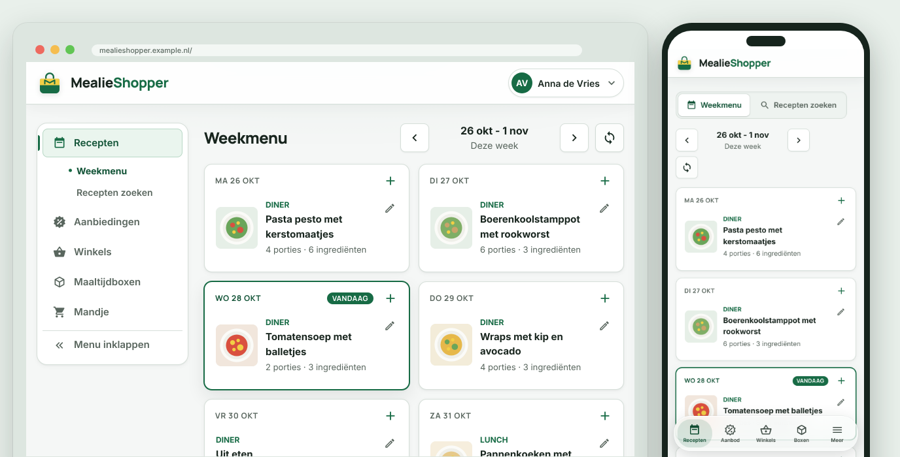
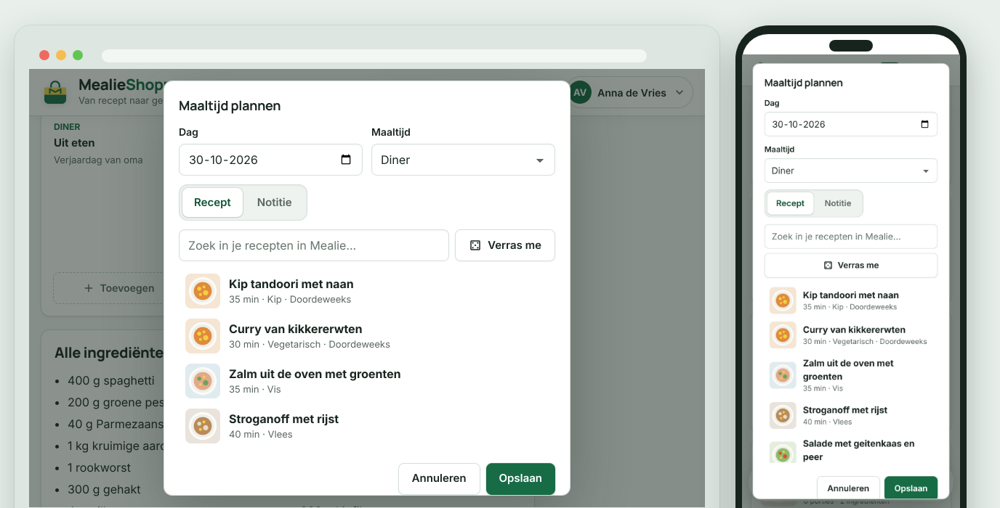
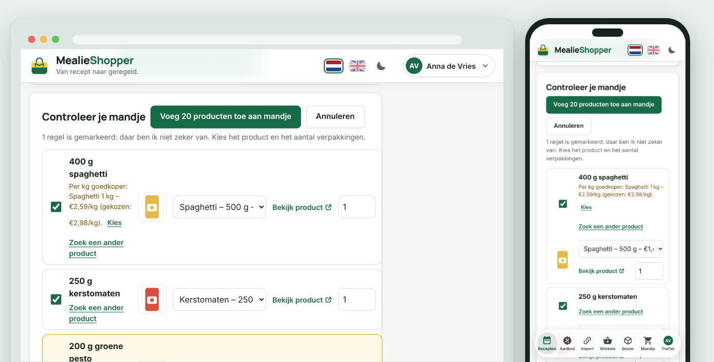
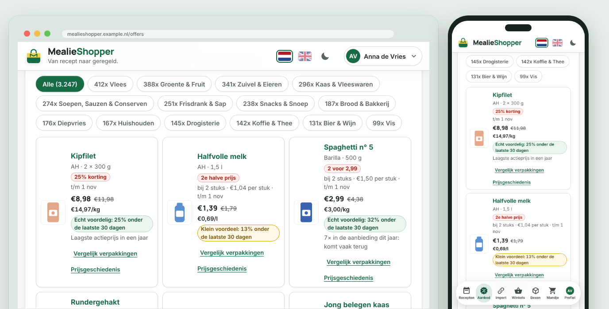
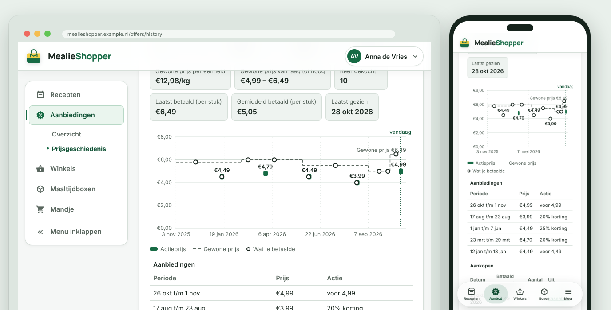
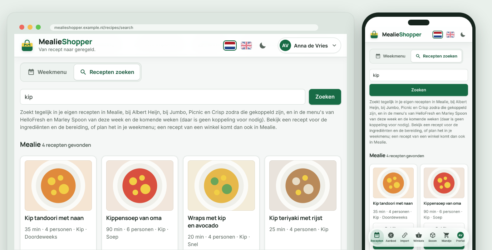
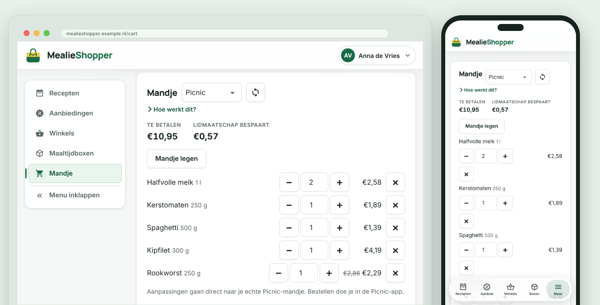
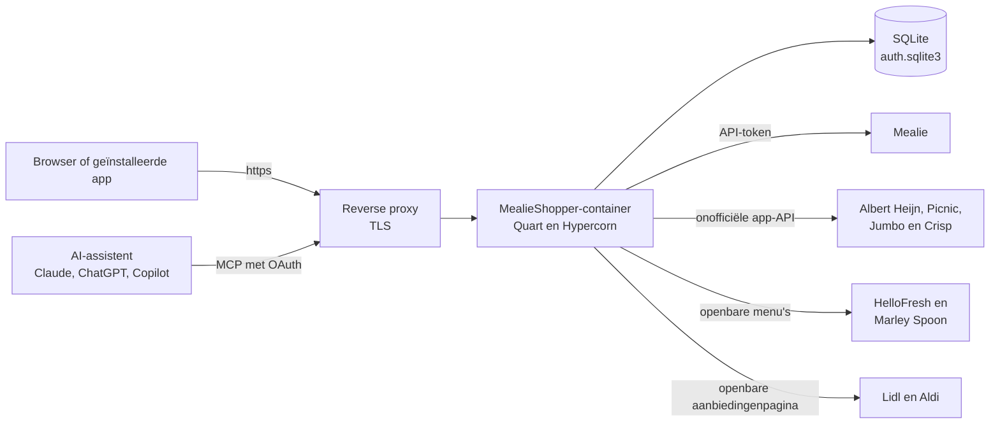
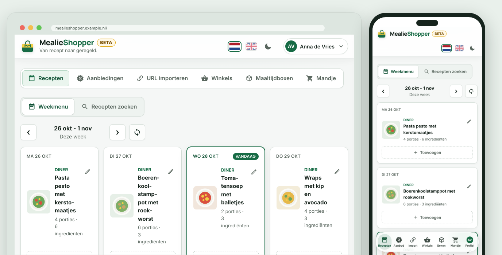

<div align="center">

<picture>
  <source media="(prefers-color-scheme: dark)" srcset="static/brand/mark-white.svg">
  
</picture>

# MealieShopper

**Van recept naar geregeld.**

Je weekmenu plannen in [Mealie](https://mealie.io) en in je mandje zetten bij [Albert Heijn](https://www.ah.nl), [Picnic](https://picnic.app), [Jumbo](https://www.jumbo.com) of [Crisp](https://crisp.nl), plus recepten zoeken, bewaren en importeren. Voor wie zijn recepten in Mealie bijhoudt en de app zelf host.

🇳🇱 **Nederlands** · 🇬🇧 [English](README.en.md)

[](#snel-starten)
[](#installatie-zelf-hosten)
[](#home-assistant-add-on)
[](#wat-kan-het)

[](https://github.com/helmerzNL/MealieShopper/commits/beta)
[](https://github.com/helmerzNL/MealieShopper/graphs/commit-activity)
[](LICENSE)
[](https://github.com/helmerzNL/MealieShopper/forks)
[](https://github.com/helmerzNL/MealieShopper/stargazers)
[](https://github.com/helmerzNL/MealieShopper/issues)
[](https://github.com/helmerzNL/MealieShopper/graphs/contributors)

[](https://github.com/helmerzNL/MealieShopper/releases/latest)
[](https://github.com/helmerzNL/MealieShopper/releases)
[](https://buymeacoffee.com/flux76)
[](https://ko-fi.com/flux76)

[Handleiding](docs/handleiding.md) · [Wijzigingen](CHANGELOG.md) · [Een fout melden](https://github.com/helmerzNL/MealieShopper/issues/new/choose)

<picture>
  <source media="(prefers-color-scheme: dark)" srcset="docs/screenshots/nl/dark.png">
  
</picture>

</div>

---

## Inhoud

- [Waarom MealieShopper?](#waarom-mealieshopper)
- [Wat kan het?](#wat-kan-het)
- [Zo ziet het eruit](#zo-ziet-het-eruit)
- [Snel starten](#snel-starten)
- [Configuratie](#configuratie)
- [Beheer](#beheer)
- [Data en back-ups](#data-en-back-ups)
- [Architectuur](#architectuur)
- [Stabiel en beta](#stabiel-en-beta)
- [Meewerken](#meewerken)
- [Privacy en beveiliging](#privacy-en-beveiliging)
- [Steun MealieShopper](#steun-mealieshopper)
- [Licentie](#licentie)

## Waarom MealieShopper?

Een weekmenu plannen in Mealie is fijn, maar daarna begint het overtypen: elk ingrediënt opzoeken in de app van je supermarkt, uitrekenen hoeveel verpakkingen je nodig hebt en nagaan of de aanbieding echt goedkoper is. MealieShopper doet dat voor je. Het leest je weekmenu uit Mealie, zoekt per ingrediënt de producten bij Albert Heijn, Picnic, Jumbo of Crisp, rekent porties en verpakkingen om en zet ze na jouw controle in je mandje; bestellen doe je zelf. Daaromheen staan de aanbiedingen met een eerlijk oordeel, je bestellingen en kassabonnen, en recepten van de winkels en maaltijdboxen die je met één klik inplant. Het draait in je eigen container, voor je hele huishouden.

## Wat kan het?

- **Weekmenu naar je mandje**: één knop zoekt voor elk ingrediënt uit je weekmenu de beste producten bij Albert Heijn, Picnic, Jumbo of Crisp, rekent de porties en verpakkingen uit en telt hetzelfde ingrediënt uit meerdere recepten op. Je vinkt af wat je al in huis hebt (en wat je altijd in huis hebt, onthoudt de app), kiest voor welke dagen je boodschappen doet en controleert alles eerst in een lijst; een product dat je daar zelf koos, staat de volgende keer vooraan. Pas na je bevestiging gaat het in je mandje, en bestellen doe je zelf.
- **Het weekmenu plannen**: zet een recept of een notitie op een dag, verplaats of verwijder een maaltijd, of laat Mealie met **Verras me** kiezen. Elke wijziging gaat meteen naar Mealie.
- **Aanbiedingen en receptvoorstellen**: de aanbiedingen van Albert Heijn (ook je persoonlijke Bonus Box), Picnic, Jumbo en Crisp, en zonder account ook die van Lidl en Aldi, per week en elke dag bijgewerkt, met recepten waarvan ingrediënten in de aanbieding zijn.
- **Is het echt een aanbieding?**: bij elke aanbieding de prijs per kilo, liter of stuk en een oordeel tegen de gewone prijs van de laatste 30 dagen. De **Prijsgeschiedenis** toont per product de aanbiedingen, de gewone prijs en wat je zelf betaalde, en **Vergelijk verpakkingen** wijst de goedkoopste verpakking aan. Openbare historische prijzen met onbekende actiestatus staan apart als **Waargenomen prijzen**, met hun bronnen. Ze tellen niet als gewone prijzen. Historische folderprijzen, zoals het archief van Albert Heijn en Jumbo sinds 2009, importeert de beheerder onder **Instellingen, Systeem**.
- **Recepten zoeken en importeren**: zoek tegelijk in Mealie, bij Albert Heijn, Jumbo, Picnic en Crisp en in de menu's van HelloFresh en Marley Spoon, bekijk een recept en plan het met één klik in, of importeer een recept via een link. Je bewaarde AH-recepten, je Jumbo-receptenlijsten en je favoriete Crisp-recepten zet je ook in één keer in Mealie.
- **Koken met een recept**: een recept staat in een kookweergave met de ingrediënten naast de genummerde stappen; vink af wat klaar is en zie welke stap nu aan de beurt is. **Start met koken** toont schermvullend één stap tegelijk, met de ingrediënten die bij de stap horen en timers met een alarm, dat ook komt als je telefoon vergrendeld is, en met **Scherm aan laten** gaat je scherm intussen niet uit.
- **Calorieën en voedingswaarden**: de kcal per persoon en een tabel met eiwit, vet, koolhydraten, suikers, vezels en zout bij een recept en een geplande maaltijd, met het totaal voor de porties die je plant en een dagtotaal per persoon in het weekmenu. Kies bij het inplannen het aantal porties (4 wordt 2) en zoek op een minimum en maximum per persoon (bijvoorbeeld minstens 30 g eiwit, hooguit 1,5 g zout), ook via je AI-assistent; ook je bewaarde AH-recepten tonen hun voedingswaarden.
- **Je winkels op één plek**: je mandje, lijstjes, bewaarde recepten, favorieten, bestellingen en AH-kassabonnen, in een eigen kopie die je doorzoekt ("wanneer kocht ik voor het laatst koffie?"), ook als de winkel even niet meewerkt. Een product op een bon dat de app niet herkent, koppel je zelf aan een product van de winkel; daarna herkent hij het wel.
- **AI-assistenten**: een MCP-server, zodat Claude, ChatGPT of Copilot je weekmenu, recepten en lijstjes kan bekijken, een maaltijd kan plannen en een recept in Mealie kan importeren; inloggen met OAuth, met je eigen account.
- **Voor het hele huishouden**: inloggen met een passkey, of met een wachtwoord en tweestapsverificatie; huisgenoten nodig je uit met een link, en alleen de beheerder koppelt Mealie en de winkels. Iedereen kiest zelf een voorkeurssupermarkt, waarmee Aanbiedingen en Winkels openen.
- **Een app op je telefoon**: installeer MealieShopper als app (PWA), in het Nederlands of Engels en in een licht of donker thema, met je eigen accentkleur; elk scherm heeft een eigen adres.
- **Jij houdt de regie**: alles draait in je eigen container, en je gegevens staan in één map op je eigen server.

Elke functie staat uitgebreid in de [handleiding](docs/handleiding.md).

## Zo ziet het eruit

| Maaltijd plannen | Controleren voor het mandje |
|:---:|:---:|
|  |  |
| **Aanbiedingen** | **Prijsgeschiedenis** |
|  |  |
| **Recepten zoeken** | **Mandje bij Picnic** |
|  |  |

<sub>Elke afbeelding toont dezelfde pagina op een computer en op een telefoon, met demogegevens. Alle schermen, met uitleg, staan in de [handleiding](docs/handleiding.md#zo-ziet-het-eruit).</sub>

## Snel starten

- 🌐 **Web:** open het adres van je eigen installatie.
- 📱 **iPhone / iPad** en 🤖 **Android:** zie [Installeren als app](#installeren-als-app).
- 🐳 **Zelf hosten:** zie [Installatie](#installatie-zelf-hosten), met Docker of als [Home Assistant-add-on](#home-assistant-add-on).

### Installeren als app

MealieShopper is een PWA: je kunt hem installeren en hij opent dan zonder browserbalk. Op een telefoon krijg je dan een zwevende, glazen menubalk onderaan met zes onderdelen. Net als in een native app zoom je in de app niet met twee vingers en blijft de titelbalk bovenaan staan, ook als je naar beneden sleept; in de browser kun je gewoon zoomen. De menubalk ziet eruit zoals bij je andere apps: zwevend glas op een iPhone, de balk van Android op een Android-toestel. Onder Instellingen, Voorkeuren kies je zelf, en stel je het glaseffect in.

- **iPhone en iPad (Safari):** Delen, dan `Zet op beginscherm`.
- **Android (Chrome):** menu, dan `App installeren`.
- **Windows en macOS (Edge of Chrome):** het installatie-icoon in de adresbalk.

Installeren werkt alleen via HTTPS (behalve op `localhost`). Wil je de menubalk bekijken zonder te installeren, open dan `?tabbar=1` achter het adres op je telefoon (`?tabbar=0` zet hem weer uit).

### Installatie (zelf hosten)

Je hebt een computer of NAS met Docker nodig. Je hoeft niets in te stellen: MealieShopper loopt je bij de eerste start zelf door de beveiliging en de koppelingen.

#### Docker Compose (bijvoorbeeld Unraid)

1. Maak een map voor je gegevens, bijvoorbeeld `/mnt/user/appdata/mealieshopper`.
2. Gebruik de meegeleverde [`docker-compose.yml`](docker-compose.yml). Die publiceert de app op poort `5959` en bewaart je gegevens in `/mnt/user/appdata/mealieshopper`.
3. Wil je iets instellen? Kopieer [`.env.unraid.example`](.env.unraid.example) naar `.env.unraid` en pas aan wat je nodig hebt. Het bestand is optioneel (Docker Compose 2.24 of nieuwer).
4. Start:

   ```bash
   docker compose up -d
   ```

5. Open `http://<adres van je server>:5959` en volg de installatiehulp.

De image staat op `ghcr.io/helmerznl/mealieshopper:latest` en is gebouwd voor `linux/amd64` en `linux/arm64`, dus hij draait ook op een ARM-NAS (zoals sommige Synology-modellen) en op een Raspberry Pi.

#### Docker

```bash
docker run -d --name mealieshopper -p 8000:8000 \
  -v /mnt/user/appdata/mealieshopper:/data \
  ghcr.io/helmerznl/mealieshopper:latest
```

Open daarna `http://localhost:8000`. Zelf bouwen kan met `docker build -t mealieshopper .`.

#### Home Assistant-add-on

Draai je Home Assistant OS of een Supervised-installatie? Dan installeer je MealieShopper als add-on, zonder Docker-commando's:

1. Ga naar **Instellingen > Add-ons > Add-on store**, open het menu rechtsboven (⋮) en kies **Repositories**.
2. Voeg `https://github.com/helmerznl/mealieshopper` toe en installeer **MealieShopper**.
3. Klik op **Starten** en open `http://<adres van Home Assistant>:5959` (of **Webinterface openen**). De installatie-assistent doet de rest.

Het is hetzelfde image als de Docker-versie (`linux/amd64` en `linux/arm64`). De data-map van de add-on is `/data`, dus Home Assistant neemt de database en `secret.key` mee in zijn back-ups. Alle opties (Mealie-adres en -token, publiek adres, AI-sleutels enzovoort) zijn optioneel en staan op het tabblad **Configuratie** van de add-on; het zijn dezelfde waarden als de omgevingsvariabelen onder [Configuratie](#configuratie). Er is geen ingress: de app heeft een eigen inlog en een MCP-server die een eigen adres nodig hebben, dus open hem op poort `5959` en zet die poort niet rechtstreeks op internet. Voor de ontwikkelversie is er een tweede add-on, **MealieShopper (beta)** (poort `5960`, eigen data-map), in de repository `https://github.com/helmerznl/mealieshopper#beta`. De bestanden van de add-on staan in [`homeassistant/`](homeassistant/mealieshopper/DOCS.md).

### Eerste start

Op een nieuwe installatie opent MealieShopper een installatiehulp: de beveiliging, Mealie koppelen, de vraag welke winkels je gebruikt, een stap per gekozen winkel (Albert Heijn, Jumbo, Picnic) en een overzicht. Wat je overslaat doe je later onder **Instellingen** (in het avatar-menu, op een telefoon onder **Meer**). Doe de eerste start op een netwerk dat je vertrouwt, of meteen nadat de container draait: zolang er nog geen inlogmethode is ingesteld, kan wie het adres als eerste opent de installatie claimen. Elke stap, met schermafbeeldingen, staat in de [handleiding](docs/handleiding.md#eerste-start), en hoe je Mealie en de supermarkten koppelt onder [Mealie en supermarkten koppelen](docs/handleiding.md#mealie-en-supermarkten-koppelen).

## Configuratie

Alles is optioneel. `MEALIESHOPPER_TAG` zet je in `.env` naast `docker-compose.yml` ([`.env.example`](.env.example)); de andere waarden in je omgeving of in `.env.unraid` ([`.env.unraid.example`](.env.unraid.example) en [`.env.local.example`](.env.local.example) laten alles zien).

| Variabele | Verplicht | Standaard | Omschrijving |
|---|:---:|---|---|
| `MEALIESHOPPER_TAG` | ❌ | `latest` | Welke build er draait: `latest` (stabiel) of `beta`. Zet hem in `.env` naast `docker-compose.yml`: de compose-file haalt daarmee de juiste image op (`:latest` of `:beta`) en geeft dezelfde waarde aan de app, die bij een beta-build een **beta**-badge naast het woordmerk toont (en bij Over). Zie [Stabiel en beta](#stabiel-en-beta). |
| `MEALIESHOPPER_DATA_DIR` | ❌ | `/data` in de image, lokaal `./data` | Map voor de database en `secret.key`. |
| `MEALIESHOPPER_AUTH_SECRET` (of `JWT_SECRET`) | ❌ | `secret.key` | Eigen geheim voor sessies en versleuteling. Zonder deze waarde maakt de app `secret.key` in de data-map; zie *Het geheim* hieronder. |
| `MEALIESHOPPER_PUBLIC_BASE_URL` | ❌ | door de app herkend | Het publieke adres (voor de voorbeeldafbeelding, uitnodigingslinks en de AI-koppeling). Een adres dat de beheerder bij Profiel, AI-apps invult gaat voor. |
| `RP_ID`, `RP_ORIGINS` (of `RP_ORIGIN`), `RP_NAME` | ❌ | - | Alleen voor passkeys, met een domeinnaam en HTTPS. |
| `MEALIESHOPPER_MCP` | ❌ | aan | Beginwaarde van de MCP-server voor AI-assistenten (aan als inloggen aanstaat). De schakelaar bij Profiel, AI-apps gaat voor. |
| `MEALIESHOPPER_OFFERS_SCHEDULE` | ❌ | aan | Met `false` zet je de dagelijkse taak uit die de aanbiedingen van alle winkels ophaalt. De knop onder Instellingen, Koppelen blijft werken. |
| `MEALIESHOPPER_OFFERS_SYNC_HOUR` | ❌ | `5` | Het uur van de dag (0 tot en met 23, tijd van de container) waarop die taak de aanbiedingen ophaalt. |
| `MEALIESHOPPER_IMAGE_PREFETCH` | ❌ | aan | Met `false` zet je de achtergrondrondes uit die de productfoto's van de winkels alvast in de cache zetten (de map `images` in de data-map). Een foto die je opent, wordt dan nog steeds opgehaald en bewaard. |
| `MEALIESHOPPER_OFFERS_RECIPES` | ❌ | uit | Met `true` toont de app het subtabblad **Recepten** bij Aanbiedingen (receptvoorstellen uit de aanbiedingen). Standaard uit: de koppelingen tussen ingrediënten en producten zijn nog niet goed genoeg. De MCP-tools voor AI-assistenten werken ook als dit uit staat. |
| `ANTHROPIC_API_KEY`, `OPENAI_API_KEY` | ❌ | - | Een API-sleutel van Claude (Anthropic) en/of ChatGPT (OpenAI) om de koppelingen tussen ingrediënten en aanbiedingen te laten beoordelen (zie *AI: recepten zoeken bij de aanbiedingen* in de [handleiding](docs/handleiding.md#aanbiedingen-1)). Een sleutel die je in de app invult, gaat voor. Zonder sleutel gebeurt er niets met AI. |
| `ANTHROPIC_BASE_URL`, `OPENAI_BASE_URL` | ❌ | `https://api.anthropic.com`, `https://api.openai.com/v1` | Een ander adres voor de AI-aanvragen, met dezelfde API, zoals bij de officiële SDK's: een proxy als [LiteLLM](https://docs.litellm.ai/), Azure OpenAI of een lokaal model. `ANTHROPIC_BASE_URL` is zonder `/v1`, `OPENAI_BASE_URL` met `/v1`. De sleutel en het model stel je in zoals altijd: voor LiteLLM een sleutel van LiteLLM en de modelnaam uit LiteLLM. |
| `HTTPS_PROXY`, `HTTP_PROXY`, `ALL_PROXY`, `NO_PROXY`, `REQUESTS_CA_BUNDLE`, `CURL_CA_BUNDLE`, `SSL_CERT_FILE`, `SSL_CERT_DIR` | ❌ | - | Voor een proxy en een eigen certificaat. Al het uitgaande verkeer (de winkels, Mealie, GitHub, de AI-aanbieder, HelloFresh, Marley Spoon en data.mealieshopper.nl) gaat via de proxy uit `HTTPS_PROXY`, `HTTP_PROXY` of `ALL_PROXY`, behalve de hosts in `NO_PROXY` (hostnamen of losse IP-adressen, geen bereik als `192.168.0.0/16`). `REQUESTS_CA_BUNDLE` (of anders `CURL_CA_BUNDLE`) vervangt de ingebouwde lijst met vertrouwde CA's door dat bestand of die map, bijvoorbeeld voor een Mealie met een eigen certificaat. Zet er je eigen CA en de publieke basiscertificaten in, anders vertrouwt de app de winkels en GitHub niet meer. Zonder die twee doen `SSL_CERT_FILE` en `SSL_CERT_DIR` hetzelfde. |
| `MEALIESHOPPER_UPDATE_CHECK` | ❌ | aan | Met `false` zet je de updatecheck uit (Instellingen, Systeem). Standaard kijkt de app op GitHub of er een nieuwere release is en meldt dat aan de beheerder; er gaat geen informatie over jou of de installatie mee. |
| `MEALIESHOPPER_AUDIT_LOG` | ❌ | aan | Met `false` zet je de auditlog uit (Instellingen, Auditlog). |
| `MEALIESHOPPER_AUDIT_BODIES` | ❌ | aan | Met `false` bewaart de auditlog alleen wie, wat, wanneer en de uitkomst, niet de verzoeken en antwoorden zelf. |
| `MEALIESHOPPER_AUDIT_BODY_CHARS` | ❌ | `4000` | Hoeveel tekens van elk verzoek en antwoord de auditlog bewaart; langere teksten worden ingekort. |
| `MEALIESHOPPER_AUDIT_RETENTION_DAYS` | ❌ | `30` | Na hoeveel dagen de auditlog regels wist; `0` wist nooit vanzelf. |
| `PASSKEY_AUTH_ENABLED` | ❌ | aan | Met `false` staat inloggen helemaal uit (alleen als noodgreep). |
| `MEALIESHOPPER_SESSION_DAYS` | ❌ | `90` | Hoeveel dagen je ingelogd blijft. Elk gebruik na een dag verlengt de sessie met deze duur, dus wie de app blijft gebruiken logt niet opnieuw in. |
| `MEALIE_URL`, `MEALIE_API_TOKEN` | ❌ | - | Mealie via de omgeving; een koppeling uit de app gaat voor. |
| `AH_REFRESH_TOKEN` | ❌ | - | Startwaarde voor de AH-koppeling; normaal koppel je in de app. |
| `PICNIC_COUNTRY_CODE` | ❌ | `NL` | Land van je Picnic-account: `NL`, `DE` of `FR`. De koppeling zelf maak je in de app. |
| `PORT` | ❌ | `8000` | Poort bij `python run.py`. |
| `MEALIESHOPPER_VERSION`, `MEALIESHOPPER_COMMIT` | ❌ | uit de build | Overschrijven het versienummer en de commit die bij Over staan. |

In de Home Assistant-add-on stel je deze in op het tabblad **Configuratie**; `docker-entrypoint.py` zet ze bij het starten van de container om in de variabelen hierboven.

**Het geheim.** Zonder `MEALIESHOPPER_AUTH_SECRET` maakt de app bij de eerste start zelf een willekeurig geheim en bewaart dat in de data-map (`secret.key`, alleen leesbaar voor de eigenaar). Daaruit volgen twee aparte sleutels: een voor de sessies en een voor de versleuteling van je opgeslagen koppelingen en het MFA-geheim. Zet je zelf `MEALIESHOPPER_AUTH_SECRET`, dan staat de sleutel niet op schijf naast de database; gebruik dan een lange, vaste, willekeurige waarde (`openssl rand -hex 32`) en verander hem niet achteraf.

Wat de auditlog bewaart en wat hij verbergt, staat in de [handleiding](docs/handleiding.md#auditlog).

## Beheer

| Taak | Commando |
|---|---|
| Starten | `docker compose up -d` |
| Stoppen | `docker compose down` |
| Bijwerken | `docker compose pull && docker compose up -d` |
| Terug naar de vorige versie | zet `MEALIESHOPPER_TAG` in `.env` op het vorige versienummer (`X.Y.Z`), dan `docker compose up -d` |
| Logboek | `docker compose logs -f` |

Bij een nieuwe versie hoef je niets te doen; de database wordt zo nodig vanzelf aangevuld. Bij Over zie je welke versie en commit er draait. In Home Assistant meldt de add-on de update en klik je op **Bijwerken**. Kopieer de data-map voordat je naar een oudere versie teruggaat: een back-up die een nieuwere versie in de app maakte, zet een oudere versie niet terug.

- **Health check:** `GET /healthz` antwoordt `200` met `{"ok": true}`.
- **Grootste upload:** 200 MB, een back-upbestand bij het terugzetten of een prijsarchief. Het scherm stuurt zo'n bestand in stukken van 4 MB, elk een eigen verzoek, dus wat voor de app staat (een reverse proxy, een tunnel of CDN zoals Cloudflare) hoeft geen groter verzoek door te laten. Stuur je zelf via de API het hele bestand in één verzoek (`POST …/stage`), dan moet de proxy wel 200 MB toelaten; bij nginx is dat `client_max_body_size 200m`.
- **Updatecheck:** onder **Instellingen, Systeem** kijkt de app op GitHub of er een nieuwere release is dan de versie die draait. Is die er, dan krijgt de beheerder een melding bovenaan het scherm en een bolletje bij **Beheer**, met een link naar de release-notes. De app vraagt dit hooguit om de zes uur aan GitHub (of direct met **Nu controleren**) en stuurt daarbij geen informatie over jou of de installatie mee. Uitzetten kan met `MEALIESHOPPER_UPDATE_CHECK=false`. De app werkt zichzelf nooit bij.

## Data en back-ups

Alles staat in de data-map: `/data` in de container, op de host de map die je in `docker-compose.yml` mount (in het voorbeeld `/mnt/user/appdata/mealieshopper`), lokaal `./data` (`MEALIESHOPPER_DATA_DIR`).

| Bestand | Wat erin staat |
|---|---|
| `auth.sqlite3` | instellingen, passkeys, wachtwoord, kopieën van je lijstjes, recepten, bestellingen en kassabonnen bij de supermarkten, plaatjes uit Mealie, de bewaarde afbeeldingen van aanbiedingen die je kocht |
| `secret.key` | het geheim voor de sessies en de versleuteling van je koppelingen (niet als je zelf `MEALIESHOPPER_AUTH_SECRET` zet) |

**Neem de hele map mee in je back-ups.** Zonder `secret.key` (of je eigen `MEALIESHOPPER_AUTH_SECRET`) zijn de opgeslagen koppelingen en sessies onleesbaar: je koppelt Mealie en de supermarkten dan opnieuw, en de app laat dat zien als "niet gekoppeld".

**Back-up maken en terugzetten in de app.** Onder **Instellingen, Systeem, Back-up en terugzetten** maakt de beheerder met één klik één bestand (`mealieshopper-backup-….json`) met alle gegevens, en zet die later terug, bijvoorbeeld op een nieuwe server. Er zit in wat je zelf hebt opgebouwd: de koppelingen met Mealie, Albert Heijn, Picnic, Jumbo en de AI-sleutels, de kopieën van je lijstjes, bewaarde recepten, bestellingen en kassabonnen, je eigen koppelingen van bonregels aan producten, de aanbiedingen van nu **en de hele historie van de (bonus)aanbiedingen** en de bijgehouden prijzen, de bewaarde afbeeldingen van aanbiedingen die je kocht, de beoordelingen van aanbiedingen bij recepten, de profielen en de keuzes bij AI en MCP. Na het terugzetten werkt de app weer zoals voor de back-up.

- **De koppelingen zijn versleuteld met een wachtwoord dat je zelf kiest** (scrypt en Fernet, minstens 8 tekens). Dat wachtwoord staat nergens opgeslagen: zonder wachtwoord zijn de koppelingen in het bestand niet te lezen. Haal je het vinkje *Neem de koppelingen mee* weg, dan bevat het bestand geen koppelingen en vraagt het geen wachtwoord; je koppelt na het terugzetten dan opnieuw. Ben je het wachtwoord kwijt, vink dan bij het terugzetten *Zet de koppelingen terug* uit: de rest gaat gewoon terug en de koppelingen die er nu zijn, blijven staan. Het bestand wordt op de nieuwe server opnieuw versleuteld met de sleutel van die server (`secret.key`), dus de koppelingen werken ook als die sleutel anders is.
- **Je kiest wat er meegaat.** Bij het maken kun je *de aanbiedingen van nu* en *de historie van aanbiedingen* weglaten; dat maakt het bestand kleiner. Bij het terugzetten vink je ze, net als de koppelingen, uit als je ze niet terug wilt. Wat niet in het bestand zit of wat je uitvinkt, blijft op de server zoals het is. De aanbiedingen van nu haalt de app bij de volgende synchronisatie weer op; de historie niet.
- **Wat inlogt op MealieShopper zit er nooit in:** passkeys, wachtwoorden, tweestapsverificatie en herstelcodes, uitnodigingen, sessies, de toegang van AI-assistenten (MCP) en `secret.key` zelf. Een bestand dat je mailt of in een clouddrive bewaart kan dus geen MealieShopper openen. Het gevolg: zet je terug op een nieuwe installatie, stel dan eerst het inloggen in (de installatiehulp) en zet daarna de back-up terug. Het auditlog, de bewaarde receptafbeeldingen (komen vanzelf terug uit Mealie) en het webadres dat je voor de server instelde zitten er ook niet in.
- **Terugzetten is alles of niets.** Je kiest het bestand, de server controleert het helemaal (elk onderdeel, elke kolom en elke waarde; afbeeldingen worden opnieuw gelezen) en laat zien wat erin zit: aantallen en welke koppelingen. Pas na je bevestiging vervangt de server in één keer wat er nu staat. Een afgekeurd bestand verandert niets en blijft niet staan, en gaat er halverwege iets mis, dan is er niets gewijzigd. Een back-up van een oudere versie werkt; een van een nieuwere versie wordt geweigerd met de melding dat je eerst moet bijwerken. Profielen van gebruikers die op deze installatie niet bestaan worden overgeslagen. Je gebruikers en hun inloggegevens blijven zoals ze zijn.
- **Je ziet wat er gebeurt.** Elke fase heeft een naam en, waar te tellen, een getal en een balk: het maken, het downloaden (met de grootte), het uploaden, het controleren en het vervangen. Na afloop staat er hoe lang elk deel duurde. Het terugzetten loopt op de server: de pagina verlaten, herladen of sluiten stopt niets, en bij het terugkomen op het scherm zie je de voortgang weer. Het geüploade bestand staat tot dan in de data-map als `.restore-<code>` (tijdens het uploaden `.restore-<code>.part`) en wordt na gebruik of na een uur verwijderd. Na een geslaagd terugzetten laadt de pagina opnieuw.
- **Grenzen:** een back-upbestand mag hoogstens 200 MB zijn (een back-up met jaren aanbiedingen is enkele megabytes, een geïmporteerd prijsarchief maakt er al snel ruim 100 MB van; elke bewaarde afbeelding van een aanbieding die je kocht telt daar ruwweg 50 tot 200 kB bij op). Het scherm uploadt het bestand in stukken van 4 MB, elk een eigen verzoek: een reverse proxy, tunnel of CDN voor MealieShopper (Cloudflare laat op de gratis versie hoogstens 100 MB per verzoek door) hoeft dus geen groot verzoek toe te laten. Een stuk dat mislukt, of waar 30 seconden niets mee gebeurt, gaat vanzelf opnieuw (de server geeft zo'n stuk na 30 seconden stilte ook op, met een regel in het logboek, zodat het de rest van de app niet ophoudt); komt de upload echt niet verder, dan zegt het scherm dat, in plaats van te blijven staan. Het uploaden en downloaden als geheel heeft geen tijdslimiet.
- **Dit is jouw eigen kopie van wat je invoerde, geen vervanging van een kopie van de hele data-map.** Die blijft de manier om een hele server te bewaren. Het patroon volgt [`backup-restore.md`](https://github.com/Flux76HQ/App-Guidance/blob/main/shared/guidelines/backup-restore.md) van App-Guidance, met twee bewuste afwijkingen: de koppelingen mogen mee, versleuteld met je wachtwoord, en het bestand gaat in stukken naar de server.

**Prijsarchief importeren.** Onder **Instellingen, Systeem, Prijsarchief importeren** voegt de beheerder historische prijzen toe aan de Prijsgeschiedenis, uit de ZIP van een pakket (zoals het folderarchief van AH, Jumbo, Picnic en Crisp, ook de gist voor data.mealieshopper.nl) of uit een bestand in het formaat `mealieshopper-price-archive`, of met **Aanbiedingen ophalen** rechtstreeks van [data.mealieshopper.nl](https://data.mealieshopper.nl). Dat vult aan en is geen back-up (alleen met het vinkje *Vervang wat eerder uit een prijsarchief kwam* gaan eerdere archiefregels er eerst uit); de prijzen die erbij komen, gaan daarna wel mee in de back-up. Het formaat en de controles staan in de [handleiding](docs/handleiding.md#prijsarchief-importeren). Andersom geeft **Prijsarchief exporteren** alle aanbiedingen en prijzen als ZIP, met een bestand per winkel en maand, om te delen in bijvoorbeeld een GitHub-repo, of in de vorm van data.mealieshopper.nl om ze daar in te sturen; je persoonlijke aanbiedingen gaan er nooit in (zie de [handleiding](docs/handleiding.md#prijsarchief-exporteren)).

Alles wissen en opnieuw beginnen kan ook: zie [Fabrieksinstellingen](docs/handleiding.md#fabrieksinstellingen) in de handleiding.

## Architectuur



| Onderdeel | Doel | Gegevens |
|---|---|---|
| `mealieshopper` | De container: de Quart-app onder Hypercorn met de interface, de API, de MCP-server en de dagelijkse taak voor de aanbiedingen | `/data` (`auth.sqlite3` en `secret.key`) |
| Mealie | Je recepten en weekmenu; draait apart en wordt niet meegeleverd | in Mealie zelf |
| Albert Heijn, Picnic, Jumbo, Crisp | Producten, mandjes, lijstjes, bestellingen en aanbiedingen | wat MealieShopper bewaart, staat in `auth.sqlite3` |
| Lidl, Aldi | De aanbiedingen van de week (geen webwinkel, dus geen mandje) | wat MealieShopper bewaart, staat in `auth.sqlite3` |

MealieShopper is een onofficieel hulpmiddel en heeft geen band met Mealie, Albert Heijn, Picnic, Jumbo, Crisp, Lidl of Aldi.

**Integraties**

| Integratie | Waarvoor |
|---|---|
| [Mealie](https://mealie.io) | Je recepten en weekmenu; geïmporteerde recepten en wat je plant komen hier terecht. Via de API met een token. |
| [Albert Heijn](https://www.ah.nl) | Lijstjes, bewaarde recepten, de weekplanner (alleen lezen), producten en het winkelmandje, via de **niet-officiële** app-API van AH. AH kan die zonder bericht wijzigen; gebruik het voor persoonlijk gebruik. |
| [Allerhande](https://www.ah.nl/allerhande) | Recepten zoeken en importeren. |
| [Jumbo](https://www.jumbo.com) | Producten zoeken en het winkelmandje vullen, via de **niet-officiële** app-API van Jumbo (Auth0 en GraphQL). Jumbo kan die zonder bericht wijzigen of een server weigeren; gebruik het voor persoonlijk gebruik. |
| [Picnic](https://picnic.app) | Producten zoeken en het winkelmandje vullen, via de **niet-officiële** app-API van Picnic. Picnic kan die zonder bericht wijzigen; gebruik het voor persoonlijk gebruik. |
| [Crisp](https://crisp.nl) | Producten zoeken, het winkelmandje vullen en aanpassen, recepten, favorieten, bestellingen en aanbiedingen, via de **niet-officiële** app-API van Crisp. Crisp kan die zonder bericht wijzigen; gebruik het voor persoonlijk gebruik. |
| [Lidl](https://www.lidl.nl) | De aanbiedingen van de week, van de openbare aanbiedingenpagina; geen account. Lidl verkoopt geen boodschappen online, dus er is geen mandje. Lidl kan de pagina zonder bericht wijzigen. |
| [Aldi](https://www.aldi.nl) | De aanbiedingen van de week, van de openbare aanbiedingenpagina; geen account. Aldi verkoopt geen boodschappen online, dus er is geen mandje. Aldi kan de pagina zonder bericht wijzigen. |
| [WebAuthn](https://www.w3.org/TR/webauthn-2/) | Inloggen met een passkey. |
| [TOTP (RFC 6238)](https://www.rfc-editor.org/rfc/rfc6238) | Tweestapsverificatie met een authenticator-app. |
| [Web Push (RFC 8030)](https://www.rfc-editor.org/rfc/rfc8030) | De melding van een kooktimer, ook als je telefoon vergrendeld is, via de push-dienst van je browser (Google, Apple, Mozilla of Microsoft). |
| [MCP](https://modelcontextprotocol.io) en [OAuth 2.1](https://datatracker.ietf.org/doc/draft-ietf-oauth-v2-1/) | De koppeling met AI-assistenten zoals Claude, ChatGPT en Copilot. |
| [GitHub Container Registry](https://ghcr.io) | Hier staat de Docker-image. |

**Componenten**

| Component | Licentie | Waarvoor |
|---|---|---|
| [Python](https://www.python.org) | PSF-2.0 | De programmeertaal van de server. |
| [Quart](https://quart.palletsprojects.com) | MIT | Het webframework. |
| [Flask](https://flask.palletsprojects.com) | BSD-3-Clause | Wordt door Quart gebruikt als basis van het webframework. |
| [Werkzeug](https://werkzeug.palletsprojects.com) | BSD-3-Clause | Wordt door Quart en Flask gebruikt voor verzoeken, antwoorden en routes. |
| [Hypercorn](https://hypercorn.readthedocs.io) | MIT | De webserver in de container. |
| [PyJWT](https://pyjwt.readthedocs.io) | MIT | Ondertekent sessies. |
| [cryptography](https://cryptography.io) | Apache-2.0 OR BSD-3-Clause | Versleutelt opgeslagen koppelingen en controleert passkeys. |
| [cbor2](https://github.com/agronholm/cbor2) | MIT | Leest passkey-gegevens. |
| [py_webauthn](https://github.com/duo-labs/py_webauthn) | BSD-3-Clause | Controleert passkeys bij het aanmaken en inloggen. |
| [pyasn1](https://github.com/pyasn1/pyasn1) | BSD-2-Clause | Wordt door py_webauthn gebruikt om passkey-certificaten te lezen. |
| [pyasn1-modules](https://github.com/pyasn1/pyasn1-modules) | BSD-2-Clause | Wordt door py_webauthn gebruikt om passkey-certificaten te lezen. |
| [pyOpenSSL](https://pyopenssl.org) | Apache-2.0 | Wordt door py_webauthn gebruikt om passkey-certificaten te controleren. |
| [HTTPX](https://www.python-httpx.org) | BSD-3-Clause | Praat met Mealie en de supermarkten. |
| [aiosqlite](https://github.com/omnilib/aiosqlite) | MIT | Leest en schrijft de database zonder de server te laten wachten. |
| [py-vapid](https://github.com/web-push-libs/vapid) | MPL-2.0 | Ondertekent de push-meldingen van de kooktimers (VAPID). |
| [http-ece](https://github.com/web-push-libs/encrypted-content-encoding) | MIT | Versleutelt de push-meldingen van de kooktimers voor je browser. |
| [SQLite](https://sqlite.org) | Public domain | De database. |
| [Material Design Icons](https://pictogrammers.com/library/mdi/) | Apache-2.0 | De iconen. |
| [qrcode-generator](https://github.com/kazuhikoarase/qrcode-generator) | MIT | Tekent in je browser de QR-code voor tweestapsverificatie. |
| [Inter](https://rsms.me/inter/) en [Manrope](https://github.com/sharanda/manrope) | OFL-1.1 | De lettertypen. |

De versies van de Python-pakketten zie je in de app bij **Over**.

## Stabiel en beta

MealieShopper heeft twee lijnen, met elk een eigen branch en container-image:

| | Stabiel | Beta |
| --- | --- | --- |
| Branch | `main` | `beta` |
| Image | `ghcr.io/helmerznl/mealieshopper:latest` (en `X.Y.Z`) | `ghcr.io/helmerznl/mealieshopper:beta` (en `X.Y.Z-beta`) |
| GitHub release | `vX.Y.Z` | pre-release `vX.Y.Z-beta` |
| Voor wie | iedereen; dit is de standaard | wie nieuwe functies eerst wil proberen |

Elke wijziging komt eerst in `beta` binnen. Elke push naar `beta` bouwt direct een nieuwe beta-image en een pre-release op GitHub, zodat de ontwikkeling doorloopt zonder de stabiele versie te raken. Pas als de beta goed bevalt, wordt hij gepromoveerd naar `main`: dat bouwt `latest` en de stabiele release, met de release-teksten van alle versies sinds de vorige stabiele release. Een beta kan dus nieuwer zijn dan de stabiele versie, maar ook nog fouten bevatten.



De beta-build herken je aan de **beta**-badge naast het woordmerk; bij Over staat ook **beta** achter het versienummer.

**Beta draaien.** Zet `MEALIESHOPPER_TAG=beta` in een bestand `.env` naast `docker-compose.yml` (kopieer [`.env.example`](.env.example)) en haal de image op:

```bash
docker compose pull && docker compose up -d
```

Bij `docker run` gebruik je `ghcr.io/helmerznl/mealieshopper:beta`. Wil je een bepaalde beta vastzetten, gebruik dan de tag met het versienummer, bijvoorbeeld `2.72.1-beta`.

Staat de waarde in `.env.unraid`, dan ziet Compose hem niet voor de image-tag; gebruik dan `docker compose --env-file .env.unraid up -d`.

**Houd je stabiele installatie ongemoeid.**

- Gebruik voor de beta een **aparte data-map**, zodat je stabiele gegevens, koppelingen en inlog niet door een beta worden aangeraakt.
- Draai je de beta naast de stabiele versie, geef hem dan ook een andere `container_name` en een andere poort dan `5959` in `docker-compose.yml`.
- Terug naar stabiel kan door `MEALIESHOPPER_TAG=latest` te zetten en opnieuw te pullen, met de data-map van je stabiele installatie.

**Fouten melden.** Loop je in de beta ergens tegenaan, meld het dan als [issue op GitHub](https://github.com/helmerznl/mealieshopper/issues) en noem het versienummer en de commit uit Over.

## Meewerken

Bijdragen zijn welkom. Pull requests gaan naar de branch `beta`, nooit naar `main`. De werkafspraken voor mensen en AI-hulpen staan in [`CLAUDE.md`](CLAUDE.md). Een koppeling van een oude productnaam die je zelf maakte, kun je als pull request aanbieden: zie [Winkels: losse aankopen](docs/handleiding.md#winkels-losse-aankopen) in de handleiding. Voor fouten en ideeën open je een [issue](https://github.com/helmerzNL/MealieShopper/issues/new/choose).

```bash
python -m venv .venv
.venv/bin/pip install -r requirements.txt -r requirements-dev.txt   # Windows: .\.venv\Scripts\pip
.venv/bin/python run.py                                            # Windows: .\.venv\Scripts\python
.venv/bin/python -m pytest                                         # alle tests
```

De app luistert op `http://localhost:8000`. Zie [`.env.local.example`](.env.local.example) voor de opties.

- **Opbouw:** `mealieshopper/` (Quart-app: `app.py`, `auth.py`, `auth_password.py`, `users.py`, `onboarding.py`, `mealie.py`, `ah.py`, `picnic.py`, `jumbo.py`, `audit.py`, `updates.py`, `mcp.py`, `mcp_http.py`, `oauth.py`, `ah_orders.py`, `offers.py`, `offers_schedule.py`, `offer_categories.py`, `about.py`, `i18n.py`), `static/` en `templates/` (de interface, zonder bouwstap), `tests/`.
- **Teksten en talen:** de interface staat in `static/i18n/nl.js` en `en.js`, één tekst per regel. In de HTML staat de Nederlandse tekst in de pagina, met `data-i18n="sleutel"`; in de scripts gebruik je `t("sleutel", { naam })`, `th(...)` (met opmaak, waarden ge-escaped) en `tn("sleutel", aantal)` (meervoud). Een taal toevoegen betekent een bestand `static/i18n/<taal>.js`, een vlag en de taal in `static/i18n.js` en `mealieshopper/i18n.py`. `tests/test_i18n.py` bewaakt dat beide woordenboeken gelijk zijn.
- **Huisstijl:** kleuren, typografie en PWA-instellingen staan in [`docs/huisstijl.md`](docs/huisstijl.md). Herbouw de beeldbestanden met `python scripts/build_brand.py` (Pillow nodig).
- **Versie en release:** het versienummer staat in `VERSION` (alleen `X.Y.Z`); verhoog het bij een release, draai `python scripts/ha_addon.py` (dat zet de versie in de Home Assistant-add-ons onder `homeassistant/`; een test faalt als je het vergeet), schrijf een kopje voor de nieuwe versie in [`CHANGELOG.md`](CHANGELOG.md) en merge naar `beta`: de workflow `.github/workflows/release.yml` maakt dan de pre-release `vX.Y.Z-beta`, met die tekst; bij de promotie van `beta` naar `main` volgt de stabiele release `vX.Y.Z`, met de tekst van alle versies sinds de vorige stabiele release (`release_notes.py --since`). Elke versie krijgt een eigen GitHub release. De commit komt uit de build: de Dockerfile heeft het build-argument `GIT_COMMIT`, en de workflow in `.github/workflows/docker.yml` zet dat op `github.sha`. Handmatig: `docker build --build-arg GIT_COMMIT=$(git rev-parse HEAD) -t mealieshopper .`
- **Branches en container registry:** pull requests gaan naar `beta`, niet naar `main` (`main` krijgt alleen een pull request vanuit `beta`; de check in `.github/workflows/pr-target.yml` dwingt dat af en zet een beveiligingsupdate van Dependabot, die altijd op `main` binnenkomt, over naar `beta`). De workflow bouwt en pusht bij elke push naar `main` naar `ghcr.io/helmerznl/mealieshopper:latest` (en `X.Y.Z`), en bij elke push naar `beta` naar `ghcr.io/helmerznl/mealieshopper:beta` (en `X.Y.Z-beta`), voor `linux/amd64` en `linux/arm64` (via QEMU en Buildx; ook handmatig via `workflow_dispatch`). Wil je de ontwikkelversie draaien, gebruik dan de tag `beta` en een eigen data-map.
- **Screenshots:** de afbeeldingen in `docs/screenshots/` zijn gemaakt met Playwright tegen een draaiende MealieShopper met nagebootste gegevens en zelfgetekende illustraties (geen foto's van derden), zodat ze overal vrij te gebruiken zijn. Start daarvoor een lege MealieShopper met inloggen uit (`PASSKEY_AUTH_ENABLED=false`; een paar scenario's vragen echte gegevens aan de server, zoals de componentenlijst bij Over) en maak ze opnieuw met `SHOT_URL=http://localhost:8000 node scripts/screenshots/index.js` (optioneel `--only plan,login` en `--lang nl`). Het consent-scenario draait Python met Quart, dus de omgeving van de app moet op het `PATH` staan. In de adresbalk van het venster zet het script het adres van het scherm. Staat er een foutmelding in beeld, dan meldt het script `LET OP`; de scenario's staan in `scripts/screenshots/scenarios/` en de demo-gegevens in `scripts/screenshots/demo.js`. Er is een Node-installatie met Playwright voor nodig.

## Privacy en beveiliging

- Alles staat op je eigen server: geen account bij ons, geen analytics, geen tracking. De updatecheck vraagt GitHub alleen naar de nieuwste release, zonder informatie over jou of je installatie, en naar een AI-dienst gaat alleen iets als de beheerder een eigen sleutel invult en zelf op de knop drukt.
- Je koppelingen met Mealie en de supermarkten staan versleuteld in de database. Wachtwoorden van de winkels en je afleveradres bewaart MealieShopper niet.
- De melding van een kooktimer gaat via de push-dienst van je browser (Google, Apple, Mozilla of Microsoft), versleuteld: die ziet alleen dat er een bericht is. Zie de [handleiding](docs/handleiding.md#koken-met-een-recept).
- Een AI-assistent die je zelf koppelt (MCP), leest alleen in jouw naam en met jouw rechten.
- Inloggen gaat met een passkey, of met een wachtwoord (scrypt, minstens 10 tekens) en optionele tweestapsverificatie; na 5 mislukte pogingen per IP-adres is inloggen 15 minuten geblokkeerd. Alles over inloggen, gebruikers en de AI-koppeling staat in de [handleiding](docs/handleiding.md#beveiliging).
- Zolang er nog geen inlogmethode is ingesteld, kan wie het adres als eerste opent de installatie claimen. Doe de eerste start op een netwerk dat je vertrouwt, of meteen nadat de container draait.
- Het IP-adres voor de blokkade na mislukte pogingen komt uit `X-Forwarded-For` van je reverse proxy (één stap). Zet MealieShopper dus niet rechtstreeks op internet, maar achter een proxy die dat veld zelf instelt.
- Passkeys vragen een domeinnaam en HTTPS. Zet dan `RP_ID` (alleen de hostnaam) en `RP_ORIGINS` (het volledige adres), zie [`.env.unraid.example`](.env.unraid.example).
- Meld een kwetsbaarheid vertrouwelijk, zoals beschreven in [`SECURITY.md`](SECURITY.md), nooit in een openbaar issue.

## Steun MealieShopper

MealieShopper is gratis. Heb je er iets aan? Met een koffie houd je de ontwikkeling gaande.

<a href="https://buymeacoffee.com/flux76"></a>
<a href="https://ko-fi.com/flux76"></a>

## Licentie

[MIT](LICENSE) © 2026 Flux76

De componenten die MealieShopper gebruikt hebben elk hun eigen licentie; zie [Architectuur](#architectuur).

---

<div align="center">
<sub>Met ❤️ gemaakt in Nederland door <a href="https://flux76.com">Flux76</a></sub>
</div>
