# User guide

🇬🇧 **English** · 🇳🇱 [Nederlands](handleiding.md)

Everything MealieShopper can do, screen by screen. Installing, configuring, running it and backups are in the [README](../README.en.md).

## Contents

- [All features at a glance](#all-features-at-a-glance)
- [What it looks like](#what-it-looks-like)
- [First start](#first-start)
- [Usage](#usage)
- [Linking Mealie and supermarkets](#linking-mealie-and-supermarkets)
- [Security](#security)
- [Users and invitations](#users-and-invitations)
- [AI assistants (MCP)](#ai-assistants-mcp)
- [Audit log](#audit-log)
- [Factory reset](#factory-reset)
- [Troubleshooting](#troubleshooting)

## All features at a glance

- **Week menu to groceries.** The week menu from Mealie, with the pictures of your recipes. You choose your supermarket in the planner: Albert Heijn, Picnic, Jumbo or Crisp, as far as linked. The servings you set per meal in Mealie's planner carry over: the amounts are scaled and the same ingredient from several recipes is added up. One button looks up the best products for every ingredient, works out how many packs you need and shows them first in a check list. There you untick what you don't want and choose another product or number of packs; only after you confirm are they put in your basket at that store. You finish the order yourself, at Albert Heijn, in the Picnic app, at Jumbo or in the Crisp app. With **Prefer organic** the check list suggests an organic product first, when the store has one.
- **The shopping list remembers your week.** A checklist behind the **Shopping** button of the week menu: choose which days you shop for (days that are over do not count), untick what you do not need, and use the house to put under **Already at home** what you always have at home; that is no longer searched. The check list shows how far the search is, puts what you have to check at the top, adds up an estimated total and stays when you reload. A product you chose yourself instead of the suggestion comes first next time as **Chosen before**.
- **Planning the week menu.** Put a recipe from Mealie or a note ("Eating out") on a day, move or remove a meal, or let Mealie pick a recipe following your meal plan rules with **Surprise me**. Tapping a meal shows its recipe, with the ingredients for the servings you planned. Every change goes straight to Mealie; MealieShopper keeps no plan of its own.
- **Offers and recipe suggestions.** The Offers tab shows the offers of Albert Heijn (Bonus, and with an AH link also your personal Bonus Box), Picnic, Jumbo and Crisp, and without a link those of Lidl and Aldi, updated automatically every day, and searches your recipes (Mealie, Jumbo, Picnic and saved AH recipes) for dishes with ingredients on offer.
- **Is it really a deal?** Every offer shows its price per kilo, litre or piece and a verdict: a real deal, a small saving, or not cheaper than the regular price. The **Price history** shows per product the offers, the regular price over time and what you paid yourself, from your orders and receipts. **Compare pack sizes** shows which pack is cheapest per unit, and the check list of the week menu points it out when another pack is cheaper. With **Only bought before** you only see what you bought; MealieShopper keeps the image of those products, so you recognise a product that got another name or photo. Older purchases from your confirmation emails can be read in with the help of an AI assistant.
- **Importing a price archive.** Historical leaflet and store prices (for example from AH and Jumbo since 2009) you add to the Price history under **Settings, System**; nothing is replaced. With **Fetch offers** you fetch the shared offers and prices from [data.mealieshopper.nl](https://data.mealieshopper.nl). See [Importing a price archive](#importing-a-price-archive).
- **Exporting a price archive.** All offers and prices as a ZIP, with one file per store and month, to share in for example a GitHub repository, or in the layout of data.mealieshopper.nl to submit them there; your personal offers are never included. See [Exporting a price archive](#exporting-a-price-archive).
- **Search and import recipes.** Search your own recipes in Mealie, the recipes of Albert Heijn, Jumbo, Picnic, Crisp and the menus of HelloFresh and Marley Spoon at the same time. You view every recipe in MealieShopper and plan it with one click; a recipe from a store then goes into Mealie too (if it is already there, MealieShopper uses that recipe). Filter every source on course, vegetarian or vegan and cooking time, and Mealie and AH also on meat, fish or poultry. Leave the search field empty to browse all your recipes in Mealie, with tags and categories, by name, newest first or by rating; MealieShopper also adds the tags for vegetarian, meat, fish and poultry in Mealie. Or import a recipe from a link. Your saved AH recipes, your Jumbo recipe lists and your favourite Crisp recipes also go into Mealie in one go: a selection, or (the administrator) a whole group or list, with the store as tag and the group as category.
- **Browsing through your recipes.** With a recipe open, use the arrows above it (or below the recipe), the arrow keys or a swipe to go to the previous or next recipe in the same list you opened it from: the filter under Find recipes, your recipes under Stores, the recipes of a meal kit or the meals of your week menu.
- **Calories and nutrition.** A recipe and a planned meal show the kcal per serving and a table with the nutrition (protein, fat, carbohydrates, sugars, fibre and salt), from Mealie or the store, per serving and for the servings you plan. Under every day in the week menu is what one person gets that day. Choose 2 servings of a recipe for 4 when planning, and the ingredients and the totals follow. In the recipe picker and in Find recipes you search by a minimum and maximum per serving, for example at least 30 g of protein and at most 1.5 g of salt, and an AI assistant can do that too. Your saved AH recipes get their nutrition as well. See [Calories and nutrition](#calories-and-nutrition).
- **Cooking from a recipe.** An opened recipe is shown in a cooking view: the ingredients next to the numbered steps, the amounts in bold, ingredients and steps to tick off, and the step you are at marked *Now*. **Start cooking** shows one step at a time full screen in large type, with the ingredients that belong to the step, timers with an alarm and **Previous** and **Next**; with **Keep screen on** your screen does not switch off meanwhile.
- **Your AH account in MealieShopper.** Your saved recipes (with your recipe groups from the AH app) and your favourite lists, kept as a copy of their own so they keep working when AH is unavailable. Searching your recipes and lists is instant. You also see the week planner of the AH app, and **To week menu** puts its Allerhande recipes and loose products in your week menu.
- **One Basket tab.** Your basket at Albert Heijn (the shopping list the weekly menu writes to), Picnic, Jumbo and Crisp, with a list for the stores you linked. At Picnic and Crisp you change quantities or empty the basket; Jumbo shows it read-only. After filling from the week menu, the **View basket** button takes you there.
- **Orders and receipts.** Your AH basket, your orders at Albert Heijn and your receipts from the shop, kept as a copy of their own so you can look at and search them without a connection to AH ("when did I last buy coffee?"). Your AI assistant can query them too. When MealieShopper does not recognise a product on a receipt or in an imported order, you link it to a product of the store yourself; next time it does recognise it.
- **Your own supermarket first.** Under **Settings, Preferences** you pick your preferred supermarket (Albert Heijn by default); Offers and Stores open with it. See [Preferences](#preferences).
- **Picnic, Jumbo and Crisp under Stores.** Choose the store in the store menu: at Picnic your recipes, favourites and orders, at Jumbo your lists, orders and recipe lists, at Crisp your favourite recipes, favourites and orders. Where possible MealieShopper keeps a local copy, with the same buttons as at Albert Heijn.
- **Meal kits (HelloFresh and Marley Spoon).** A tab of its own next to Stores with the public weekly menus of HelloFresh and Marley Spoon Netherlands, which you can browse per week and search. You pick the provider in the drop-down menu at the top, view a recipe or plan it with one click (which puts it in Mealie too). No account or link is needed. This is unofficial: MealieShopper only reads public data, sparingly and with its own User-Agent, and the recipes and photos remain the providers'.
- **Setup guide.** On the first start you go through security, Mealie and the stores you tick yourself (Albert Heijn, Jumbo, Picnic and Crisp).
- **Audit log and update check.** The administrator sees every request to the stores and from AI assistants (with export) and gets a notice when a new version is available.
- **Dark and light, in your own colour.** In the menu under your name (on a phone: **More**) you switch between light and dark; without a choice the app follows your device. Under **Settings, Preferences** every user picks their own theme, a green or dark grey background for the dark theme, and an accent colour.
- **Every screen has its own address.** Recipes are at `/recipes`, the basket at `/cart`, the price history at `/offers/history`, an order at `/stores/ah/orders/<number>` and a receipt at `/stores/ah/receipts/<number>`. Reloading, a bookmark and back and forward in the browser therefore work as you expect. The menu and the tabs are ordinary links: Ctrl+click (Cmd+click on a Mac) or the middle mouse button opens a screen in a new tab. Where possible, the screens link to each other: an offer to the price history of that product, a purchase in the price history to the order or receipt, and a product in an order or on a receipt back to its price history.
- **An app on your phone.** Install MealieShopper as an app (PWA). On a phone you get a glass menu bar at the bottom, like a real app. From a window 860 pixels wide the menu sits on the left, with the tabs of the open section underneath it (such as *Orders* under **Stores**), and can be collapsed to icons only; the tabs then sit above the page again. On a phone the tabs of a section are one row that you swipe sideways. When that row runs on, the edge fades on the side where there is more. In the installed app you don't zoom with two fingers, and the title bar stays at the top, also when you drag down; to reload the page there, use **Refresh** in the **More** menu. Press and hold the app icon for the shortcuts to **Week menu**, **Offers** and **Basket**. The bar at the bottom looks like the other apps on your phone: floating glass on an iPhone, the Android bar on an Android device; under **Settings, Preferences** you choose yourself.
- **Secure login.** A passkey (with a domain name and HTTPS), or a username and password with optional two-step verification.
- **Multiple users.** You are the administrator and invite housemates with a link. They use the basic functions; only you link Mealie and the supermarkets and manage the users.
- **AI assistants.** An MCP server, so you can let Claude, ChatGPT or Copilot look at your week menu, recipes and lists, plan a meal and import a recipe into Mealie. OAuth login, with your own account.
- **Dutch and English.** Switch in the menu under your name or under **Settings, Preferences**; the app remembers your choice.
- **You stay in control.** Everything runs in your own container; your data lives in a SQLite file in your own data folder.

## What it looks like

Every image shows the same page on a computer and on a phone; the address bar shows the address of that screen. The recipes and products are sample data.

### Week menu and basket

Your week menu from Mealie, with every day of the week: plan a recipe or note on it with **Add** (on a day that already has something planned, that is the **+** to the right of the date), tap a meal to read its recipe, or tap the pencil at the top right to move or remove it. Pick a recipe from Mealie, or let Mealie pick one with **Surprise me**. Every change goes straight to Mealie.

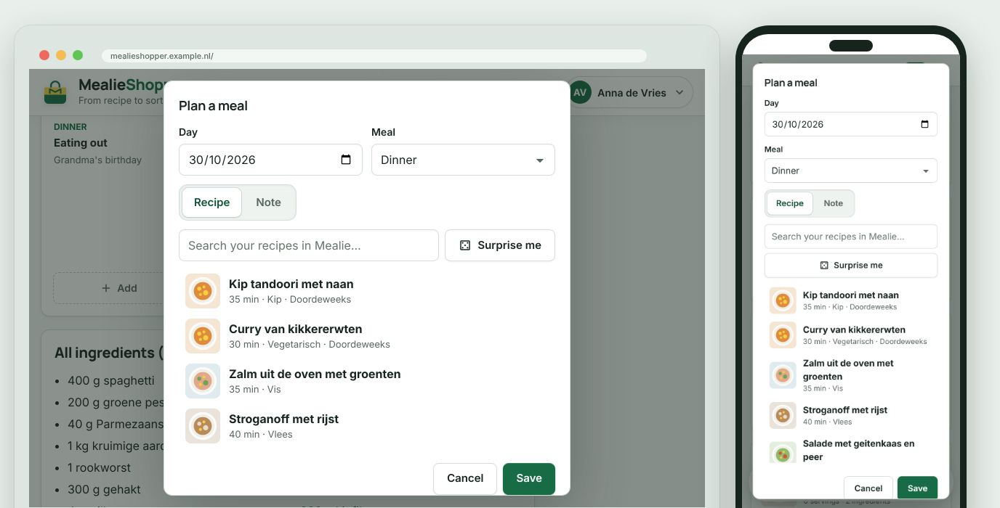

Tapping a meal opens its recipe in a window: the description, **Start cooking** and **Keep screen on**, the ingredients (already scaled to the servings you planned) to tick off and the numbered steps of the method, with **Open in Mealie** and **Edit**.

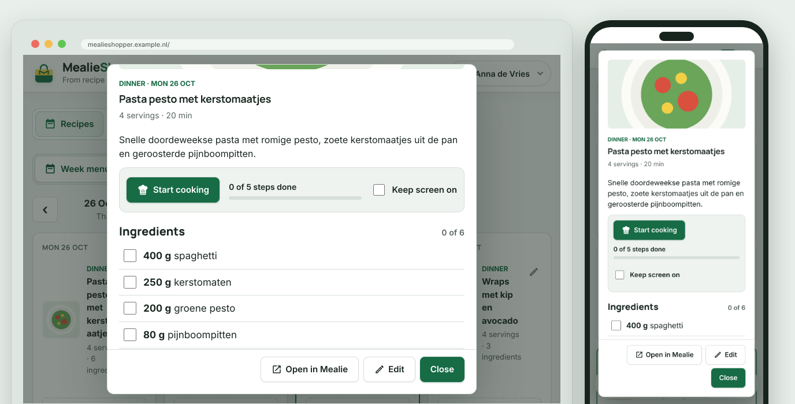

The servings you set per meal in Mealie's planner scale every amount. The number of packs is calculated with the pack size from AH, and lines the app is not sure about are marked so you check them before the basket is filled. Every product has a photo; tap it to see it large. In the drop-down every product shows its price per kilo, litre or piece. When another pack is cheaper per unit, a line under the ingredient says so, with **Choose**. The buttons to add the products or cancel sit in a bar that stays in view at the bottom, so after checking a long list you don't have to scroll back up.

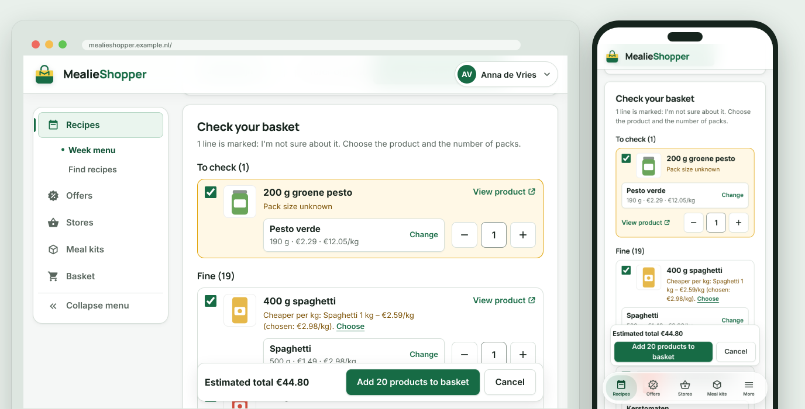

### To Picnic, Jumbo or Crisp

If Picnic, Jumbo or Crisp is linked, you choose next to the button which supermarket the week menu goes to. The products go straight into the basket at that store; **View basket** takes you to the Basket tab. An order is never placed.

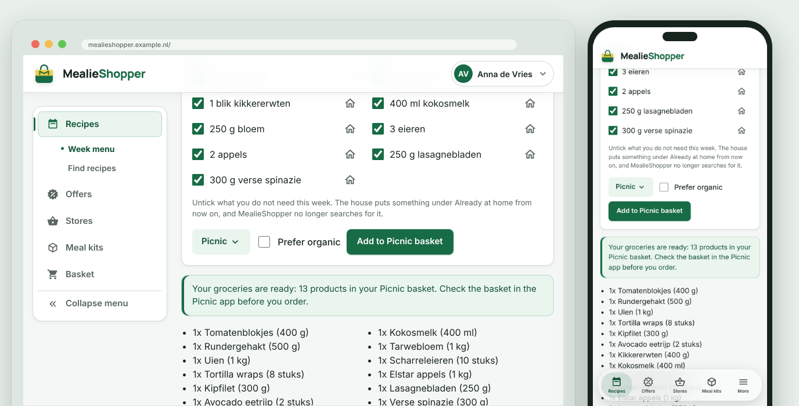

### Basket

One tab for your basket at every linked store, chosen in the list at the top. At Albert Heijn that is the shopping list the week menu writes to.

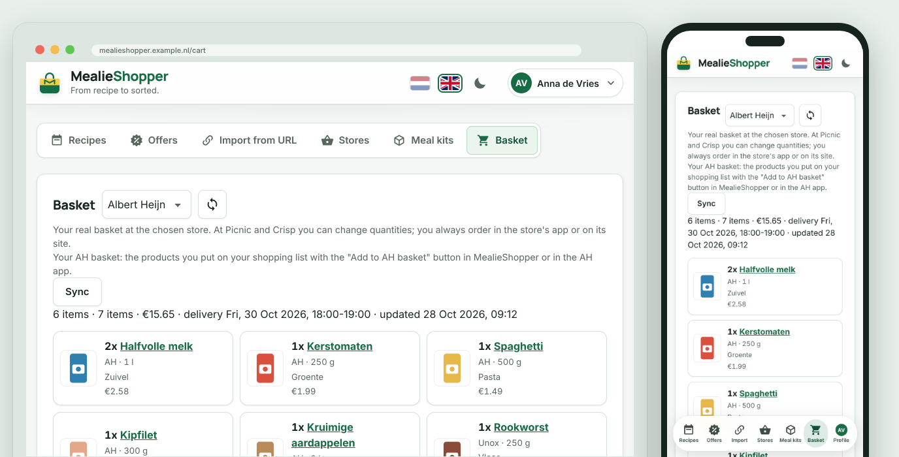

At Picnic and Crisp you change quantities, remove products or empty the basket. At Picnic you see below it what you pay, what your membership saves and the next available delivery slots; at Crisp what you pay and how much is still missing to reach the minimum order. Jumbo shows the basket read-only.

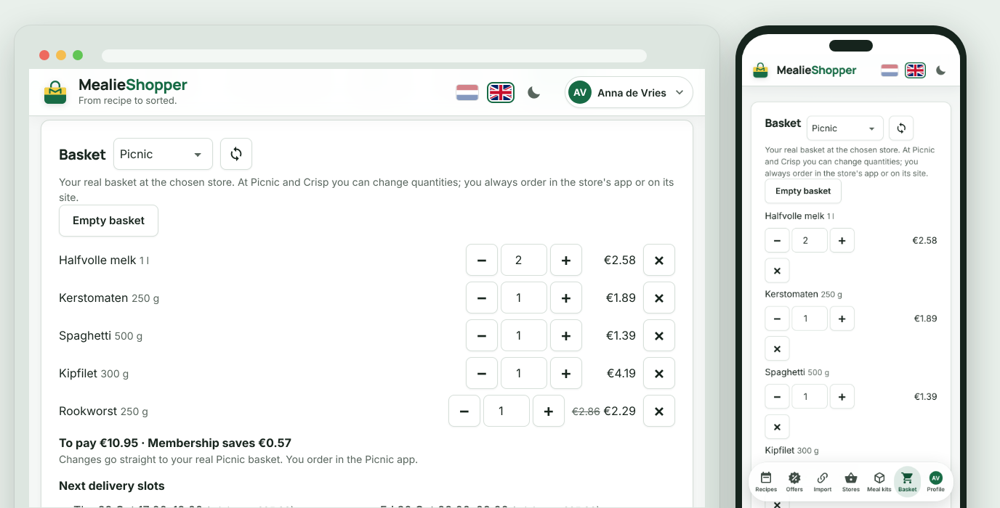

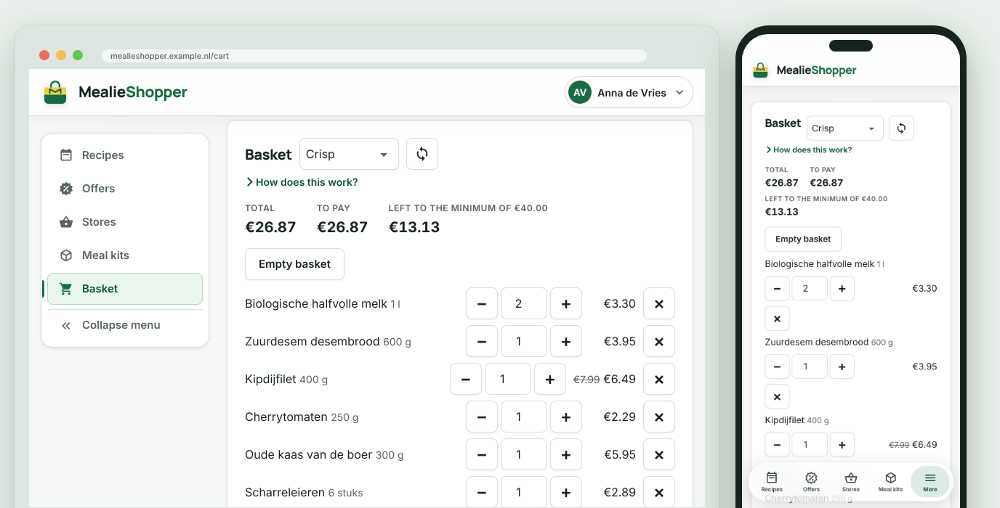

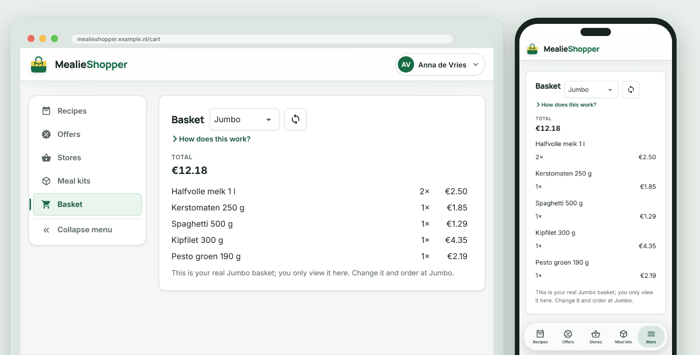

### Offers

The offers of Albert Heijn, Picnic, Jumbo, Crisp, Lidl and Aldi, per week and in step with the week menu: plan next week and you see next week's offers. At Albert Heijn that is the complete Bonus week, Monday to Sunday; next week's Bonus is there as soon as AH gives it at the weekend. Pick a category to see only those offers.

Every offer is a card with the photo on top. Top left on the photo is the discount: solid green when it is a real deal, neutral for a small saving, and *No discount* when it is not cheaper than the regular price. Below it are the store's deal (bold, such as *2 for 2.99*), the price per item with the regular price struck through (the lowest of the last 30 days when it comes from a fresh purchase or measurement, otherwise the store's from-price), the price per kilo, litre or piece, and in one row the insights from the history, such as *Lowest price ever* or *€6.99 in May*. Bottom right are two small buttons: *Compare pack sizes* and the *Price history*. Hover the photo for a large version with the price history of the past year (on a phone: tap it). Above the cards you can search, show only the real deals, sort and switch to a compact list.

**Where the regular price comes from.** The verdict puts the deal price per item next to the product's regular price. That price comes from your orders, receipts and confirmation emails, from the prices MealieShopper measured at the store and from the from-price of earlier offers. A line of a receipt or confirmation email only counts when it is certain to belong to the product: through your own link, a shared link or AH's link on the article number. A line that only matches the product by name could be a different pack size, and an article number on the receipt that happens to equal the number of a webshop product could be a different product: such a line does show in the price history, but it does not count for the verdict or for the regular price of a purchase. A price from the last 30 days is fresh, and of the fresh prices the lowest counts. If nothing is from the last 30 days, the newest price still counts up to a year back. Hover the badge for the explanation. With a fresh price it gives the lowest regular price of the last 30 days. On a dashed badge with an older price or the from-price of an earlier offer it gives the regular price with its source (order, receipt, confirmation email, measured price or from-price in the leaflet) and the date, such as *Regular price € 2.49, receipt of 1 Aug 2026*. On a dashed badge that only has the store's claim it says that MealieShopper does not know a regular price yet, or that the last known regular price is too old to judge. If the newest price is older than a year, MealieShopper does not judge with it, and the card shows *Last known regular price ... Too old to judge.* If the store states a from-price with the offer, the dashed badge with the store's claim sits above it, just as for a product MealieShopper knows nothing about. Without a from-price there is no badge. The badge has a **dashed border** when the percentage does not rest on a fresh price from a purchase or measurement: the regular price is older than 30 days or the from-price of an earlier offer, or the percentage comes from the from-price the store states with the offer itself, which is a claim of the store. That from-price never counts as a source for the verdict on the same offer, also when the offer changed halfway. If the store states a from-price with the offer that is lower than the regular price MealieShopper knows, the price has dropped since, and the verdict uses the store's from-price: an older price makes the verdict stricter, never more generous than the store itself. The badge is then dashed, and the explanation names the higher price MealieShopper knows with its source and date. If the from-price of an earlier offer is the lowest of the last 30 days, the explanation names its source and date and judges against the last 30 days. The regular price that belongs to a purchase comes from the same sources, from at most a year before the purchase. A price that was already stored with that purchase stays when only an older source remains.

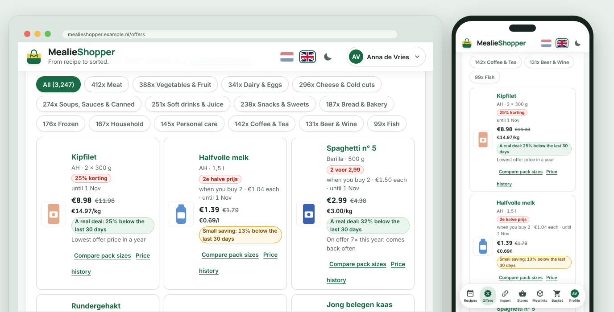

**Compare pack sizes** searches the store for other packs of the same product and lists them per kilo, litre or piece, the cheapest first. By default you only see the same kind of product; **Same brand**, **On offer** and a name filter narrow the list. At the top it says which pack is cheapest and by how much.

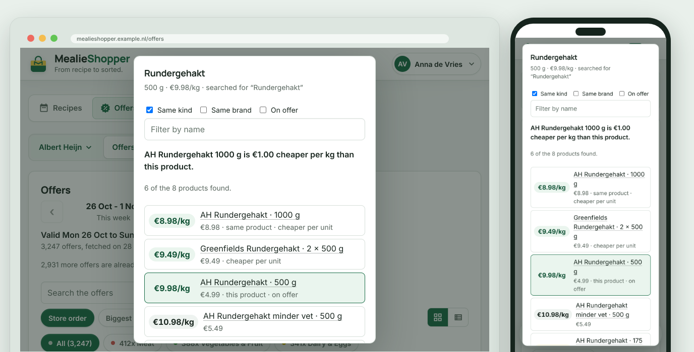

The **Price history** shows per product when it was on offer, the regular price over time and what you paid yourself, from your orders and receipts. Under the key figure *Regular price* it says which source the newest regular price comes from and its date, such as *confirmation email of 3 Oct 2026* (the date of that price). That way you also see a regular price that went up just before an offer. If you get there from an offer, an order or a receipt, that product is at the top, also when its name differs from the one in the history. An offer that has yet to start (next week's bonus) is shown as *On offer from 9 Nov*, with the price and the deal. It only counts in the history once it starts.

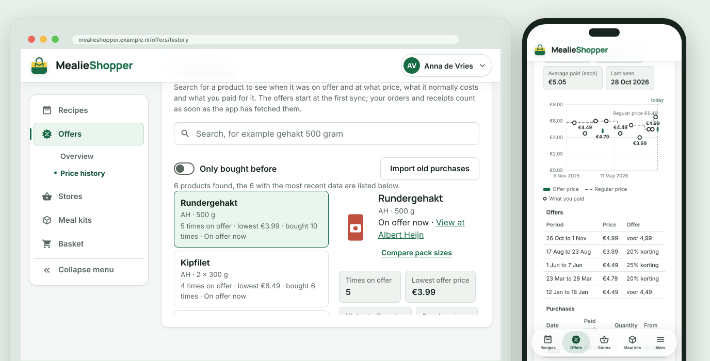

With the **Only bought before** switch the list only shows the products you bought at least once. For such a product MealieShopper keeps the image, with the name the product had at the time. When it gets another name or photo, **Saved images** shows that it is still the same product.

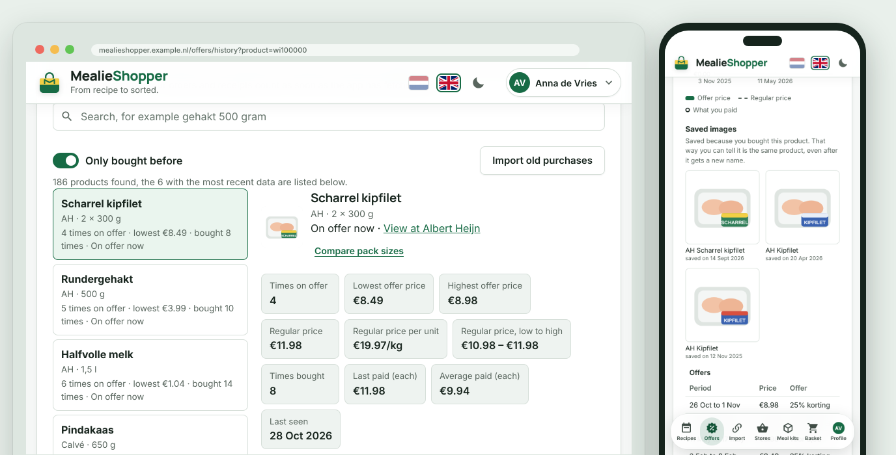

Your account only has the orders of the last few months; older ones are still in your confirmation emails. With **Import old purchases** (administrator only) you copy a prompt for an AI assistant such as Claude or ChatGPT and paste the JSON the assistant makes of your emails. **Check** shows per order whether it is new or already there; only **Import** reads them in. An order in your account whose products have not been fetched yet (this happens with old Jumbo orders) does not count as a duplicate: the products from your email are added. If MealieShopper fetches them from the store later after all, the imported version drops out, so nothing counts twice. The same button is under **Orders** of every store. The imported orders are listed there among your past orders, just like an order from your account: as *Order* with an archive box after it, with the status and delivery time from the email and the photos of the products the lines belong to. An order in your account without products is then not listed next to it a second time. With the bin the administrator removes a whole order. MealieShopper does not import a cancelled order.

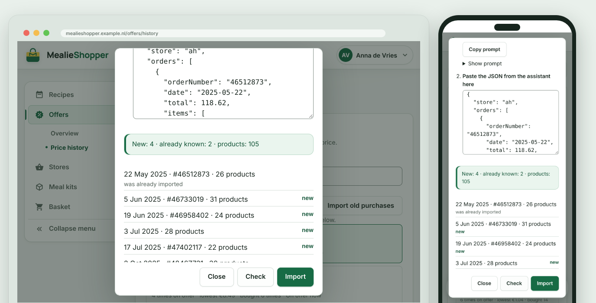

### Find recipes

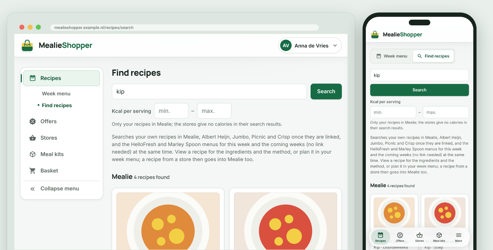

You also search your own recipes in Mealie; they come first. If Jumbo, Picnic or Crisp is linked, you search those at once too; the results are grouped per store. Tapping a card opens the recipe in the same place, with the ingredients and the method; **Plan** at the bottom puts it in your week menu. The recipe also has **Import** (only put it in Mealie) and a link to the store or to Mealie.

**Browsing your recipes in Mealie.** Leave the search field empty and your recipes in Mealie are there at once, under *Your recipes in Mealie*. Scroll down and the next page loads by itself. Type a search term and the screen also searches your stores and the menus, as always; it says so too. Under **Dish type, time and tags** you filter and sort:

- **Course**: breakfast, lunch, starter, soup, main course, side dish, dessert or snack. For Mealie from your categories and tags; a recipe without a course counts as a main course.
- **Diet**: vegetarian or vegan. Vegetarian also shows vegan recipes.
- **Meat, fish or poultry**: only recipes with meat, with fish or with poultry.
- **Tags and categories** from Mealie, with the number of recipes. The plus means *must have*: choose *Pasta* and *Vegetarian* and you only see vegetarian pasta. The minus hides recipes with that tag. The search box above the list finds a tag quickly.
- **Cooking time**: up to 15, 30, 45, 60 or 90 minutes. That is the total time from Mealie, or else the preparation plus the cooking time. A recipe without a time in Mealie drops out with this filter; how many, is shown above the results.
- **Order**: by name, newest first (when the recipe came into Mealie) or by rating. With a search term and *Name*, the best matches come first.

The filters work together with a search term and with the nutrition values. Course, diet and time also apply to the stores and meal kits, as far as they give it in their search results:

| Source | Course | Vegetarian, vegan | Meat, fish, poultry | Cooking time |
|---|---|---|---|---|
| Mealie | yes | yes | yes | yes |
| Albert Heijn | yes | yes | yes | yes |
| Jumbo | yes | no | no | yes |
| Picnic | yes | through the labels | no | yes |
| Crisp | yes | no | no | yes |
| HelloFresh, Marley Spoon | yes | through the label | no | yes |

A source that does not know a chosen filter is left out, and the results say which. Picnic, Crisp and the meal kits give no course: their recipes count as a main course, unless a label says otherwise. At Albert Heijn, *up to 15 minutes* is AH's own *snel* (quick) filter; with a longer time and at Jumbo, MealieShopper looks at more recipes at a time and keeps what fits the time. It then says *12 recipes in the first 96 hits* instead of a total. With a filter on tags or categories only Mealie is searched, and an order lets everyone take part.

**Vegetarian, meat, fish and poultry for your Mealie recipes.** MealieShopper reads the ingredients of your recipes and works out whether a recipe is vegetarian or vegan, or has meat, fish or poultry. That is a word list, not AI: a line with meat, fish or poultry makes a recipe not vegetarian, a line with dairy, egg or honey not vegan, and a stock, fish sauce or gelatine only not vegetarian. A vegetarian or vegan tag of your own comes first. MealieShopper also adds those tags in Mealie (*Vegetarisch*, *Veganistisch*, *Vlees*, *Vis*, *Gevogelte*), after every round through your recipes. A tag you set yourself always stays. If a tag from MealieShopper no longer fits because the recipe changed, it removes it; if you remove one, it does not add it to that recipe again. You can turn this off under **Settings, Link, Mealie**; the tags that are there stay, and Find recipes still filters on what the ingredients say.

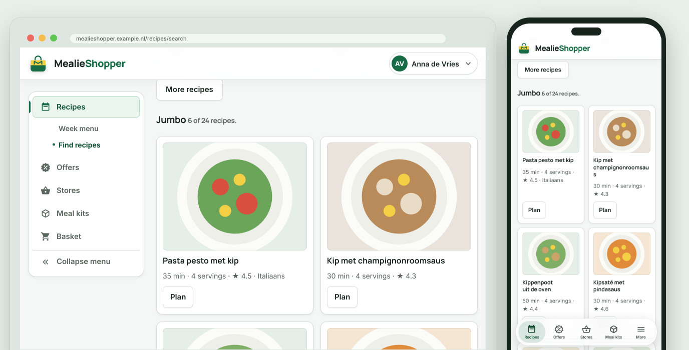

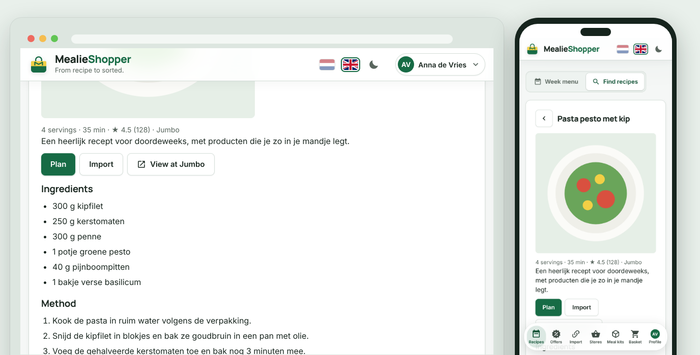

You read a recipe in the cooking view: tick off ingredients and steps, and the step you are at is marked *Now*. **Start cooking** opens cooking mode: one step at a time full screen in large type, with **Previous** and **Next** within reach of your thumb and, on a large screen, the ingredients alongside. Under the step are the ingredients that belong to it and a button for every time the step mentions; a running timer floats at the bottom right.

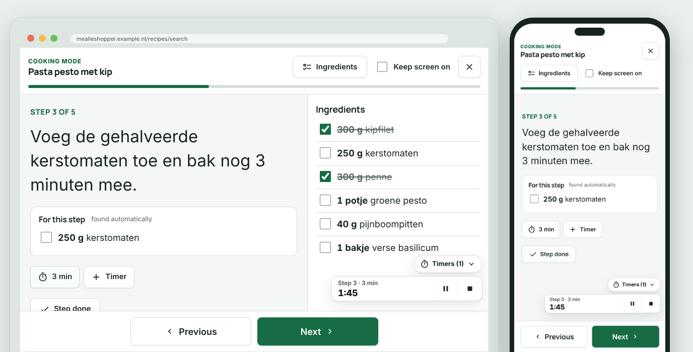

The menus of **HelloFresh** and **Marley Spoon** are always searched too, without a link: for this week and the three weeks after, MealieShopper fetches the menus that are not there yet while you search (the first time that takes a moment; afterwards they are kept for 6 hours). Tap a recipe for the ingredients and the method, or choose **Plan**.

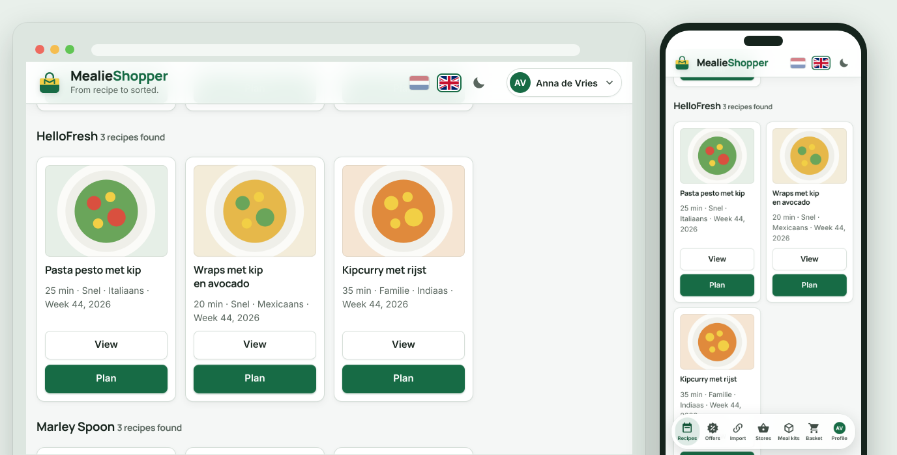

### Choosing a store

Under **Stores** the store menu is the first button in the tab bar. It shows the chosen store and opens with the linked stores: Albert Heijn, Jumbo, Picnic and Crisp. With one linked store the menu is hidden.

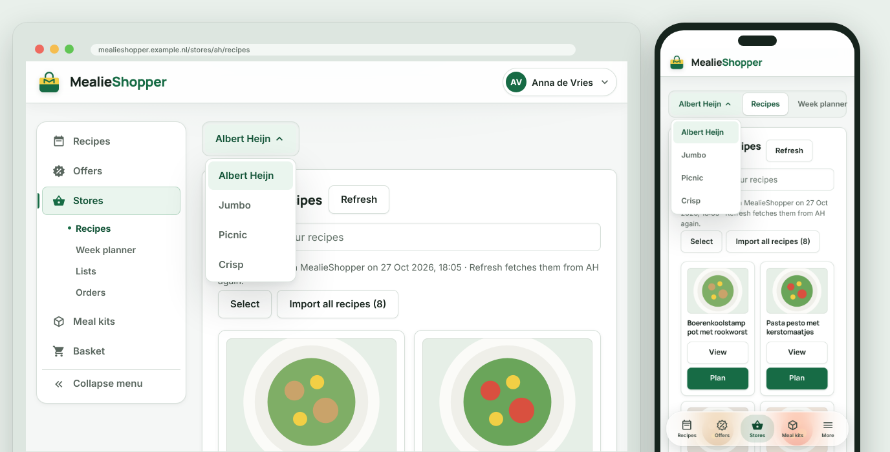

### Meal kits

The **Meal kits** tab shows the public weekly menus of HelloFresh and Marley Spoon Netherlands. You choose the provider in the drop-down menu at the top (like the store under Stores), browse per week and view a recipe or plan it with one click.

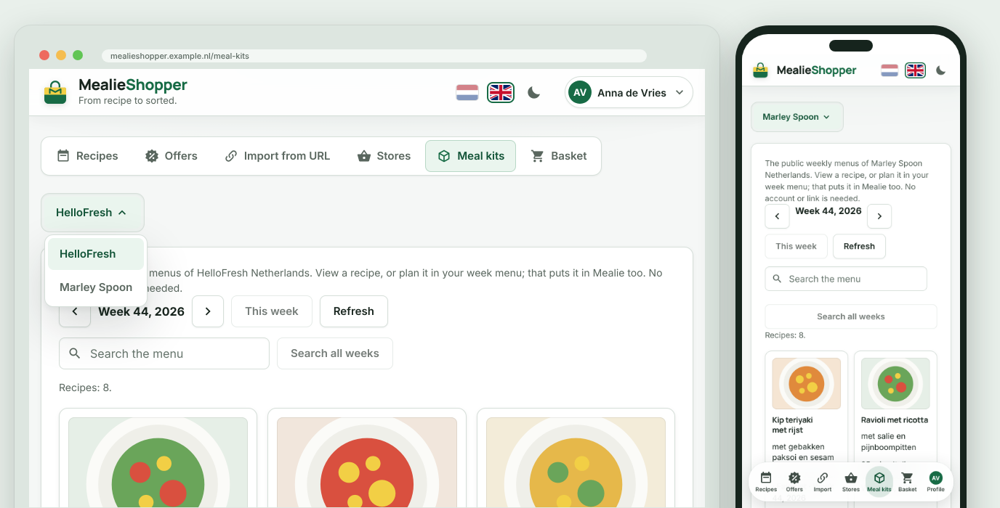

### Stores: your saved AH recipes

Your saved Allerhande recipes live in MealieShopper, at least two side by side on a phone. Search your recipes at the top. If you made recipe groups in the AH app, pick *All recipes* or one of your groups next to the title.

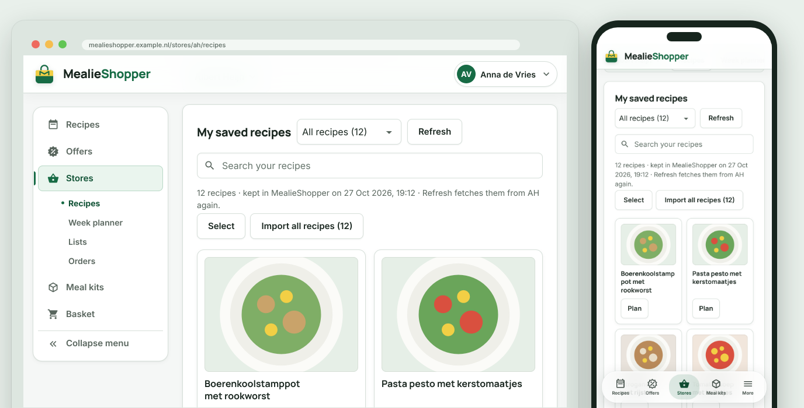

Pick a group to see only its recipes, in the order of that group; searching works within the group.

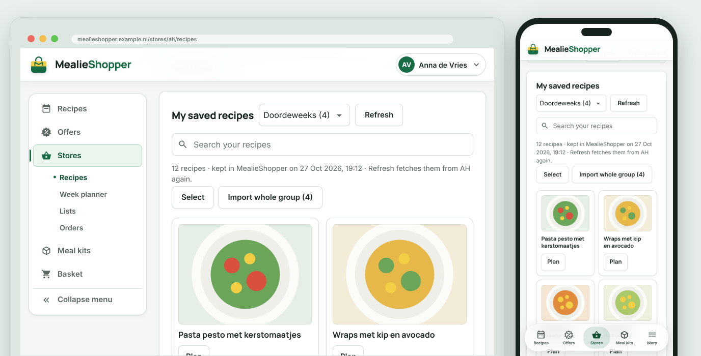

With `Select` you put several recipes into Mealie at once, and the administrator a whole group with `Import whole group`; see [Bulk import into Mealie](#bulk-import-into-mealie).

### Stores: the week planner of the AH app

If you plan in the week planner of the AH app, you see that plan under **Week planner**: per day, from today. **To week menu** puts everything on the same day in your week menu: Allerhande recipes (imported into Mealie first if needed) and loose products. A product that is already a recipe in Mealie goes in as that recipe; MealieShopper makes a recipe of the others, or with **Loose products of a day together as one menu** one menu per day, with **Soup and pizza always separate** on top. Those two switches are under **Settings, Preferences, Supermarket** (see [Preferences](#preferences)); the link below the explanation takes you there. A summary then appears above the days.

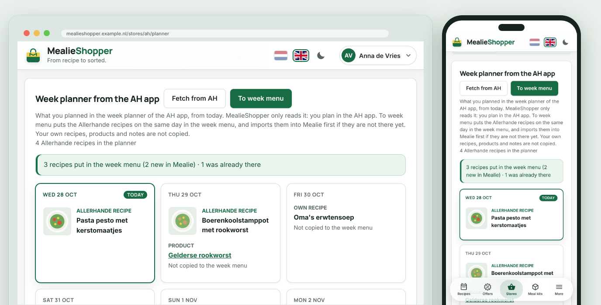

### Stores: your lists

Your favourite lists as cards. Sync them to MealieShopper, search by name or by product, and open a list in the same place. In an opened list you put the whole list in your basket with one press on **Add to basket**, and you change the quantity per product.

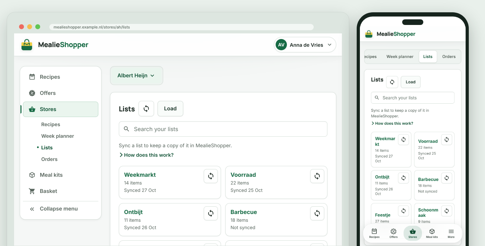

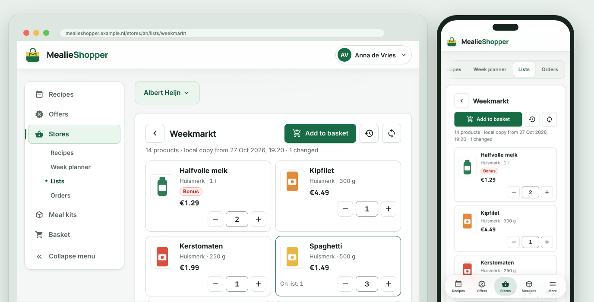

### Stores: AH orders and receipts

Your orders and receipts share one table, newest first. Above it you choose what you see: checkboxes for orders and receipts, an amount from and to, and the search field. Your **receipts** from the shop open as a **receipt** the way they look on paper: a narrow strip with quantity, description, price and amount, the bonus lines, the total and how you paid. In the bar under the title you switch to **By category**, **Cards** or **Table** (see *Opening an order* below): the same lines with the name and the photo of the webshop product the line is linked to (a line that is not linked yet keeps the abbreviated name from the receipt) and the bonus lines below. Under the title are the number of items, the total and the payment method, and the header shows the amount saved. A description or a card links to the price history of the web shop product the article number on the receipt is linked to. When you open a receipt, MealieShopper looks up the lines that are not linked yet (a few at a time, gentle on AH) and fetches the photos of the linked lines that do not have one yet. Everything is kept in a local copy. The search field searches the products in all your orders and receipts (search for "soda", for example) and shows only the purchases with that product, with the matching lines in the Products column. Open such a receipt and the matching lines are highlighted. Your **upcoming orders** (still open, with their delivery time) are at the top, your **past orders** (delivered, kept for good) among them on their date. Open an order for its products. Your AH basket is under the Basket tab. The filters and the search text stay when you reload the page or come back from an order, until you close the browser tab. The list first shows the first hundred purchases; **More purchases** below it adds the next hundred. The filters, the search and the count above the list always cover all purchases.

**Linking it yourself.** When MealieShopper does not recognise a line (a shortened name such as *COTTAGE CH*, or a name in a confirmation email that differs from the webshop), it gets a button with a chain link: on the paper receipt after the description, in the Cards view on the right of the card, and in By category and the table after the name (on a receipt and in an imported order). The button opens **Link a product**: a search field with the name of the line, and the products of the store with photo, brand, size and price. Choose the right product. The line shows that product straight away, with the link to its price history, and its purchases count at that product in the Price history instead of as a loose product. From then on MealieShopper also recognises every line with the same article number (on an AH receipt) or the same name (a receipt line without an article number, or a line from an email) on your other and future receipts and imported orders; it no longer looks up such an article number at AH either. On a line that already belongs to a product, automatically or not, the button reads **Choose another product**: that is how you fix a wrong link, because your own choice always comes first. If you linked the line yourself, **Unlink** removes your choice and the automatic link applies again. This works for Albert Heijn, Jumbo, Picnic and Crisp, and anyone who can see the receipt or order may link. Your links are part of the backup (`GET` and `PUT /api/product-links`, `DELETE /api/product-links/<store>/<kind>/<key>`; the dialog searches with `GET /api/product-links/search?store=<store>&q=<name>`).

**Table, cards or overview.** Above the list on the right you switch between three views of the same filtered list: the **Table**, **Cards** with a collage of product photos (four, or six on large cards) and the **Overview** with the details of each purchase on one row and a strip of photos on the right (on the right, at a fixed width, so the text of every row starts at the same place). A receipt shows the photos of the webshop products its lines are linked to. An imported order shows the photos of the products its lines belong to; an imported order or a receipt without linked products gets the icon of its kind and the first product names. Each kind has a colour: green for an order, yellow for a receipt, grey for an imported order, as a dot in the table and at the checkboxes and as a stripe on the cards and in the overview. Otherwise an imported order is simply called *Order*, with an archive box after it (point at it and it says *Imported from your confirmation emails*). With **Sort** you choose date, amount or number of products, ascending or descending (clicking a column header in the table does the same). With **Options** you choose the card size and what a card shows: status and delivery slot (the payment method for a receipt), the bonus amount saved and the product names. When searching, the cards and the overview show the matching lines. The view, the sort order and the options are kept in your browser, also when you open an order and go back. Switching and sorting need no request to the server. On a phone **Cards** is the default, as long as you have not chosen a view yourself: the six-column table does not fit there.

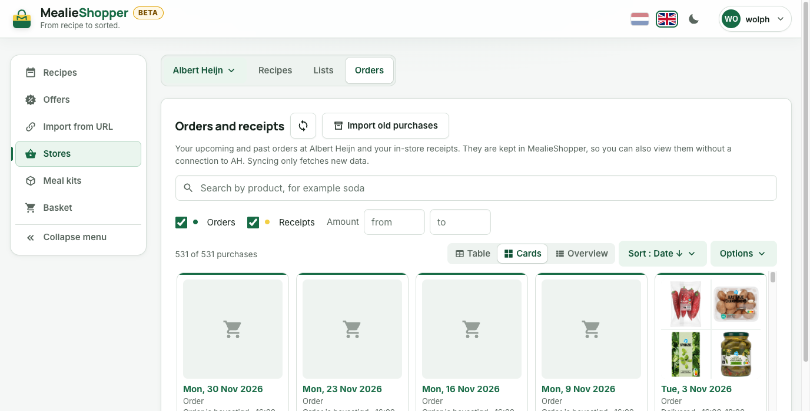

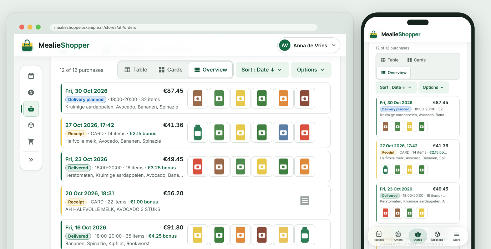

**Hovers.** With a mouse, rest the pointer on a purchase or a product photo for a moment to see more. On a product photo in the cards or the overview you see the photo large with the name, brand and size, the category, what you paid ("2x €1.19 = €2.38") with the discount badge, and how often you bought the product before. On the rest of a purchase (the row in the table or the overview, or the card) you see per category how many units and products it held, a few small photos and the subtotal, with the amount saved and the total at the bottom. A large order fits on the screen too. A click on the window opens the purchase, and Escape or a click next to it closes it. The window only reads what MealieShopper already keeps and asks AH for nothing. A phone or tablet has no hovers: a tap opens the purchase as always.

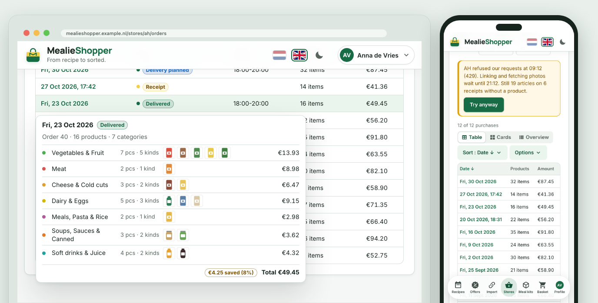

**Opening an order.** An order, an imported order or a receipt opens with a status badge in the header (*Delivered*, *Planned*, *Imported* or *Receipt*) and the amount saved with the percentage. Below it is the same bar as above the list, with four views. **By category** (the default for an order) shows a coloured header per category, with the name, the number of items and kinds ("13 units, 8 products"), the amount saved and the subtotal on the right, and the products with a small photo below it. **Cards** shows each product as a card in the colour of its category. **Table** shows the category, the product, the size, the quantity, the price, the discount, how often it was bought before and the amount, and clicking a column header sorts. **Receipt** is there for a receipt only and is its default. Every category has the same colour as in the offers: green is fruit and vegetables, red is meat. For an AH order the category comes from the AH classification, otherwise from the name of the product. A product carries badges: the discount against the regular price at the time of the purchase (the same badge as in the offers, outlined when only the AH price before bonus is known), *3x before* when you bought the same product earlier, and *Bonus*. That regular price comes from the same sources as in the offers, from at most a year before the purchase (see *Where the regular price comes from*), so the badge explanation does not mention 30 days. The search field (*Search this order*) finds a product by name, and the lists of categories and brands filter the lines: every row has a plus (show only this one), a minus (hide it) and the count. Search and the lists work together. With **Sort** you choose category, name, amount or discount. The view (separately for an order and a receipt), the sort order and the options are kept in your browser. Switching, searching and sorting need no request to the server.

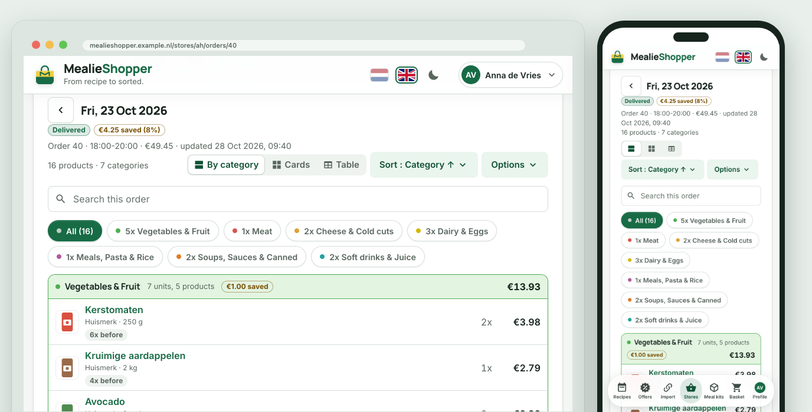

**When AH holds back.** MealieShopper links receipt lines to a product and fetches photos at a calm pace: at most 120 searches an hour, and nothing for twelve hours after a 403 or 429 from AH. A notice above the list of purchases then says so. During a pause it is orange and names when AH refused and until when the linking waits. When the hourly budget is spent, it names when it can go on. When only work for the night is waiting, it is green and names how many articles and photos are still open and when the next round is. With nothing to do there is no notice. A receipt with lines without a product gets the same notice under its header, with how many of its lines have no product yet. When AH already searched those lines in the last 30 days, the notice says the next attempt comes by itself and the button is off. Under **Settings, Link** the administrator always sees the box *Linking products and fetching photos at AH*: the state, a meter for the hourly budget, what there is to do, the last and the next round, and the buttons **Run a linking round now** and **Fill in photos** (photos only, without searches). **Fetch now** in the notice (on a receipt for that receipt only) is for everyone who is logged in. A round stays within the pace and the hourly budget, and the notice follows it until it is done. **Try anyway** during a pause is shown to the administrator only: it clears the pause, and a new 403 or 429 sets it to twelve hours again.

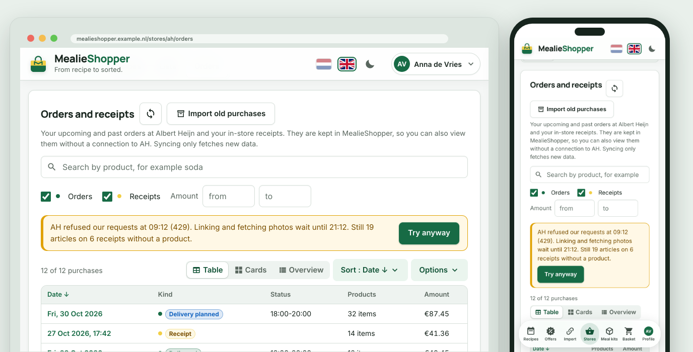

Older orders from your confirmation emails can be read in here with **Import old purchases** (administrator only, see *Offers*). They are among your past orders on their date and look like an order from your account: *Order* with an archive box after it, the status and delivery time from the email (*Delivered · 18:00-20:00*), and per product the photo, brand and size of the product the line belongs to (matched by name, as in the Price history). An imported order is always shown as *Delivered*, also when you imported it before version 3.5.0 or the email named no status: it counts as bought, and a cancelled order is not imported. When the email named no time, the one of the order in your account is shown. Open them for the products, and the search field finds them too. When the same order is in your account without products (this happens with old Jumbo orders), only the imported version is listed, with the products from your email. If MealieShopper fetches the products later after all, the order from your account is back and the imported version drops out. With the bin on the card the administrator removes an imported order as a whole; it then no longer counts in the Price history either. It works the same at Jumbo, Picnic and Crisp. At Picnic and Crisp an imported order has the same card as a delivered order, and **Add all to basket** puts the linked products in your basket (the message names what matched no product).

**Updated by itself.** The daily run that fetches the offers also fetches your orders from every linked store (Albert Heijn, Jumbo, Picnic and Crisp), and your receipts from Albert Heijn. A delivered order is therefore in the list and in the Price history as delivered the next morning, also when you do not press the sync button. If a store has two products with exactly the same name (at AH the same pointed pepper as a 500 gram bag and per 2 pieces), the price of an imported purchase decides which of the two it belongs to. If none of the prices is close, the purchase stays with the first product of that name. For a product that MealieShopper only knows from your receipt, the same run fetches the brand and the size (*2 stuks*, *500 g*), so the Price history says how much it is and what it costs per piece or per kilo.

**Photos from the stores.** The product photos in an order, the basket, the offers, the price history and the search results, and the photos of a store's recipes, do not come straight from the store. MealieShopper fetches each photo once, as a browser would, and keeps the original in the `images` folder of the data folder. From then on it comes from your own server (`GET /api/images/<token>`). That saves requests to the store, and a photo stays when the store changes its address. A receipt line linked to a webshop product shows that product's photo; when linked lines still lack photos, MealieShopper asks for them when you open the receipt, in a small background round when you open the list of purchases (at most a hundred) and at night (at most five hundred). The nightly offers task fetches what is still missing at a calm pace (at most 300 a night, newest first), and a small round follows every sync of orders or receipts. If a store answers 403 or 429, the cache waits twelve hours for that store; **Settings, System** then shows until when. A photo the store does not have does not hold up the others: Picnic then answers with a 403 from its storage (`AccessDenied`), and that counts as a missing photo, just like a 404. A photo that fails is tried again after a day (a missing photo after a week) and no more after ten times. Under **Settings, System** you see how many photos there are and how much space they take. The cache is not part of the backup (it rebuilds itself) and goes with a factory reset. `MEALIESHOPPER_IMAGE_PREFETCH=false` turns the background rounds off. A photo you open is still fetched and kept.

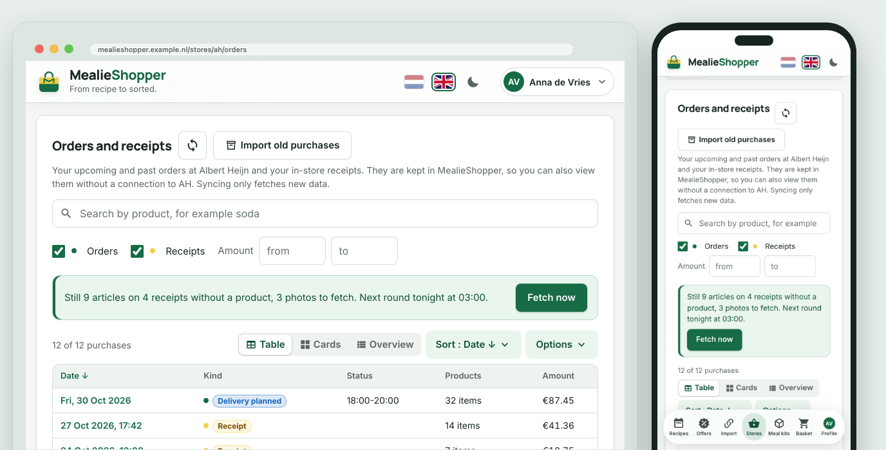

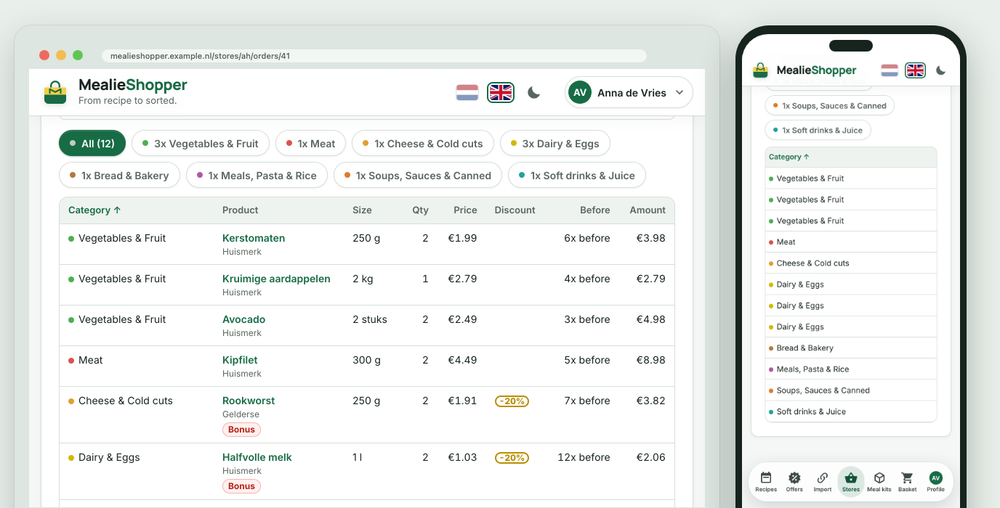

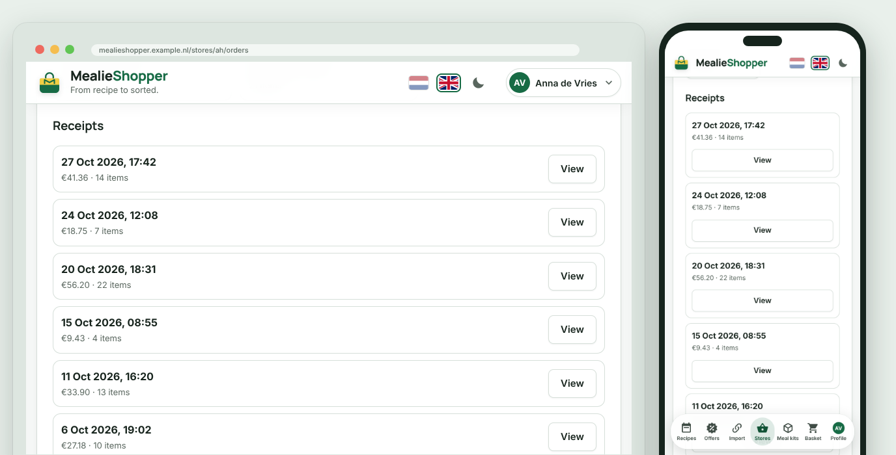

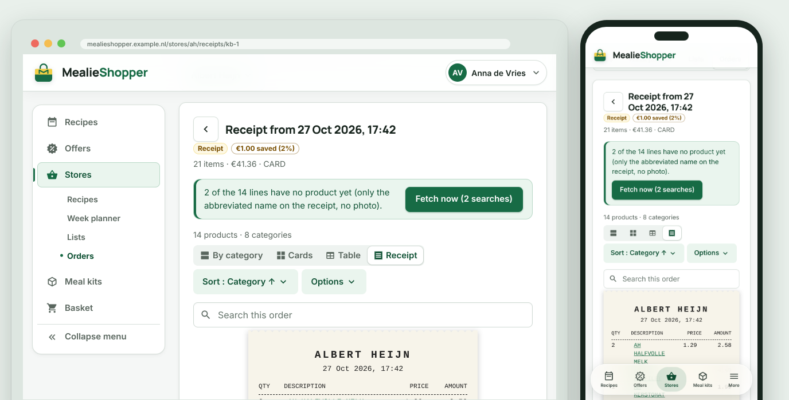

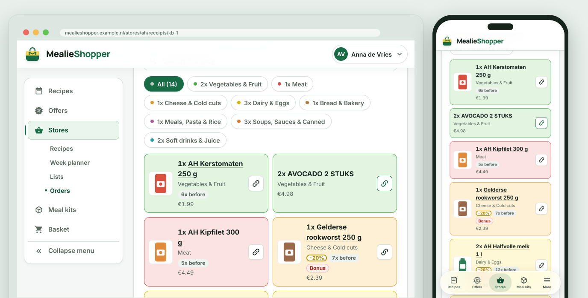

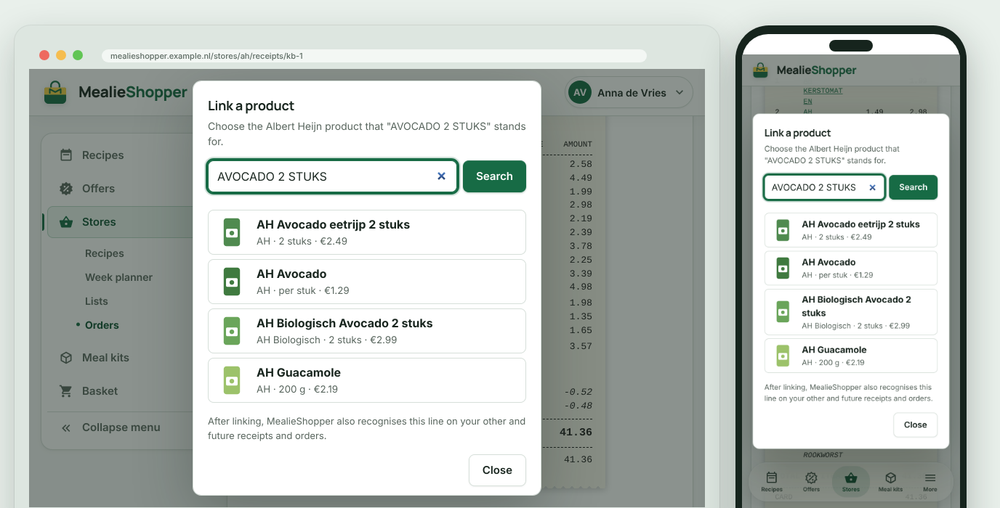

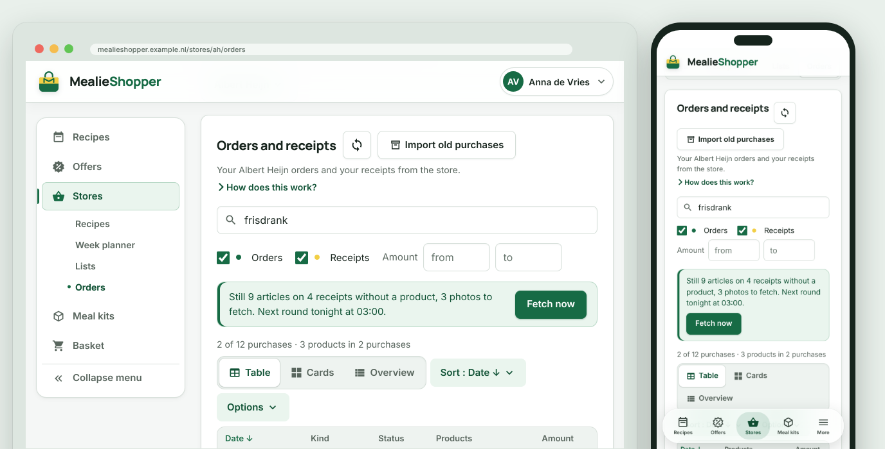

### Stores: loose purchases

A **loose purchase** is a line from an imported confirmation email (**Import old purchases**) that does not belong to a product, usually because the store renamed the product or no longer sells it. Such a line counts as a loose product in the Price history, so the old purchases of something you have bought for years are missing there. The **Loose purchases** page helps you link them to a product after all. You find it per store (Albert Heijn, Picnic, Jumbo and Crisp) under **Stores**, as a subtab next to the lists and orders. Only the administrator sees it.

**Which link applies.** For a loose name your own link wins first, then the shared list (below), then the name matching of MealieShopper. Your own choice always takes precedence.

**The nightly round.** After the nightly offers run, MealieShopper looks the loose names up at the stores you have linked, the most bought first. That is at most 100 searches per store per round, with the ten best results per search, and it only looks a name up again after 90 days. A name you rejected with **None of these** is never looked up again. At Albert Heijn every search goes through the same brake as the linking of receipt lines: at most 120 searches per hour, and twelve hours of nothing after a 403 or 429 from AH, shared by both. The other stores get the same pace (1.5 seconds between searches) and, after a 403 or 429, a pause of their own of twelve hours. The round stops for a store at the first error from that store, and the page then says until when it is paused. **Fetch now** on the page starts the same round for that store at once, with the same limits.

**What the round finds.** If exactly one result has the same name as the loose purchase, with the same numbers and the same pack as every spelling from your emails, MealieShopper links it at once, without a click. That only happens the first time the round looks the name up: a link you remove does not come back by itself, and the name then becomes a card. Such a link is not included in the export. Otherwise a **card** appears on the page with the name, how often and in which years you bought it, what you paid and the products of the store to choose from. **Link chosen product** makes the link, **Search yourself** opens **Link a product** and **None of these** puts the name under **Rejected**, where **Restore** frees it again. If the store found nothing, the name is in the list **Not found at the store**.

**The AI makes suggestions (optional, off by default).** With an API key (see *AI: searching recipes for the offers*) an AI can preselect a product on each card, and mark the pack size as uncertain. This is off, also after an update, because it costs money at the provider and sends data to them. If you tick **Let the AI make suggestions for loose purchases overnight** under **Settings, Link, AI review of matches**, a request follows at the end of the round. If it is off and there is a key, the page has the button **Ask the AI for suggestions**, which does the same for the cards without a suggestion, only when you press it. Each request sends the provider groups of 20 names, and per name only:

- the old product name from your email
- how often you bought it
- the lowest and the highest price you paid per piece
- the first and the last year you bought it
- per candidate from the store a sequence number in the list, the title, the brand, the size and the price

No product numbers, photos, order numbers, order moments, addresses or account details are sent. What the AI chooses is only a preselected choice: MealieShopper links nothing unless you click **Link chosen product**.

**The shared list.** Whoever has linked an old name to the right product once has solved it for everyone at the same store. So every version of MealieShopper has, per store, a file with links from old names to products (`mealieshopper/shared_link_data/<store>.json`). A name in that file is linked without a search and without a click. In the **Link a product** window such a line shows *Linked through the shared list*, with the button **Not right**. That switches the link off for that product on your installation, so the name is loose again and enters the round. If a later version of the file corrects the name to another product, that new link does apply. Your own links and your **Not right** stay after an update and go into the backup, as does the state of the loose names.

**Sharing your links through a pull request.** What you linked yourself or confirmed on a card, you can offer to the project. The app sends nothing to GitHub itself: you make the file, and you propose the change.

1. Choose **Export for GitHub** on the page. The window shows your own links for that store that are not in the file yet, and **Download** saves the new file of that store (`<store>.json`).
2. Open the file on GitHub with the link in the window and replace its contents with the file you downloaded.
3. Propose the change as a pull request to the `beta` branch.

Each link has four fields in the file: `name` (the old name), `productId`, `title` and `unitSize`. No prices, dates or quantities from your purchases. A name that is already in the file with another product appears in the window under **Differs from the file** and is only included if you tick it. Names that look alike but are linked to different products are listed under **Left out** until you link them to the same product. A link that MealieShopper made itself because the name matched exactly is not included.

### Stores: Picnic

Choose **Picnic** in the store menu; three tabs appear. **Recipes** shows your recipes from the Picnic app (*Saved*, *Order again* and the *Cookbook*) as cards; tapping a card shows the ingredients and the method, and `Plan` puts the recipe in your week menu (and in Mealie). In Mealie the recipe arrives with its ingredients, method, photo, servings and time, with the link to Picnic as its source. If a Picnic recipe reached Mealie without ingredients and method before version 3.8.1, delete it there and put it in Mealie again: otherwise `Plan` uses the empty recipe that is already there.

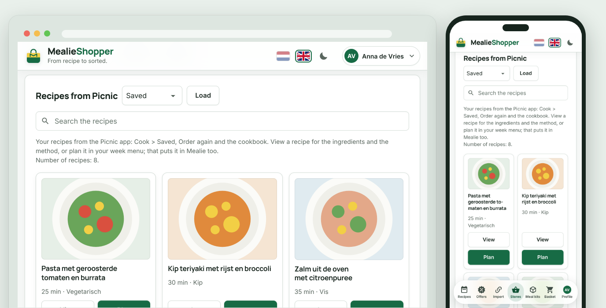

**Favorites** shows the products you marked as favourite in the Picnic app, with a button to put one in your Picnic basket.

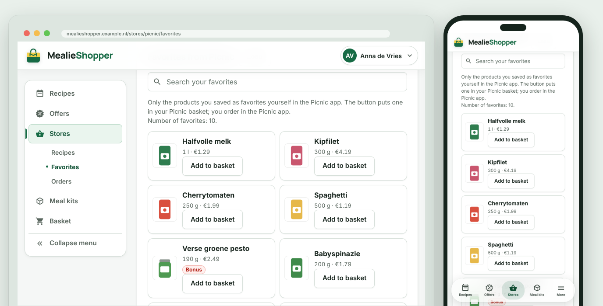

**Orders** shows your upcoming deliveries (fetched live) and your delivered orders, which you keep locally with *Sync*. Open an order for its products and put them in your Picnic basket again with one button.

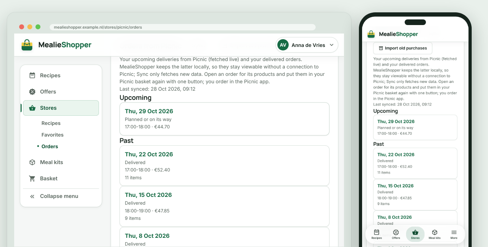

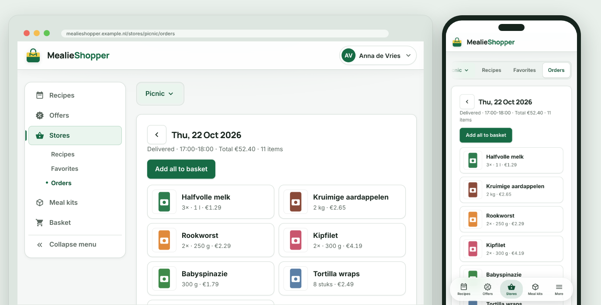

### Stores: Jumbo

Choose **Jumbo** in the store menu. You see your **lists** (your own lists, Favourites and the shopping list), your **orders** and your **recipe lists**.

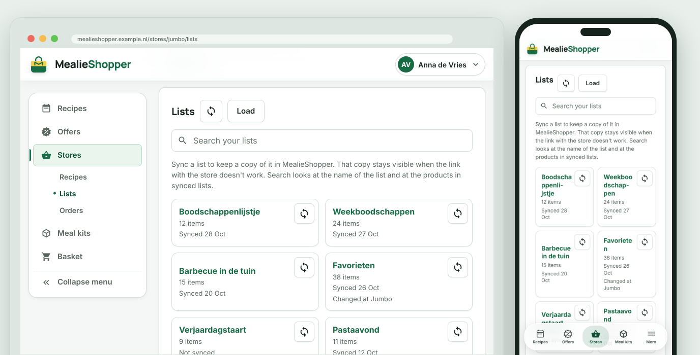

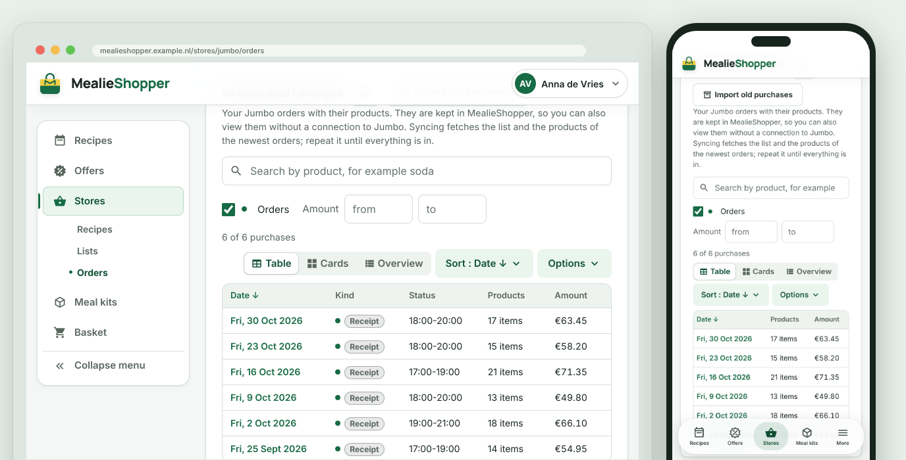

Under **Recipes** you choose Favourites or one of your own lists; tapping a card shows the ingredients, the method and the nutrition values, and `Plan` puts the recipe in your week menu (and in Mealie). With `Select` and `Import whole list` you put more recipes into Mealie at once; see [Bulk import into Mealie](#bulk-import-into-mealie).

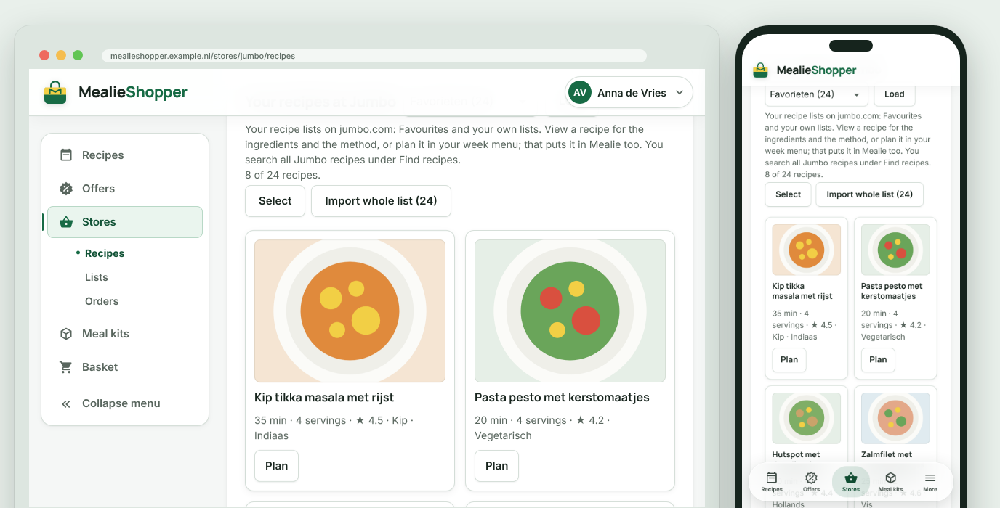

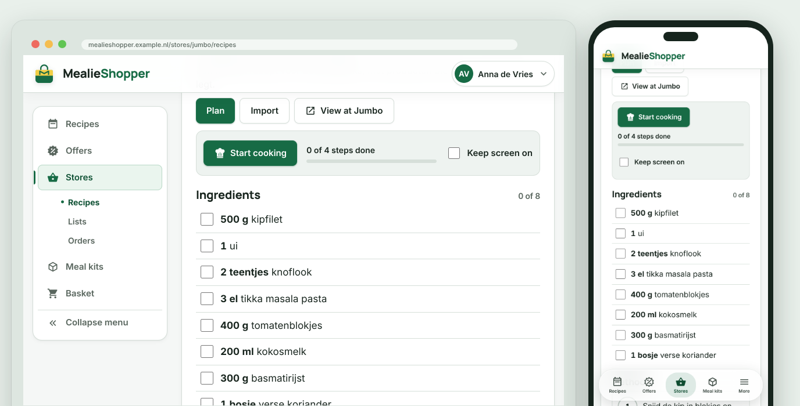

### Stores: Crisp

Choose **Crisp** in the store menu; it has three tabs. **Recipes** shows your favourite recipes from the Crisp app as cards: the recipes with a heart. The app shows them as *Favorieten* at the top of the recipes page, or for some accounts under *Saved by you*; MealieShopper reads both. Tapping a card shows the ingredients and the method, and `Plan` puts the recipe in your week menu (and in Mealie). With `Select` or `Import all recipes` you put them into Mealie in one go (see [Bulk import into Mealie](#bulk-import-into-mealie)). You search all Crisp recipes under **Find recipes**.

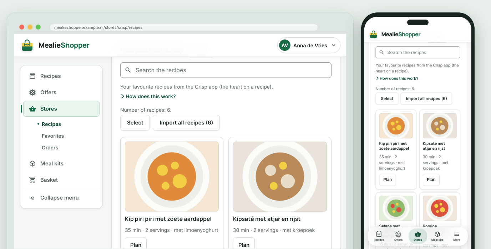

**Favorites** shows the products you saved in the Crisp app, with a button to put one in your Crisp basket.

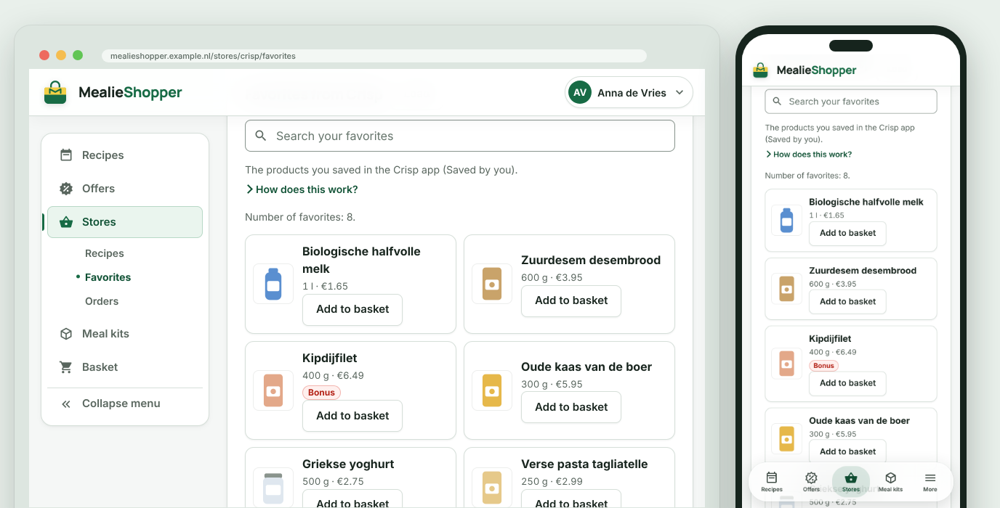

**Orders** shows your upcoming orders (fetched live) and your delivered orders, which you keep locally with *Sync*. Open an order for its products and put them back in your Crisp basket with one button.

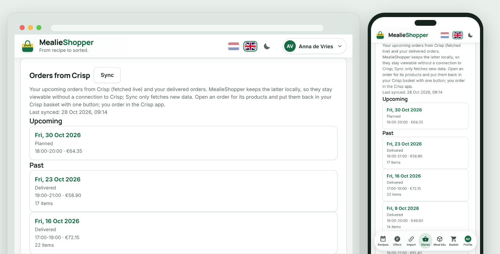

### Dark theme

**Dark mode** or **Light mode** in the menu under your name switches between light and dark; without a choice the app follows your device.

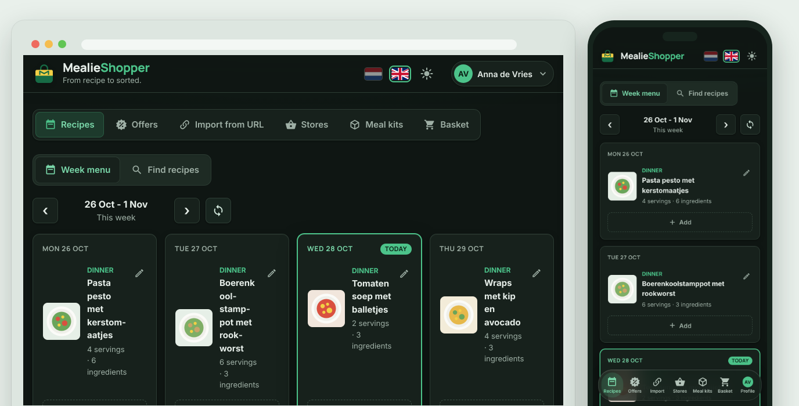

Under **Settings, Preferences** you pick the theme, a green or dark grey background for the dark theme, and an accent colour. Here dark grey with blue: the buttons, links and the active tab follow the colour, in the menu bar at the bottom too.

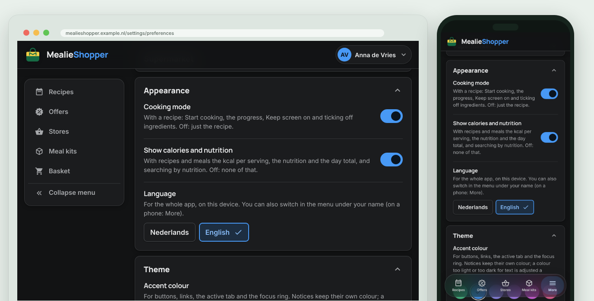

Under **Navigation bar** you choose how the bar at the bottom of the app looks: *Automatic* (like the other apps on your device), *iOS-like* (floating glass, with a slider for the glass effect) or *Android-like* (full width, with a pill behind the active icon, as on the phone here).


## First start

On a new installation MealieShopper opens a setup guide. It starts with security, Mealie and the question which stores you use; then comes a step for each store you ticked, and an overview. At the top you see which step you are on; *Back* takes you a step back, and what you skip you do later under **Settings** (in the avatar menu, on a phone under **More**). An existing installation (with a passkey or password) does not see it.

**1. Security.** The app looks at how you open it.

| You open MealieShopper through | What you can choose |
|---|---|
| a domain name with HTTPS | a **passkey** (recommended), or a username and password |
| an IP address, `localhost`, a `.local` name or without HTTPS | a username and password, or deliberately **no security** (with a warning); passkeys don't work there |

After the password you can turn on **two-step verification** with an authenticator app. That is optional, just like the password itself. You get 8 recovery codes that you see only once.


**2. Link Mealie.** Enter the address of your Mealie and an API token; MealieShopper checks them with Mealie before anything is saved.


**3. Which stores do you use?** Tick where you do your shopping: Albert Heijn, Jumbo, Picnic or Crisp. Only those stores get a step; you skip the rest. Each store says how linking works: Albert Heijn and Jumbo need a computer (the browser console), Picnic also works on a phone, and Crisp is linked after the guide. You can link or unlink any store later under **Settings, Link**; the week menu works without a store too, only filling your basket does not. The guide remembers your choice when you reload the page.


**Link Albert Heijn** (if you ticked it). Instructions for logging in through the browser console, with the login button and the paste field right in the step. This only works on a computer; you can skip the step and do it later.


**Link Jumbo** (if you ticked it). Works just like Albert Heijn: instructions for logging in through the browser console, with the login button and the paste field right in the step. This only works on a computer; if you don't use Jumbo, skip the step.


**Link Picnic** (if you ticked it). Enter your Picnic email address and password. If Picnic asks for a code, a field for it appears in the same step; the code arrives by text message (or by email, with the button below it). Your password is not stored. You can skip this step too.


**Done.** An overview of what is set up: security, Mealie and the stores you ticked. If a link is missing, a button takes you back to that step. If you ticked Crisp, there is **Link Crisp**: it finishes the guide and opens the Crisp block under **Settings, Link**. When Mealie is linked, the last button is called **Plan your first meal** and opens the week menu.


## Usage

The **Recipes** tab has two subtabs: **Week menu** (planning the week menu and sending it to your basket) and **Find recipes**.

Every screen starts with one line that says what it is. More explanation is folded away behind **How does this work?**; tap or click it to read it. Warnings and errors are always in view.

**Address, Back and your place.** Every screen has its own address, so reloading, a bookmark and the browser's Back and Forward buttons work. When you look at a week other than the current one, the first day of that week is in the address (`/recipes?week=2026-11-16`, for Offers `/offers?week=2026-11-16`); paging through the weeks does not add a history step per week. When you go back to a screen, you are at the place in the list where you were. After a screen change the focus is on the content of the new screen, so the Tab key continues there and a screen reader announces the screen.

### Planning the week menu

The week menu always shows the whole week, including days without a meal. **The week starts on the first day of your household in Mealie** (in Mealie under the household settings; the default there is Sunday). Want another day? Under **Settings, Link, Mealie**, pick a fixed day under *First day of the week* instead of *As in Mealie* (owner only). It applies to everyone and to the MCP tool `get_week_menu` as well. If Mealie is not linked or cannot be reached, the week starts on Monday. MealieShopper asks Mealie for the day at most once every ten minutes (`GET /api/households/preferences`); **Check link** fetches it again at once. **Add** on a day (or the **+** next to the date, when something is already planned that day) opens the *Plan a meal* window: choose the day, the meal (breakfast, lunch, dinner or side; from Mealie 3.7 also snack, drink and dessert) and then **Recipe** or **Note**. With **Recipe** you search your recipes in Mealie and pick one; **Surprise me** lets Mealie pick a recipe itself, following the meal plan rules of your household (in Mealie under the meal plan settings). Under a chosen recipe you choose the number of servings, with the kcal per serving and the total next to it (from Mealie 3.29; see [Calories](#calories-and-nutrition)). A **Note** is a meal without a recipe, such as *Eating out* or *Leftovers*, with optional details. Tap a planned meal to read its recipe in a window: the ingredients (already scaled to the servings you planned) and the method in the cooking view (see [Cooking from a recipe](#cooking-from-a-recipe)) and the cooking time, with **Open in Mealie** and **Edit**. The pencil at the top right of a meal (or **Edit** in that window) opens *Edit meal*: change the day, the meal or the recipe, or take it off the week menu with **Remove**; the recipe stays in Mealie. A note has no recipe: tapping it opens *Edit meal* straight away.

Every change goes straight to Mealie (`/api/households/mealplans`) and MealieShopper then fetches the week again. MealieShopper keeps no plan of its own, so what you plan in Mealie shows here too, and the other way round. Everyone who is logged in may plan; in Mealie the meal is in the name of the token's user. The same window opens with **Plan** on every recipe: in Find recipes, Meal kits and Stores, and in the message after an import (also under Import from URL). If the recipe comes from a store or meal kit, MealieShopper first puts it in Mealie when you save, or uses the recipe that is already there (Mealie keeps the source link of every import; MealieShopper looks that up first).

### Week menu to your basket

The week menu loads by itself when you open the page, with the pictures, and the two weeks after it are fetched in the background. Each week is remembered for a while, so paging through weeks is instant; the sync button next to the week fetches it again from Mealie. If Picnic or Jumbo is linked next to Albert Heijn, you choose the store in the drop-down menu below the shopping list, next to the button. The button carries the name of the chosen store, for example `Add to Albert Heijn basket`. It looks up the best five products per ingredient and works out how many packs you need, using the pack size the store gives with the product: 6 eggs with "10 pieces" is one box, 500 g with "250 g" is two, and "2 tbsp" of oil is one bottle. The number is always 1 to 99. At Albert Heijn fresh meat comes before cold cuts when a single piece of fresh meat names the ingredient: for "kipfilet" (chicken breast) raw chicken breast (*AH Scharrel kipfilet 2 stuks*), not slices for on bread; for ham and roast beef, which you buy as cold cuts, the cold cuts stay. Next, a product named exactly like the ingredient comes first ("penne" or "AH Penne" is AH Penne), and a single product comes before a multipack ("3-pack"). When AH puts a multipack of the ingredient on top, the single products whose name contains the ingredient come first: for "eieren" (eggs) a box of eggs, not the strawberries ("aardbeien") AH also finds for "eieren". Otherwise MealieShopper keeps AH's order.

**The shopping list.** What you need is in a checklist behind the **Shopping** button next to the week; it is closed by default, so the week menu stays easy to scan. The button opens the list in place of the week menu, and the **<** arrow before the title takes you back to the week menu. Above the list you choose the days at *Shopping for*: in the current week the days that are over do not count, and the list says so (*2 meals of earlier days do not count*); tap a day to include it anyway or to leave it out. In another week all days count. Untick what you do not need this week. With the **house** next to a line you put something under **Already at home**: MealieShopper remembers that per user, from then on it is unticked in a block of its own under the list and is no longer searched at the store. Tick it there if you do want to buy it this week, or tap the house again to let it take part as usual. The name is that of the ingredient in Mealie (*olive oil*); for an ingredient Mealie did not parse it is the whole line (*2 tbsp olive oil*), and then it only applies to exactly that line. The days and the ticks apply to that week and stay until you close the tab; what is at home goes into the backup.


You always see a check list first; the basket is never filled without your confirmation. There you choose the product and the number of packs per line, tick what should go in and confirm. The chosen product is in the line with its size and price; **Change** unfolds the other options, each with a photo, and **Done** folds them again. You set the number of packs with `−` and `+` or by typing. Every product shows its price per kilo, litre or piece (with an offer, what an item costs with the deal). After the suggested product only the same product in another size or what is cheaper per unit is listed, and only the same kind of product (for minced beef no mixed mince or meatballs). The kind follows the ingredient when the suggestion names it: for eggs and *AH Witte vrije uitloopeieren M* all eggs count, also barn eggs and organic eggs, and the egg sizes S, M and L are a size. When the suggestion names the ingredient as a word of its own (*AH Halfvolle melk*), a compound such as buttermilk (karnemelk) does not count. At Albert Heijn the product also has to be in the same AH main category: *AH Appelmoes 0% suiker toegevoegd* mentions sugar but is not sugar; other search results are found with the search field under the options. When another option is cheaper per unit, the line under the ingredient says so (*Cheaper per kg: AH Rundergehakt 500 g – € 10.70/kg (chosen: € 12.63/kg)*), with **Choose**; the number of packs follows. Lines the app is unsure about (unknown pack size, weight against pieces, or more than 10 packs) are marked. Every product shows the photo of the chosen product (pick another one and the photo changes with it; tap it to see the photo large) and a link to the product in the web shop (Picnic has none; there the photo shows what goes in your basket), so you can check that it is right. An ingredient that was not found you can search for there yourself with a search term of your own (for example "pak choi" for "paksoi"); if you find it, it goes in the basket like the rest. With the search field under the options (**Change**) you can also look for an alternative on a line that was found.

**Progress, order and total.** Only what is ticked is searched, in groups of six: above the list you see how far it is (*12 of 25 searched*) and **Stop** breaks it off; what has not been searched by then is listed as *Not searched yet* with a search field. What you have to check (doubt, not found, an earlier choice that is gone) is at the top under *To check*, the rest under *Fine*. The bar at the bottom shows the **estimated total**: price times packs of what is ticked, without deals such as 2 for the price of 1. The check list stays when you reload the page or go a week further and come back (for up to twelve hours, in this tab), with your choices in it; it disappears when you add or cancel. The check list is in the same view as the shopping list: if you go back to the week menu with the arrow and open the list again, it is still there.

**MealieShopper remembers what you choose.** If you choose another product than the first one in the check list, or search for one yourself, MealieShopper remembers that for that ingredient, per user and per store, as soon as it is in your basket. Next time that product comes first with the label **Chosen before**; the regular suggestion stays among the options, and your own choice goes before *Prefer organic*. **Stop remembering** makes MealieShopper forget the choice (the product stays chosen in this list). If the product no longer exists, the regular suggestion is listed, with *Your earlier choice … was not found*. If you searched under another name ("pak choi" for "paksoi"), the choice is remembered for the ingredient, not for your search term. The choices go into the backup.

**The check list belongs to a store.** If you choose another store while the check list is open, MealieShopper first asks whether the list may go: the products in the list are those of the store you searched at, and searching and adding from the list always go to that store. **Cancel** asks as well, so your choices are not gone with one tap. If Albert Heijn is not linked yet, the shopping list says so right at the button, with **Link Albert Heijn** next to it (a regular user reads that the administrator has to link); so you do not walk through the whole list first. After adding, every store shows **View basket**, Albert Heijn too.

**Prefer organic.** Next to the button is the *Prefer organic* switch. When it is on, the check list first suggests an organic product of the same kind for each ingredient, when the store has one: for minced beef "AH Biologisch Rundergehakt", not the organic meatballs. At Albert Heijn MealieShopper recognises an organic product by AH's own *biologisch* (organic) property, and otherwise (also at Picnic, Jumbo and Crisp) by "biologisch", "bio" or "organic" in the name or brand. If the search results have no organic product, MealieShopper searches once more for that ingredient with "biologisch" in front. If that finds nothing either, the regular product stays, with the note *No organic option found*. The regular product can still be chosen: the options list it as *cheaper per unit*, so you see what organic costs. Organic products have the word *organic* among the options, also when you search yourself. Every user has their own switch; it stays the way you left it and is part of the backup. The same switch is under **Settings, Preferences, Supermarket**; the two stay in step.

MealieShopper fetches the pictures from Mealie itself with your API token and keeps them in the database. That way it also works when your Mealie can't be reached directly from your phone, and next time nothing is asked of Mealie.

### Basket

The **Basket** tab (on a phone in the **More** menu) shows the basket of the store you choose at the top (Albert Heijn, Picnic, Jumbo and Crisp, as far as linked). At the top are the key figures: the total (or what you pay), the number of products and, at Albert Heijn, the delivery. The explanation is behind **How does this work?**. At Albert Heijn the basket is the shopping list the week menu writes to, from a local copy that you refresh with the button next to the title. At Picnic you change quantities (with `−` and `+` or by typing), remove a product or empty the basket after a confirmation; that goes straight to your real basket. The key figures also show what your membership saves, and at the bottom are the next available delivery slots (you choose one in the Picnic app). At Crisp changing and emptying works the same; the key figures also show how much more you need to reach Crisp's minimum order. Jumbo shows the basket read-only. After filling from the week menu, **View basket** takes you there. When you choose a store for your groceries in the week menu, **Basket** opens with that store afterwards too.

### Searching and importing recipes

`Find recipes` searches your own recipes in **Mealie** (once Mealie is linked; at the top, with `More recipes` for the next page), **Albert Heijn** (up to the first 2,000 hits) and, as soon as they are linked, **Jumbo** (all recipes of jumbo.com) **Picnic** (your saved recipes and the cookbook, by name; Picnic has no search of its own) and **Crisp** (the recipes in the Crisp app, with Crisp's own search) at the same time, and always the menus of **HelloFresh** and **Marley Spoon** for this week and the three weeks after (no link needed for those; missing menus are fetched while you search and kept for 6 hours). The results are grouped per store, with `More recipes` for the next page; a store that does not answer leaves the others in place. Tapping a card opens the recipe; `Plan` sits at the bottom, at the same height on every card. Tapping a card shows the recipe in MealieShopper, with the ingredients and the method, `Import` (put it in Mealie without planning; not for a recipe that already comes from Mealie) and a link to the source: `View at Albert Heijn` (or the other store) or `Open in Mealie`. Picnic and Crisp have no web page, so there is no link there. A recipe from another site goes into Mealie on the page *Import a recipe from a URL* (the address `/import`, no longer in the menu since 3.10.0): paste an Allerhande link, a link to a Jumbo recipe or another recipe site there. Only a public http(s) address: the app refuses an address on your own network (localhost, a name without a domain, an internal IP address), like the MCP tool does. Importing fetches the recipe data through the AH API and hands it to Mealie as a schema.org recipe, because AH blocks its web pages for servers. With the *Kcal per serving* fields and **More filters** you search by nutrition, also without a search term (see [Calories](#calories-and-nutrition)).

**Browsing and filtering (since 4.20.0).** Without a search term and without filters, `GET /api/mealie/recipes` asks Mealie for all your recipes by name, 24 per page. With a filter, MealieShopper searches its own recipe cache, the same one as for the nutrition values: per recipe the tags, the categories, the cooking time, the date it came into Mealie and the rating. Mealie itself cannot filter on cooking time. Those values are in Mealie's list, so every round updates them for all recipes without fetching every recipe; the daily run of the offers (at `MEALIESHOPPER_OFFERS_SYNC_HOUR`, 5 o'clock by default) starts such a round, and so does a search with a filter when the cache is older than 10 minutes. The route takes `tags`, `tagsOut`, `categories` and `categoriesOut` (slugs, comma-separated or repeated), `maxMinutes` and `sort` (`name`, `newest` or `rating`). The answer says in `withoutTime` how many recipes without a time were left out. `GET /api/mealie/recipes/facets` gives the tags and categories with the number of recipes for each.

**Course, diet and meat/fish/poultry (since 4.22.0).** `GET /api/mealie/recipes` also takes `course` (ontbijt, lunch, voorgerecht, soep, hoofdgerecht, bijgerecht, dessert or snack), `diet` (`vegetarisch` or `veganistisch`) and `protein` (`vlees`, `vis` or `gevogelte`). The search routes of the stores and meal kits (`/api/ah/search`, `/api/jumbo/recipes`, `/api/picnic/recipes`, `/api/crisp/recipes`, `/api/hellofresh/search`, `/api/marleyspoon/search`) take `course`, `diet`, `protein` and `maxMinutes`. AH gets them as filters of its own search (menugang, soort gerecht, speciale wensen, recepten met, and *snel* for at most 15 minutes). Where MealieShopper filters over more pages itself (a longer time at AH, and Jumbo), `total` is null and `scanned` and `page` or `nextOffset` say where the next request continues. What the ingredients of a Mealie recipe say is in the recipe cache; the first round after the update fetches every recipe once more for that. A separate task after the round adds the tags in Mealie, at most 300 recipes at a time; creating a tag needs the *organise* permission in Mealie. The setting is `dietTags` in `GET` and `PUT /api/server-settings` (administrator only).

**Importing a link.** Paste a link to a recipe on another site (`https://...`) into the search field and choose `Search`: MealieShopper then does not search, but imports that recipe into Mealie, and offers `Plan` afterwards. It has to be a public address; an address on your own network is refused. The separate page *Import a recipe from a URL* still exists at the address `/import`.

### Cooking from a recipe

Wherever you open a recipe (under Find recipes, under Stores, under Meal kits and by tapping a meal in the week menu), the ingredients and the method are shown in a **cooking view** that you can also use while you cook.

- **Browsing through your recipes.** When you open a recipe from a list, you then browse through that same list, in the same order as the cards on the screen: with a search term, a filter, a chosen week or a chosen list, it browses through exactly that. Under Find recipes, under Stores (your saved AH recipes, the week planner of the AH app, Jumbo, Picnic and Crisp) and under Meal kits there are two arrows above the recipe with your place next to them (*3 of 24*), and **Previous** and **Next** below the recipe, so you do not have to go back up after a long recipe. In the window of a meal in the week menu the arrows sit next to the meal type and you browse through the meals that have a recipe, in the order of the screen (a note such as *Eating out* has no recipe and is skipped). With a keyboard use the left and right arrow keys (not in a form field); on a phone or tablet swipe across the recipe to the left (next) or right (previous); up and down still scroll. At the first and the last recipe the arrow is dimmed. Without a search term the list under Find recipes (and the favourites list of Jumbo) is not on the screen all at once: when you reach the last recipe that is loaded, **Next** loads the next page and carries on; the counter then shows the total of the whole list.
- **Ingredients next to the method.** On a wide screen the ingredients are on the left and the numbered steps on the right, and the ingredients stay in view while you scroll through the steps; that also goes for the window of a meal, which gets wider on a large screen. On a phone they are stacked. The amount and the unit are in bold (**400 g** spaghetti). A heading from Mealie (*For the sauce*) is shown above its ingredients, and the title of a step above that step.
- **Ticking off.** Tap an ingredient once you have it ready: it is struck through and the count above the list goes up. Tap the number of a step when it is done. The first step that is still open gets the label **Now** and a green border, and the bar above shows how many steps are done. **Start over** clears all ticks.
- **Your progress is kept** on this device, also when you reload the page, until 12 hours after your last tick. A recipe from Mealie has the same progress in the week menu and under Find recipes. If the recipe has changed in Mealie in the meantime (a different number of ingredients or steps), you start again.
- **Start cooking** opens **cooking mode**: the whole screen, one step at a time in large type. **Next** marks the step as done and moves on; on the last step the button is called **Finish** and closes cooking mode. **Previous** goes back without changing anything, and **Step done** marks a step as done or open again. With a keyboard you use the arrow keys (or Page Up and Page Down); on a phone or tablet you swipe across the step to the left (next) or right (previous). **Ingredients** shows the ingredients with their ticks: next to the step on a large screen, as a panel at the bottom on a phone. The cross or Esc closes cooking mode; on a phone Esc closes the panel first.
- **Keep screen on.** With this switch on, your screen does not switch off while a recipe is in view or cooking mode is open (the browser's Screen Wake Lock). It is off by default; once you switch it on, this device remembers that for the next recipes. Go back to the list or to another screen, or close the window, and the screen may switch off again. The switch is only there when your browser can do it: over HTTPS or on `localhost` (not over plain `http://` on your home network), in Chrome, Edge, Safari from iOS 16.4 and Firefox from version 126. A phone in battery saver mode may refuse it; the screen then switches off as usual.
- **Ingredients for a step.** Under a step are the ingredients that belong to it, with their amount; in cooking mode with ticks, in step with the list of all ingredients. For a recipe from Mealie they come from Mealie's links (*Link ingredients* at a step). If a step has no links there, or the recipe comes from a store, the app looks for the ingredients in the text of the step ("chop the onion" finds *1 red onion, chopped*); it then says *found automatically*. For a recipe from Mealie, cooking mode has a **Link** button: tick which ingredients belong to the step and choose **Save**. Your choice goes to Mealie straight away, so you see it there too, and again next time. A store recipe can be linked once it is in Mealie (**Import**).


- **Timers.** If a step mentions a time ("10-12 minutes", "1 hour and 15 minutes", "a quarter of an hour" in Dutch: "een kwartier"), cooking mode has a button with that time under the step; for a range the shortest time counts. With **Timer** you set a time in minutes yourself. Up to eight timers can run at once. They float at the bottom right, above **Previous** and **Next** (outside cooking mode above the tab bar), with the step they belong to, and **Timers** folds them down to just the next time. Pause or stop a timer with the buttons next to it; it keeps running when you go to another step, close cooking mode or reload the page.
- **The alarm.** At 0 the timer turns red, the app beeps and a phone vibrates, until you tap stop (the beeping stops after two minutes). If the app is not in view, a system notification appears too: the first time you start a timer, the browser asks for permission. The notification works over HTTPS, and on Android and in the installed app (PWA, also on iPhone from iOS 16.4 via **Add to Home Screen**) with a small service worker that only shows the notifications.
- **Also with a locked phone.** A phone that is locked, or has had the app in the background for a long time, pauses it; the app then cannot beep by itself. That is why the server sends the notification, with Web Push. When you start, pause, resume or stop a timer, the app tells the server its running timers and their remaining time. At 0 the server sends a notification through your browser's push service, even when the app is paused or closed. The notification names the timer, the recipe and the step; tapping it opens the app. If the app is still running when the timer ends, it reports it itself and no second notification comes (the server waits two seconds for that). There is nothing to set up: it works as soon as you allow notifications, over HTTPS. On Android and the computer it also works in the browser, on an iPhone only in the installed app (**Add to Home Screen**, iOS 16.4 or newer). Without HTTPS, without permission or in a browser without push (an incognito or private window) everything works as before; **Keep screen on** then keeps the app active while you cook.
  - **What the server needs:** outbound traffic (HTTPS, port 443) to the browser's push service: `fcm.googleapis.com` (Chrome, Edge on Android, Samsung Internet, Opera, Brave), `web.push.apple.com` (Safari and iPhone), `updates.push.services.mozilla.com` (Firefox) and `*.notify.windows.com` (Edge on Windows). The server sends nothing to any other address, even if a browser gives one. A proxy for outbound traffic (`HTTPS_PROXY`) is used.
  - **Privacy:** the content is encrypted for your browser. The push service only sees that there is a message, and as contact the public address of your MealieShopper (the `sub` of the VAPID token).
  - **Clean-up:** a push subscription belongs to one browser. Logging out removes it, as do deleting a user and the factory reset; a subscription the push service refuses (expired or cancelled) is removed by the server itself. The subscriptions and the key the server signs with (VAPID, one per installation, stored encrypted like your links) are not in the backup: after restoring on another installation, the app asks for a new subscription with the next timer by itself.
- **Rather without?** Turn cooking mode off under **Settings, Preferences, Appearance** (see [Preferences](#preferences)): the bar with Start cooking and the ticks next to the ingredients go away.

### Calories and nutrition

If a recipe has nutrition, MealieShopper shows it: from Mealie, or for a recipe from a store or meal kit from that store (Albert Heijn, Jumbo, HelloFresh and Marley Spoon give it, per serving). Everything is per serving. Salt is shown in grams, as on a package: Mealie and the stores keep sodium, and salt is sodium times 2.5.

- **On the cards.** In Find recipes, in the recipe picker of *Plan a meal* and with your saved recipes from Albert Heijn, the cards show the kcal per serving followed by protein, sugar and salt (*490 kcal per serving · 27 g protein · 6 g sugar · 0.5 g salt*). The cards from Jumbo show the kcal, if Jumbo gives them.
- **With a recipe.** Under a recipe is the table *Nutrition*: energy, protein, fat (of which saturated), carbohydrates (of which sugars), fibre and salt, per serving. For a planned meal the table also has a column with the total for the servings you planned, and above the recipe it says *490 kcal per serving · 980 kcal in total*. Mealie itself only shows the nutrition when you switch it on for the recipe (the recipe setting *Show nutrition*, or by default for your household); MealieShopper always shows it.
- **Per day.** Under every day in the week menu is what one person gets that day, the sum per serving of the meals with a recipe: *Per person: 1,850 kcal · 85 g protein · 60 g sugar · 5.2 g salt*. A note does not count. If a recipe has no nutrition, it says how many meals are missing.
- **Choosing servings.** In *Plan a meal* and *Edit meal* you choose the number of servings under the chosen recipe, with **−** and **+** or by typing; next to it are the kcal per serving and the total. Set a recipe for 4 to 2 servings and the ingredients (in the window of the meal, the shopping list and the basket) and the totals halve; per serving it stays the same. MealieShopper stores the servings in Mealie as the scale of the recipe (`recipeScale`), like Mealie's planner does; that needs Mealie 3.29. If Mealie does not know the servings of a recipe, or your Mealie is older, the field is not there. If you leave the number as it is, what Mealie had stays.
- **Searching by nutrition.** The recipe picker and Find recipes have the fields *Kcal per serving* (min. and max.), and under **More filters** the same for protein, fat, carbohydrates, sugars and fibre (in grams) and salt (in grams, with one decimal), always per serving. Fill in what you want, for example at least 30 g of protein and at most 1.5 g of salt. In Find recipes the search term may then be empty, and MealieShopper only searches your recipes in Mealie: the stores give no nutrition in their search results. Recipes without a requested value drop out; how many, is shown.
- **How the search works.** Mealie gives no nutrition in its list of recipes and stores it as text, so Mealie cannot search by nutrition itself. MealieShopper therefore keeps the nutrition per serving of each recipe in its own database: of every recipe it fetches from Mealie, and with a search by nutrition (when the list is older than ten minutes) of the recipes that are new or changed in Mealie. The first time, MealieShopper reads all your recipes (2,000 at most, eight at a time). If that takes longer than a few seconds, you see how far it is and the list fills in by itself. Up to version 4.7.0 it kept only the kcal; the first search fetches those recipes once more. This list is not part of the backup: it builds itself up again.
- **Saved recipes from Albert Heijn.** In the list of your saved recipes AH gives no nutrition. MealieShopper therefore fetches it per recipe: when you open a recipe, when the recipe index of the offers reads it, and after **Refresh** in the background, at most 60 recipes at a time with a second and a half in between. If AH refuses for a while, it stops and the others follow next time. A refresh keeps the nutrition. As long as there are recipes without nutrition, the line under the list says so. A recipe for which AH has no nutrition is not asked again. Picnic and Crisp give no nutrition, as far as known.
- **Albert Heijn and Jumbo into Mealie.** A recipe from Allerhande takes its nutrition along when it is imported into Mealie (since 4.4.1), also with the bulk import and with *To week menu* from the week planner of the AH app. Recipes you imported earlier are filled in by the administrator under **Settings, Link, Mealie** (see [Mealie](#mealie)). For Jumbo, MealieShopper converts salt to sodium (1 g of salt is 400 mg of sodium); up to version 4.4.0 the salt went into Mealie as sodium.
- **Rather without?** Turn **Show calories and nutrition** off under **Settings, Preferences, Appearance** (see [Preferences](#preferences)): the kcal, the table, the short values on the cards, the day total, the total next to the servings and the fields to search go away.

### Bulk import into Mealie

Under **Stores** you put your saved AH recipes, your Jumbo recipe lists and your favourite Crisp recipes into Mealie in one go, instead of one by one.

- **A selection.** Choose `Select` above the recipes: every card gets a box. Tap a card or its box to choose it; `Select all` chooses the cards you see (at AH and Crisp within your search, at Jumbo the pages that are loaded). At the bottom a bar shows `Import N recipes into Mealie`. You choose at most 50 at a time. Everyone who may import a single recipe may do this.
- **A whole group or list** (administrator only). `Import whole group` (AH, for the chosen recipe group; with *All recipes* chosen the button reads `Import all recipes`) and `Import whole list` (Jumbo) put everything from that group or list into Mealie, and `Import all recipes` at Crisp all your favourite recipes. At Jumbo and Crisp MealieShopper first fetches the list (at Jumbo all its pages).

First a window asks you to confirm: how many recipes it is, which tag and category they get and roughly how long it takes. Then the import runs in the background and you can keep using the app. The window shows the progress and per recipe *Imported*, *Already in Mealie* or *Failed* (with the reason), with a link to the recipe in Mealie. If you close the window, *Import into Mealie running* appears above the recipes; it opens the window again, also after reloading the page. `Stop` stops the import after the recipe it is working on; whoever started it and the administrator may do that. One import runs at a time.


**In Mealie.** Every recipe gets the tag with the store's name (*Albert Heijn*, *Jumbo* or *Crisp*), and from a group or list also the category with that name (for example *Doordeweeks*). *All recipes*, the Jumbo *Favourites* and the favourite Crisp recipes are not a grouping of your own; those only get the tag. If you select recipes while a group or list is chosen, they get that category too. If the tag or category does not exist yet, MealieShopper creates it. For that the Mealie user of your API token must be allowed to organise (in Mealie, at the user: *Organize*); if not, the recipes are imported anyway, with a notice.

**Nothing twice, and gentle on the stores.** A recipe that is already in Mealie (same source) is not imported again; it only gets the tag and category it is missing. If Mealie cannot look up what is already there, the import stops, because otherwise everything would be imported twice. MealieShopper waits a second and a half between two recipes. If AH, Jumbo or Crisp refuses the requests (403 or 429), the link with Jumbo or Crisp has expired, five recipes fail in a row or Mealie refuses the token, the import stops. MealieShopper fetches at most 250 new recipes per run; what is already in Mealie does not count. Start the import again afterwards for the rest: it carries on where it stopped. That also goes after a restart of MealieShopper, which interrupts a running import. MealieShopper fetches Mealie's units and foods once per import, not for every recipe.


API: `POST /api/mealie/bulk-import` (a selection: `store` is `ah`, `jumbo` or `crisp`, `ids` the recipes and optionally `group` for the category), `POST /api/mealie/bulk-import/group` (a whole group or list, with `store` and `group`; at AH without `group` and at Crisp all favourite recipes; administrator only), `GET /api/mealie/bulk-import` (the progress) and `POST /api/mealie/bulk-import/cancel`. The import runs in MealieShopper's memory and appears as one line per run in the audit log (*Mealie bulk import*). There is no MCP tool for it: the rule *administrator only* does not apply there.

### Offers

The **Offers** tab has the same layout as Stores: a drop-down menu for the store (Albert Heijn, Lidl and Aldi are always in it, Picnic, Jumbo and Crisp once they are linked) and the sub-tabs **Overview**, **Recipes** and **Price history**. The page opens with your preferred supermarket (see [Preferences](#preferences); Albert Heijn by default). If you pick another store, it is in the address (for example `/offers?store=ah`), so a reload or a bookmark opens the same store; `/offers` without a store is your preferred supermarket. In the **Price history** the menu lists every store, also one that is not linked: it can hold prices from a price archive or from your receipts. If you go back to **Offers** or **Recipes** with such a store chosen, the page opens with your preferred supermarket. The first shows a store's offers, with the old and new price and the label (for example *2 for 3*). That works for **Albert Heijn** (Bonus; no AH link needed), **Picnic**, **Jumbo** and **Crisp** (once linked), and for **Lidl** and **Aldi** (no link; see [Lidl and Aldi](#lidl-and-aldi)). **Bonus Box.** When your AH account is linked, MealieShopper also fetches your personal offers at AH: the Bonus Box from the AH app, for this week and (from Friday) next week. They are at the top of the offers with the label *Bonus Box · activated* (green) or *Bonus Box · activate in the AH app* (yellow): AH lets you activate a number of them each week (5, with Premium 10), and only an activated offer applies. You activate them yourself in the AH app; MealieShopper doesn't, because it can't be undone. With the switch **Only Bonus Box** in the filter sidebar you see only your Bonus Box, with the categories that go with it; the choice is remembered in your browser. Next to it you see how many you activated, or why there are none (no link, or fetching failed; then the Bonus Box from last time stays and the regular bonus carries on). If a product is both in the regular bonus and in your Bonus Box, both deals are in the list. The Bonus Box also counts in the recipe suggestions and in the Price history, marked as *Bonus Box* (if a product is in both, the regular bonus counts there). `GET /api/offers` gives `personal` and `activated` per offer, and in `personal` the count, the link and an error if there was one; the MCP tool `get_price_history` gives `personal` per offer. The routes are unofficial: first the app's GraphQL (`bonusPromotions` with `filterSet: APP_BONUS_BOX`), otherwise `bonuspage/v1/personal`. The AH explorer (`POST /api/ah/explore`) shows what both give, without products or prices. At Crisp MealieShopper reads the app's promo page: this week's products and deals, with the offer price and the regular price. Crisp gives no validity period there, so the Crisp offers are shown in the current week, like Picnic's. Picnic has no offers tab: MealieShopper reads the home page (Discover): the products with a discount text next to them ("1+1 free", "20% off", "2 for €5") and the action pages behind the cards under *Deals of the week*, where every product is an offer. The label is the text of the tile, or else the title of the card. Picnic gives no old price, so it is missing. The explorer (`POST /api/picnic/explore`) shows at the top of its report what those pages give. Jumbo has no route that gives everything at once: MealieShopper searches the common terms (chicken, cheese, coffee and so on) and keeps the products with an action, so these are the offers for those terms and not necessarily all of them. The offers are cached: a store you already saw shows at once again, and the browser only asks whether anything changed (`ETag`, a `304` if not). While the offers of another store load, a spinning icon with *Loading the offers of …* shows (it stands still if your system asks for reduced motion). Above the offers are the categories followed by their count ("Vegetables & Fruit 5", "Meat 10"); a click shows the offers of that category. On a phone they are one row that you swipe sideways. You sort with the **Sort** list next to the buttons for cards or a list. Three rows show first; `More` shows three more each time. **Search, filter, sort and the compact list.** Above the categories is a search field: type *zalm* and only the offers with that word in the name or brand remain, in every category, and the categories count along. Left of the offers is a **filter sidebar** (on a screen narrower than 1200 pixels behind the **Filters** button, with the number of active filters on it): **Brand** (the brands in the list with their counts, several at once), **Bought before** (only products from your orders, imported purchases and receipts), **Lowest price in a year**, **Rarely on offer** (fewer than six times in the past twelve months, leaflet offers included), **Minimum discount** (a slider in steps of 5 percent) and **Price per unit, at most** (a limit per kilo, litre or piece, only the units that occur in this week's offers). Under the heading **Store** are the switches **Only Bonus Box** and **Only real deals**: the latter keeps only the offers that are at least 20% below the lowest regular price of the last 30 days. Filters stack, the active filters sit under the categories as chips with a cross and **Clear all**, and after the count you see how many cards pass the filters and the switches (a pack family counts as one, the search field does not count). A pack family stays when one of its packs matches, its other rows are then dimmed. The filters are remembered per browser and per store. Sort by **Best first** (the default, see below), **Store order**, **Biggest discount**, **Lowest price per unit** (per kilo first, then per litre, then per piece) or **Lowest ever first** (the lowest price ever first, then those of 12 and 6 months). The two small buttons on the right switch between the cards and a compact list with one line per offer: photo, discount, name with pack size and deal, price, price per unit, price label and two icons for Compare pack sizes and the Price history. The filter, the sort order and the view are remembered in your browser. **Price history at the card.** Point the mouse at a card or a row (on a screen at least 860 pixels wide) and after a short pause a panel appears beside the card with the price history of that product: the photo, the offer price with the old price and the deal text, the key figures, the chart with the buttons for 1 year, 3 years and all, the last eight purchases and a link to the full price history. If the product belongs to a pack family, the packs sit in the panel as buttons and you switch between them without closing it. The panel stays as long as the mouse is on the card or the panel and disappears on Escape or scrolling. With a keyboard, Tab to a card opens the panel, Tab past the last button of the card goes into the panel (Shift+Tab back), Tab past its last link goes on to the next card, and Escape closes the panel and returns the focus to the card. Without a mouse (a phone or tablet) a tap on the photo opens the same as a dialog. MealieShopper makes the division itself from the product name, because the stores do not give the same categories; at AH the category the store sends with the offer comes first (the same table as for your orders), and a product that fits nowhere is under *Other*. There is no button to refresh here any more: the offers come from the local copy, which is refreshed every day and which the administrator can sync right away (see below); if fetching fails, the previous copy stays. Every sync also writes the offers to a history in the database, kept forever: per product when it was on offer, with price, old price, label and validity. A continuous period counts as one time; a price change during the same offer does not. `GET /api/offers/history` (with `store`, `q` for part of the name and `limit`) shows how often something was on offer and the details. The **Price history** sub-tab shows that: search for a product (of the chosen store) and pick it from the list; a chart shows every time it was on offer as a bar at the offer price, across the store's validity period (or, without those dates, from the first to the last sync), with a dashed line for the regular price and an arrow for an offer that is still running. Above it are the number of times, the lowest and highest offer price and the regular price, and below it a table with the same periods. The same deal in a new week counts as a new time. History from before this feature has no start date from the store and falls back to the moment of syncing. **Regular price and what you paid.** The Price history also shows the regular price over time and what you paid yourself. The regular price comes from three places: every time MealieShopper looks a product up at the store (the check list of the week menu, *Search for another product*, the search per store and the search tools of the MCP server), the price before the deal of an offer, and the regular price in your orders. From a search MealieShopper keeps one price per product per day (`price_observations`, also in the backup); a product on offer without a known price before is skipped. What you paid comes from your saved orders (AH, Jumbo, Picnic and Crisp; delivered ones only) and your AH receipts, per item. So everything the app ever fetched is in there right away, without a separate import. A receipt shows the price without the discount at the bottom of the receipt. The id on a receipt is AH's article number (`hqId`), not the id of the web shop: *BLOEMKOOL* on the receipt has 20960, *AH Bloemkool* in the web shop 4183. After every sync of the receipts, and every night in the offers task, MealieShopper looks the names on the receipts up at AH and only links an article number to the result with exactly that article number. It goes per name (*REDBAND* and *RED BAND* are one search for all Red Band article numbers) and an abbreviated name gets a second try with its longest word (*RB PICOLIENT* becomes *PICOLIENT*). A linked line gets the name from the web shop (*Red Band Winegums original*), and the name on the receipt stays searchable. When you search the Price history for a name that is on a receipt but not linked yet (*redband*), MealieShopper looks that name up at AH right away (at most two searches), so you see the real products at once. Gentle on AH: at most 20 searches after a sync and 60 at night, for the whole app a second and a half apart and at most 120 an hour, the most bought first. When AH answers 403 or 429, linking stops and waits 12 hours. What AH does not find, it tries again after 30 days. When a line is not linked, the name counts (*AH RUNDERGEHAKT* belongs to *AH Rundergehakt*, and *BLOEMKOOL* to *AH Bloemkool* when only one product has that name without *AH* in front), and when that fits nothing either, the line is listed as its own product. If you link such a line to a product yourself (see *Linking it yourself* under *Stores: AH orders and receipts*), it counts at that product, also on your future receipts. Above the list it says for how many orders and receipts the products have not been fetched yet; those purchases are missing until you sync them under Stores. The chart shows the regular price as steps (a step runs until the next time another price was seen) and every purchase as a dot; below it are a legend and a table with the purchases. Above it are also how often you bought it, what you paid per item the last time and on average, and the lowest and highest regular price. You now also find products that were never on offer but that you bought or looked up. The search goes by separate words (each word must be in the name, also as part of a word: *gehakt* finds *rundergehakt*) and a size counts: *gehakt 500 gram* (or *500g*, *0,5 kg*) finds mince of 500 grams and not the 300-gram pack. `GET /api/prices/history` (with `store`, `q` and `limit`) gives this per product, the most recent first; the MCP tool `get_price_history` gives the same, compactly, to an assistant. **Only bought before.** Under the search box there is an **Only bought before** switch: with it on, the list only shows the products you bought at least once (according to your orders and receipts), also together with a search term. The choice is remembered in your browser (`GET /api/prices/history` with `bought=1`; the MCP tool has `bought`). **Import old purchases.** Your account only has the orders of the last few months. Older ones are still in your confirmation emails. With **Import old purchases** (administrator only) you copy a prompt for an AI assistant such as Claude or ChatGPT. Give that prompt to the assistant with your confirmation emails, paste the JSON that comes back and choose **Check**: you then see per order whether it is new or already there. Only **Import** reads it in. The prompt asks for the date of each order (the delivery or pick-up day) and the order number, so nothing counts twice: an order that was already imported (same number, or without a number the same day and total) or that the app knows from your account (same number or same day) is skipped, also when the app later fetches the same order from your account after all. The status and the delivery time come from the email too (`status`, `deliveryWindow`): they are shown with the order afterwards, and **Check** already shows them. A cancelled order is not imported; a status or time that cannot be read is left empty, with a note under **Check**. Per product it counts what you paid per item, with the discount on that product from the Bonus savings. An imported line belongs to the product with the same name, as with a receipt, or to the product you linked that name to yourself. The purchases are kept in `imported_purchases` and are part of the backup (`GET` and `POST /api/prices/import`). You remove them per order, with the order's own bin under **Orders** (see below). The button is also under **Orders** of every store, and the imported orders are listed there among the past orders, as *Order* with an archive box after it, with the photos and details of the products the lines belong to (`GET /api/imported-orders/<store>` also gives `status`, `slotStart`, `slotEnd`, `images`, `savings` and `bonusCount` per order, and `productId`, `image`, `brand` and `unitSize` per line). They open and can be searched like any other order; an imported order that the app later also fetches from your account is not listed twice. The bin (administrator only) removes one order (`DELETE /api/prices/import?store=ah&ref=<order number>`). Reading goes with `GET /api/imported-orders/<store>` and `GET /api/imported-orders/<store>/<ref>`; the MCP tool `search_ah_purchases` gives the imported lines with `imported: true`. **Saved images.** For every offer whose product you bought at least once, MealieShopper keeps the image when it syncs the offers, with the name the product had at the time. When a product later gets another name, or another photo, **Saved images** on the product shows whether it is still the same; a new photo is added and the old one stays (at most ten per product, the first one always stays). The image of an earlier offer in the history is added too, as long as the store still serves it. An image is resized to at most 1024 pixels wide (never enlarged); where the store has a larger version (AH, Picnic and Crisp), MealieShopper fetches that one. Fetching shows in the audit log, never makes a sync fail and takes at most 20 seconds each time; what has not arrived by then follows the next time. The images are kept in the database (`product_images`, served by `GET /api/prices/images/<id>`) and are part of the backup. **Is it really a deal?** Every offer shows the price per kilo, litre or piece (from the pack: *2 x 250 g* is 500 grams, *6 x 1 l* six litres, *per stuk* one piece) and a verdict. *A real deal* means that what an item costs with the offer (also with *2 for 3* or *2nd half price*) is at least 20% below the lowest regular price of the last 30 days; *Small saving* is lower but less; *Not cheaper than the regular price of the last 30 days* says you could recently buy it at that price or less. The verdict is shown as a **discount badge** top left on the photo: the percentage below the lowest regular price of the last 30 days, solid green when it is a real deal (20% or more), neutral for a small saving, and muted with the words *No discount* when it is not cheaper than the regular price (until version 4.8.0 these were the colours of the userscript, with red for a small discount). When MealieShopper does not know a regular price of the product yet (no tracked price and no purchase in the last 30 days), the badge shows the discount as the store states it, with a dashed border. Hover the badge for the explanation: the verdict, the lowest regular price it was compared with and, when the store gives a higher price before than what it cost in the last 30 days, that too. **The price label** bottom right on the photo comes from everything MealieShopper knows about the product: the earlier offers, the tracked regular prices and what you paid for it yourself (imported purchases included). Green: *Lowest price ever*, *Lowest in 12 months* or *Lowest in 6 months*. Grey: *Lowest since May* (the app has followed the product for less than half a year) or *€6.99 in May* (it has been lower before, with the last month that was the case). A window only counts once MealieShopper has followed the product that long and has a measurement in that window: after a week of data the app does not say *lowest in 6 months*. On top of that *n× this year* (from six times on offer: comes back often) and *Cheaper per unit*, when another pack of the same product (same name without sizes and words such as *voordeelverpakking* or *3-pack*, same brand) is at least 2% cheaper per unit, from the tracked prices and the other offers. **Lowest in a year and Best first.** Under the verdict you see whether the current price is the lowest of the past twelve months (green: *Lowest price in a year*), or how far above it lies and in which month it was lower (grey: *1.50 above the year's lowest (Aug)*). A difference of at most 3 percent, and never more than 5 cents, counts as the same price: rounding means the same deal does not land on the same cent every time. That lowest comes from four sources: the earlier offers of the product, the leaflet offers for the whole range (per item), what you paid yourself and the tracked regular prices. This week's offer itself does not count, and the app only makes the claim once it has followed the product for at least a year. The default order **Best first** puts the offers at their lowest of the year on top, by discount percentage within that, and then the others by how far they are above their lowest. An offer that is pricier per unit than another pack of the same product is not on top, but stays visible. `GET /api/offers` gives `yearLow` (`status`, `price`, `month`, `source`, `coveredSince`, `above`), `bought` and `family` per offer. **One card per product, the packs below it.** Minced beef of 300, 500 and 1000 grams are three products with three prices, but you compare them per kilo. In the card view such a pack family (same name without size, same brand) is one card, with a row per pack under the price (size, price, price per unit). The cheapest per unit is marked *cheapest*, and an offer that is pricier per unit than another pack *pricier per kg than 1000 g*. The packs come from this week's offers and the tracked prices of the last 60 days. If the app knows another pack without a recent price, that is noted below. In the compact list the warning sits on the row. The **Compare pack sizes** button (on an offer and in Price history) searches the store once for the same product and puts the packs it finds with the same unit side by side, the cheapest per unit first, coloured from green to red; *same product* and *cheaper per unit* are marked. By default only **the same kind** of product is listed (every word of the product name, without brand, sizes and pack words, is in the name: for *AH Rundergehakt* the 1000 g and organic mince, no burgers); **Same brand**, **On offer** and **Filter by name** narrow the list, and the top says which product is cheapest per unit and by how much. For *1+1 free* and *2nd half price* AH gives the regular price as the price; the per-item price follows from it (300 g mince on 1+1 free is € 5.83/kg). The prices it finds are kept too, so the verdict gets better afterwards (`GET /api/prices/compare` with `store` and `id`). Ideas and test cases come from the userscript *Albert Heijn kortingspercentages en prijs per kg/ml/etc.* by wolph. Under **Settings, Link** there is a collapsible **Offers** block with `Sync offers`: it refreshes the offers of all stores at once (administrator only) and shows per store how many there are and when they were fetched. A background task also does this every day by itself, by default around 5 am (the container's time). If the app is off at that time, it follows at the next start. Use `MEALIESHOPPER_OFFERS_SYNC_HOUR` to pick the hour and `MEALIESHOPPER_OFFERS_SCHEDULE=false` to turn the task off. The AH explorer (`POST /api/ah/explore`) also reports whether the bonus page answers; without an answer MealieShopper searches for products with the bonus flag. Each offer shows what it involves: from how many items, what an item then costs and until when it applies, as far as the store says (AH and Jumbo give a start and end date, and the top of the offers shows the period most of them share, for example *Valid Mon 26 Oct to Sun 1 Nov*; ongoing offers such as *5% volume voordeel* have no end date; Picnic gives no dates). For that MealieShopper reads the offer text (*2nd half price*, *1+1 free*, *2 for 5*, *25% off*, *2nd = 50% off*, *now €1.99*). What it cannot read with certainty, it does not calculate. An offer whose end date has passed disappears from the list and the suggestions between two syncs.

**Observed prices.** Public historical prices whose promotion status is unknown appear as separate purple diamonds in the chart and in an **Observed prices** table, with the date, package price, pack size and source link. A product with only these prices is searchable too. These measurements do not count as offers or purchases and never supply the regular price or a discount baseline. They can count in comparisons with actually observed historical prices, such as the lowest price seen. `GET /api/prices/history` and the MCP tool `get_price_history` return them separately as `observed`, with `date`, `price`, `unitSize` and `sourceUrl`. They are kept in the existing `price_observations` table with source `public_observed_unknown` and go into the backup. Confirmed regular prices from a public press release (`public_press_release`) still count as regular prices.

**With the keyboard.** The chart is one stop for the Tab key. The arrow keys then walk through the points (the regular price, the offers, your purchases), Home and End go to the first and last point and Escape goes back to the chart; a screen reader reads the price and the period at every point. The same data is in the tables under the chart.

**Per week, in step with the week menu.** The week is at the top, with the same arrows as in the week menu, and the two share the same week: plan next week and Offers shows next week's offers, pick another week here and the week menu follows. AH's Bonus week runs from Monday to Sunday, and Offers keeps those weeks, also when the week menu starts on another day (see *Planning the week menu*). A week of the week menu then goes with the Bonus week its middle day falls in, so the Bonus week that overlaps it most: for Sat 7 to Fri 13 Nov that is Mon 9 to Sun 15 Nov. If your week starts on Friday, Saturday or Sunday, *This week* on those days already shows the Bonus that starts on Monday. MealieShopper fetches the Bonus per Bonus period from the GraphQL of the AH app (`bonusPeriods` and `bonusPromotions`, one request of a few seconds): the whole Bonus of this week and, as soon as AH gives it (at the weekend), next week's, with the regular price and the deal text per product (*2e halve prijs*, *2 voor 2.99*, *voor 1.99*). A product on Bonus in both weeks is in each week with its own deal. The national and the online Bonus count; delivery discounts and the deals of Etos and Gall do not. If that fails, MealieShopper falls back on the Bonus page and then on searching with the Bonus flag; those find only part of it, and little of next week. An offer belongs to a week when it is valid on one or more of its days; an ongoing discount (such as AH's *volume voordeel*, without an end date) is in every week, after the offers with an end date. When a product is in the same week twice, the most specific deal is shown (a weekly deal wins over one that runs until the holidays). This week says *… more offers are already known that start later* with **Show the week after**. An offer without a period (Picnic gives none) was only seen today and is only shown under the current week. Earlier weeks are not available; expired offers are in **Price history**, and an offer only goes into it once it starts. The recipe suggestions use the offers of the same week; *Search recipes with AI* gets this week's offers. The line *Valid … to …* names the period most offers in that week share; a period of one day only counts when there is no longer one. `GET /api/offers` and `GET /api/offers/recipes` take `week` (a date in the week, such as `2026-11-02`); without `week` it is the current week. The answer gives the week (`week`), how many offers only start later (`later`) and how many without a period were left out for another week (`undated`). The AH explorer shows per Bonus period how many deals and products AH gives.

**Into your basket.** Every offer carries the basket of the store, on the cards and in the compact list. For Albert Heijn, Picnic and Crisp that is a plus, and once the product is in your basket a minus, the quantity and a plus. Every tap is one item, the quantity goes to the store as an exact number shortly after the last tap and 0 removes the product. For Albert Heijn the basket is your shopping list. Jumbo does not accept an exact quantity and has a trolley with a plus (*Add to basket at ...*): a tap puts the product in, the bottom of the screen briefly says what was added, and when the deal asks for a number (*2 for 3*), that number goes in. Nothing ever goes into an order. The button is only there for a linked store with a basket (Albert Heijn, Jumbo, Picnic, Crisp) and for a real webshop product; it is not there for Lidl and Aldi, for the Bonus Box as a whole and for a leaflet line without a product.

**Your search stays.** The search text and the category stay when you reload the page or come back from the price history, until you close the browser tab. The category belongs to one store.

The **Recipes** sub-tab shows the recipe suggestions: recipes with ingredients on offer, the best first, with the estimated saving. `Read recipes` reads the ingredients of your recipes: Mealie (up to 300), Jumbo favourites, Picnic recipes and favourite Crisp recipes (up to 60 per source) and your saved AH recipes (up to 60 new ones at a time; fetch them first under **Stores**). The comparison happens inside MealieShopper, on words without plurals, units and basics like salt and water; nothing is sent to an AI service, unless you enter an API key yourself and press *Search recipes with AI* (see below). An ingredient only belongs to an offer that is that product itself: the ingredient's name must be the product in the title, not something that comes with it. So *Mince with onion*, *Tuna in olive oil* and *Spinach with cream* do not count for onion, olive oil or fresh spinach, and a prepared variant such as *mushroom sauce*, *herb mix* or *orange juice* only counts if the ingredient asks for that itself. A flavour word like *herbs* does not look for a product. If the name is a kind (*sauce*, *soup*, *cheese*, *bread*, *sausage*), the other words must be in it too: *curry sauce* does not fit *Sweet chilli sauce*. A raw product such as bell pepper or chicken fillet does not fit a prepared product (crisps, focaccia, a wrap), and what is not food (shampoo, cat food) is left out. English ingredients (many Mealie imports, for example *2 tbsp mayo* or *chicken thighs*) are first translated into Dutch from a fixed list of a few hundred common ingredients; nothing is sent to a translation service. If a product has more than one name at the stores, they are all tried (*chicken thighs* becomes *kippendijen*, *kipdijfilet* and *kippendij*). A Dutch line stays as it is, and the card shows the line as it is in the recipe. A word that is not in the list stays as it is. A tablespoon of a dried spice (*2 tbsp paprika*, *1 el turmeric*) is a seasoning and does not look for a product. A line with a teaspoon or a pinch (*1 tsp salt*, *2 tl turmeric*), a spice powder (*onion powder*) and a heading such as *Spice mixture (below)* do not count as an ingredient, and the same ingredient twice in a recipe counts once. If more than one offer fits, the one with the fewest words around it wins. Better one link too few than a wrong one. The store choice at the top decides which offers the recipes are compared with, and that is stated above the recipes (*Recipes with as many ingredients as possible from the offers at Jumbo*). The recipes themselves come from all your sources (Mealie, Jumbo, Picnic, Crisp and AH), because a recipe can be cooked with any store; the card says where it comes from (*Recipe from Albert Heijn*). Basics (salt, pepper, water, oil, butter, flour, sugar, vinegar, stock and herbs) do not count in *x of y ingredients on offer*. The recipes with the largest share of their ingredients on offer come first; with an equal share, the recipe with the most ingredients first and then the largest saving. Under the links each recipe says what is not on offer (*Not on offer: …*). If the same recipe is in more than one source (for example an AH recipe you also have in Mealie), it is one card: the recipe with the best coverage stays (with equal coverage your own recipe from Mealie) and *also in Albert Heijn* names the other source. If the ingredient has a colour, cuisine or fat content (*red bell pepper*, *Provençal stir-fry vegetables*, *semi-skimmed milk*) and the offer names a different one (*Pepper yellow*, *Chinese stir-fry vegetables*, *Whole milk*), it is a different product. If a match is wrong, report it with the small flag next to the product (or with *Not a match* in the dialog below): the match disappears, also from other recipes with the same ingredient in that store, and the next fitting product takes its place. *Undo* is right under the message; reports are kept (`POST` and `DELETE /api/offers/rejections`). Click a linked product to view it in a dialog: picture, name, brand and size, the offer, the price (with the old price), the conditions and which ingredient from which recipe it is linked to, so you see at once whether the link is right. The *View at Albert Heijn* (or Jumbo) button opens the store's page in a separate window. Picnic has no web shop; there the dialog says there is no product page. *View* on a Mealie recipe opens the recipe in Mealie at the address Mealie itself uses (`/g/<group>/r/<recipe>`); MealieShopper asks Mealie for the group once and remembers it for an hour. With an older Mealie that gives no group, the old address (`/recipe/<recipe>`) stays. At the top is a filter for the kind of dish (breakfast, lunch, starter, soup, main course, side dish, dessert, snack and other), with the number of recipes per kind; only kinds that occur are listed. The kind comes from the source: the course at Jumbo, the categories and tags in Mealie, the recipe's category at AH. Picnic gives no course, so those recipes are under *other*. After updating, read the recipes once more (`Read recipes`), otherwise everything is still under *other*. The saving uses the price per item under the offer's condition (for *2nd half price* on € 4.00 that is € 3.00 each), and only when the regular price is known.

**AI: searching recipes for the offers (optional).** The matches between recipe ingredients and products are made without AI and are sometimes wrong. If you have an API key from **Claude** (Anthropic) or **ChatGPT** (OpenAI), an AI can search the recipes that go with the products on offer. Enter the key under **Settings, Link, AI review of matches** (administrator only), or set `ANTHROPIC_API_KEY` or `OPENAI_API_KEY` as an environment variable; a key from the app takes precedence. If you use a proxy such as LiteLLM, Azure OpenAI or a local model with the same API, also set `OPENAI_BASE_URL` (with `/v1`, for example `http://litellm:4000/v1`) or `ANTHROPIC_BASE_URL` (without `/v1`). Then enter the key and the model name of that proxy. The key then says which address the requests go to. You choose which provider is used (or leave it on *Automatic*: the first one with a key) and can change the model (default `claude-haiku-5-5` and `gpt-4o-mini`); `Test` checks at once whether the key and the model work. The key is stored encrypted and never shown again. As soon as there is a key, the **Recipes** sub-tab appears under Offers (also without `MEALIESHOPPER_OFFERS_RECIPES`), with the **Search recipes with AI** button (administrator only). After a confirmation, with an estimate of the number of tokens, the AI searches at most 120 recipes per round from all your sources (Mealie, saved AH recipes, Jumbo favorites and Picnic recipes): it gets the offer of the chosen store (food only, numbered) and a group of 40 recipes with numbered ingredient lines, and says per recipe which line can be matched to which product number. Products and lines go by number, so the AI cannot make up a product; an unknown or duplicate number is left out, and a basic ingredient does not match. The round runs in the background, you see the progress (also after reloading the page), and the result is kept per recipe. For the recipes the AI has searched, its matches **replace** those of MealieShopper (with a check mark *Found by AI*); a recipe the AI has not searched yet keeps our matches. A recipe is only searched again when the store's offer or the recipe's ingredients have changed, so a next round only costs what is new. The flag also works on a match from the AI. Only the text of products and ingredients goes to the provider (no recipe titles, names or addresses), only when you press the button, and it costs money at the provider; afterwards MealieShopper shows the number of tokens used. The AI searches the recipes MealieShopper already has, not live in the stores' whole recipe catalogue. API (administrator only): `GET` and `PUT /api/offers/ai`, `POST /api/offers/ai/test`, `GET /api/offers/ai/search/plan`, `POST /api/offers/ai/search` and `GET /api/offers/ai/search/status`. Reviewing existing matches (`POST /api/offers/ai/review`) still exists as an API, but no longer has a button.

### Lidl and Aldi

Lidl and Aldi do not sell groceries online. So all there is from them are the **offers of the week**, from their public offers page ([lidl.nl](https://www.lidl.nl/c/aanbiedingen/a10008785) and [aldi.nl](https://www.aldi.nl/aanbiedingen.html)). There is nothing to link: they are in the store menu of **Offers** right away, and the daily sync (and the button under **Settings, Link**) fetches them, like the AH Bonus. Above the list it says these are the offers in the stores, without a basket.

- **Available:** the offers per week with price, old price, deal and period, the categories, the verdict and the price label, the **Price history** of the offers, the recipe suggestions and the AI features for the offers. They are part of the price archive (export and import).
- **Not available:** the basket, search, **Compare pack sizes** and **Import old purchases** (those search at the store or read orders, and there are none). Lidl and Aldi are not a choice as preferred supermarket either, because **Stores** has nothing for them.
- **Lidl Plus.** If a product at Lidl only has a price with Lidl's free app *Lidl Plus*, that is the offer, with the label *-31% met Lidl Plus* and the regular price struck through. If it also has a regular offer, that one counts, because it applies to everyone.
- **Left out:** non-food and plants (at Lidl the categories *NonFood* and *P+F*, at Aldi what is only in groups such as toys, clothing or Christmas lights). Household and drugstore items stay, as with the other stores.
- **Period.** The dates are the days in the store, in Dutch time. Aldi only gives next week's offers when the week changes; a deal marked *OP=OP* (while stocks last) sometimes runs until the stock is gone.
- **Prices per region.** Lidl has six price regions; MealieShopper reads the prices the offers page shows (region 1).

The traffic is in the audit log under *Lidl* and *Aldi*. MealieShopper requests each page once per sync, with its own name in the User-Agent, and only reads pages that `robots.txt` allows (not Lidl's search). If a store returns a different page than expected, or nothing, the previous copy stays and the sync names the error. See [docs/onderzoek-lidl.md](onderzoek-lidl.md) and [docs/onderzoek-supermarkten.md](onderzoek-supermarkten.md) (in Dutch) for what was researched, including Plus, Dirk and Hoogvliet.

### Importing a price archive

MealieShopper automatically adds the shared AH weekly prices from [data.mealieshopper.nl](https://data.mealieshopper.nl), even without a linked supermarket account. The first check runs about a minute after startup, then once every 24 hours after a successful check. A failed check is retried after 15 minutes without fetching your orders again. Set `MEALIESHOPPER_SHARED_PRICES=false` to turn this off.

The automatic import reads the site's native JSON lists under `ah/prices/ahprijsindex-*.json`. It checks `index.json`, downloads only new or changed documents of at most 4 MiB, and verifies their exact length and SHA-256 before importing. Invalid documents add nothing and are retried. Each row keeps its original week, capture timestamp and `ahprijsindex` source. A corrected weekly price replaces an earlier weekly price for the same product and day. A price the app observed directly takes priority, and a later direct observation can replace a weekly price. Removing a document from the shared catalogue doesn't delete prices already imported.

Under **Settings, System, Import price archive** (administrator only) you add historical prices to the Price history: offers from old leaflets and dated prices from before MealieShopper, for example the leaflet archive of Albert Heijn and Jumbo (2009-2026), Picnic (2022-2023) and Crisp (2021-2026). Unlike **Restore backup** it replaces nothing, unless you tick **Replace what came from a price archive before** (see below). Choose the file: MealieShopper checks all of it and shows per store how many offers and prices are new, how many are already there and which period the archive covers. Only **Import** adds them, in one go on the server; if you leave the page, it carries on. The same line goes in only once, so importing again adds nothing. Or choose **Fetch offers**: MealieShopper then fetches the shared offers and prices from [data.mealieshopper.nl](https://data.mealieshopper.nl) and shows the same summary (see *Fetch offers* below).

- **What is already there wins.** An offer with the same store, address and validity is already there, and so is an offer the app already knows itself (the same product and validity). If there is already a price for the same product on the same day, it stays. A correction only changes an archive line imported earlier (its `product_id` starts with `folder:`), and only if the old value matches exactly.
- **Only what certainly belongs to one product.** A leaflet archive mostly holds lines that belong to no product the app knows: combination offers (*A or B*, *all …*, *various kinds*, *of your choice*), toys, decorations, and products you never buy. As a *Folder: …* product of their own they make the Price history unreadable. So a leaflet line (an offer with a product id starting with `folder:`, or with an address on supermarktaanbiedingen.com or voordeelmuis.nl) is only imported when it certainly belongs to one product:
  - **Linked exactly.** The app looks for a product it knows itself (your offers, tracked prices and orders, not what came from an archive) with the same name and the same pack size (the same quantity, or for a multipack like *6 x 300 ml* literally the same text). A line the archive itself already linked exactly to a product stays with that product. This linking comes from wolph's `import_archive.py`, in the package with his leaflet archive. **A leaflet line that belongs to nothing exactly is not imported.**
  - **Never a combination offer with a product.** A deal on several products at once says nothing about the price of one product. Even when the archive already linked such a line to a product, it does not come in with that product.
  - **No uncertain link.** The app does not link by words: then the pack size or the variant is not certain. A line the archive itself linked by words (*koppeling onzeker*) is left out.
  - **A short promotion text.** Of the leaflet text only the deal remains: *2 voor: 1.00 Los* instead of *Folder | 2 VOOR: 1.00Los | bron: … | koppeling onzeker: …*. The price from the archive is already per item, so the app reads no deal in that text and does not calculate again.

  The summary says how many lines certainly belong to one product and how many were skipped. With wolph's package that is a few hundred for most people: the lines the archive itself already linked exactly. If you later buy or look up products that are in the archive, import the package again with **Replace**: then the app links those lines too.

  **Prices from an archive likewise.** A price without a product (a product id `folder:…`, like the Picnic and Crisp prices in wolph's package) is only imported when it belongs exactly to a Picnic or Crisp product of yours; then it appears with that product. The package itself links those prices to no product, because Picnic's product ids changed in April 2023. The summary says how many prices belong to a product of yours and how many were skipped.

  To keep all lines (for an archive of your own, or to export everything again for data.mealieshopper.nl), tick **Also keep lines that belong to none of your products** before you choose or fetch (in the API: `?keep_unlinked=1` after the address, such as `POST /api/price-archive/stage?keep_unlinked=1`). Then unlinked leaflet lines and prices stay as a product of their own and an uncertain link comes in as a leaflet product of its own with the name from the leaflet (*Folder: AH Goudse oude kaas 48*), not with the product the archive linked it to by words. A combination offer then stays too, as a leaflet product of its own (*Folder: Alle Dr. Oetker Casa di Mama pizza's*), with the prices of the archive and the prices from the leaflet in the offer text. In a leaflet archive that is most of it: two in three lines at AH. The Price history shows such an offer for the whole range with every product whose name holds all words of the offer, as **Leaflet offers for the whole range**: an orange bar on the price per item in the chart and a table of its own. The price per item comes from the offer text (*2 voor 6.00* is 3.00, *1+1 gratis* half the regular price), and a price the archive gave as the total of several items is recognised by the regular price in the weeks around it. An offer whose regular price is far from that of the weeks around it was for another product of the brand and is left out. A list (*Casa di Mama en Tradizionale*) counts per part, with the first word of the name (usually the brand) added and at least two words of its own per part. An organic product only gets an organic offer, and a pack or multipack in the name must fit the product. They count in **Times on offer**, with how many come from the leaflet archive shown apart, because the leaflet does not say whether this exact product took part. The chart shows the period of what the product itself has (offers, regular prices, purchases) by default. **1 year**, **3 years** and **All** choose another. An unlinked leaflet line that names no weight, volume or count gets no price.
- **Replacing.** If something from a price archive is already there, the summary shows the box **Replace what came from a price archive before**, with how many offers and prices that is. Tick it, and those are removed first, in the same transaction as the import: if anything fails, everything is still there. That is how you put a tidied import over an earlier one. The app recognises an archive line by a product id starting with `folder:` or an address on supermarktaanbiedingen.com or voordeelmuis.nl (offers), and by the source `public_press_release` or `public_observed_unknown` (prices); what the app fetched itself never has those and stays. An archive of your own with other addresses and real product ids is not recognised, so it stays as well. With the box ticked, the summary shows what is added after replacing.
- **Nothing is simply trusted.** Every checksum, every line and every value is checked. An error refuses the whole file, naming the file, the line number and the reason, and changes nothing. A control character in free text (name, brand, pack size, offer text) becomes a space. The app does not take over an image address from an archive, and a script in a package is never run.
- **How you see them.** An offer from an archive appears in the Price history with the real product, as a *time on offer*. A price from an archive (Picnic, Crisp) also appears with the real product; only with `keep_unlinked` does a price that belongs to nothing appear as a product of its own, with *Archief:* before the name. A price with source `public_press_release` counts as a regular price; a price with source `public_observed_unknown` appears separately under *Observed prices* (see [Offers](#offers-1)).
- **Large file.** A price archive may be up to 200 MB, like a backup. The screen sends it in parts of 4 MB, so a reverse proxy, tunnel or CDN in front of the app does not have to let a large request through (see *Largest upload* in the [README](../README.en.md#running-it)).

**The ZIP of the package.** MealieShopper reads the ZIP as **Download ZIP** on the gist gives it, without unpacking and without a command line. It holds `supermarket-manifest.json` (`format: supermarket-archive-base64-parts`, `formatVersion: 1`) with the SHA-256 of every part and of the whole, and the parts `supermarket-archive.part-NNN.b64`: together, in Base64, the archive `supermarket-archives-<date>.tar.gz`. The `.tar.gz` on its own works too. In that archive the app reads `supermarket-archives/<date>/data-manifest.json` (the SHA-256 per file) and six data files; it does not read the rest (source HTML, PDFs, scripts). The old AH parts in the same gist (`manifest.json`, `ah-bonus-archive.part-*`) are not needed: the new package holds the same AH data, corrected.

| File | Becomes |
| --- | --- |
| `ah-corrected/observations.jsonl`, `jumbo/reports/observations.jsonl`, `picnic/reports/offers.jsonl` | offers (`offer`) |
| `picnic/reports/observations.jsonl`, `crisp/reports/observations.jsonl` | prices (`price`) |
| `ah-corrected/corrections.json` | corrections (`correction`) for Albert Heijn |

**The layout of data.mealieshopper.nl.** On [data.mealieshopper.nl](https://data.mealieshopper.nl) every store has a collection (`ah`, `jumbo`, `picnic`, `crisp`) with JSON files in the folders `offers/` (offers) and `prices/` (prices). A folder `observations/` (price observations without a known deal, as in the Picnic and Crisp gists) is read as prices. Every file is a list of lines with the fields of the own format below, but without `type`: the folder says what a line is. MealieShopper reads this layout from three sources:

- **The gist for data.mealieshopper.nl**, as **Download ZIP** gives it: `data-site-manifest.json` with, per store, the parts `data-site-<store>.part-NNN.b64`, together in Base64 the ZIP you submit to the site (`data/<store>/….zip`). The app checks the length and SHA-256 of every part, of the ZIP and of every document, and the number of lines per document; a document that is not in the manifest refuses the package. It does not read or run the schema and `restore_data.py` from the gist.
- **A ZIP with those documents**: the ZIP that `restore_data.py` from the gist makes, the export for data.mealieshopper.nl (see [Exporting a price archive](#exporting-a-price-archive)) or the ZIP of the data repository (**Code, Download ZIP**). The app reads every `.json` file directly in a folder `offers/` or `prices/`, and nothing else (no zip inside the ZIP either). If a store sits above that folder (`data/ah/offers/…`), every line must belong to that store.
- **Fetch offers**, straight from the site (see below).

Every document must be strict JSON (no key twice, no `NaN`) and a list of lines; an error names the document and the place in the list. Fields the app does not keep (such as `source_title`, `description`, `raw_old`, `raw_now`, `reason` and `matched_title` in the gist) it ignores; `match_kind` and the offer text are used by the tidying.

**Fetch offers.** With this button MealieShopper reads the catalogue `https://data.mealieshopper.nl/index.json`. From the collections of the stores it fetches every document in `offers/` and `prices/`, only from data.mealieshopper.nl itself (it follows no redirect and no other address from the catalogue), and it checks the length and SHA-256 from the catalogue. Then everything gets the same check and summary as a file, with *data.mealieshopper.nl* and the site's commit as the source; only **Import** adds it. It fetches everything again each time; the import skips what is already there. If there is nothing on the site yet, the app says so. An offer from the site with a real product id (seen by another MealieShopper) counts as an ordinary offer afterwards: **Replace** does not remove it.

**The own format `mealieshopper-price-archive`.** To make an archive yourself, use this format: a text file with one JSON object per line (`.jsonl`, or compressed `.jsonl.gz`). The first line is the header, with `format` and `formatVersion` (now `1`) and optionally `source`, `createdAt` and `license`; those appear in the summary. Every following line has a `type` and the columns of the table. Other fields may be present; the app ignores them. It may also be a folder, as [Exporting a price archive](#exporting-a-price-archive) makes it: a ZIP with the header in `mealieshopper-price-archive.json` (with `files`, the list of files) and the lines in `.jsonl` files without a header. That ZIP may have everything in one folder, like the ZIP of a GitHub repository.

```json
{"format": "mealieshopper-price-archive", "formatVersion": 1, "createdAt": "2026-11-06T09:00:00Z", "source": "My leaflet archive", "license": "CC0"}
{"type": "offer", "store": "jumbo", "product_id": "folder:552b0766", "title": "Folder: Alfa edelpils", "price": 7.49, "price_before": 12.49, "promo_label": "Krat 24 x 30 cl", "url": "https://www.supermarktaanbiedingen.com/folders/jumbo/2009/25/alfa-edelpils", "valid_from": "2009-06-18", "valid_until": "2009-07-15", "first_seen": "2009-06-18T00:00:00+00:00", "last_seen": "2009-07-15T23:59:59+00:00"}
{"type": "price", "store": "crisp", "product_id": "folder:dbaef023", "day": "2021-10-19", "source": "public_press_release", "title": "Archief: Avocado weekselectie", "unit_size": "3 stuks", "price": 4.99, "url": "https://crisp.nl/download/12/175/persbericht.pdf"}
{"type": "correction", "store": "ah", "url": "https://www.supermarktaanbiedingen.com/folders/albert_heijn/2013/23/ah-muffins", "old_price": 1.0, "old_before": 1.5, "new_price": 0.5, "new_before": 0.75}
```

- **`offer`** goes into `offer_history`. Required: `store` (`ah`, `jumbo`, `picnic` or `crisp`), `product_id`, `title`, `first_seen` and `last_seen`. Further `url` (https; Picnic and Crisp have no web shop and so no address), `brand`, `unit_size`, `category`, `price`, `price_before`, `promo_label`, `valid_from`, `valid_until` (dates as `YYYY-MM-DD`), `ended_at` (default `last_seen`), `syncs` (default 1) and `continued` (0 or 1). `personal` is always 0: an archive cannot be a Bonus Box.
- **`price`** goes into `price_observations`, one price per store, product and day. Required: `store`, `product_id`, `day`, `source`, `title` and `price` (above 0). Further `brand`, `unit_size`, `url` (https) and `seen_at` (default midnight of `day`, and always on that day). `source` is `public_press_release` (a regular price), `public_observed_unknown` (observed, promotion status unknown), or `search` or `archive_search` (a regular price a MealieShopper saw when searching; it becomes `archive_search`).
- **`correction`** changes `price` and `price_before` of one existing archive line with that `url`: `store`, `url`, `old_price`, `old_before`, `new_price` and `new_before` (a value may be `null`). Corrections only touch lines that were there before the import.
- **Limits:** dates from 2000; a price or `day` not in the future, a validity at most a year ahead; a price up to 100,000; at most 1 million lines.

API: `GET /api/price-archive` (the limit), `POST /api/price-archive/stage` (the file as the body; returns a `token` and the summary, with `stores` per store), `DELETE /api/price-archive/stage/<token>`; in parts, like the screen: `POST /api/price-archive/uploads` with `{"size": …}` (returns a `token` and `chunkBytes`), `PUT /api/price-archive/uploads/<token>?offset=…` with a part of at most `chunkBytes` as the body (a part that does not follow on gets `409` with `received`), `DELETE /api/price-archive/uploads/<token>` and `POST /api/price-archive/uploads/<token>/stage` with `{"size": …}` (returns the same as `/stage`); `POST /api/price-archive/fetch` (**Fetch offers**, returns the same as `/stage`; `?keep_unlinked=1` works with all three); `POST /api/price-archive/jobs` with `{"token": …}`, `GET /api/price-archive/jobs/latest` and `DELETE /api/price-archive/jobs/<id>`. After the import there is a line in the audit log (`price-archive`, `import`).

### Exporting a price archive

Under **Settings, System, Export price archive** (administrator only) you download all offers and prices as a ZIP: to share, for example in a public GitHub repository. Another MealieShopper imports that ZIP again with **Import price archive**, also the ZIP of the repository as GitHub gives it (**Code, Download ZIP**).

- **What is in it.** All offers (`offer_history`) of Albert Heijn, Jumbo, Picnic and Crisp, and all prices (`price_observations`): the regular prices the app saw when searching, and what came from a price archive before. An image goes along only as an address.
- **What is never in it.** Your personal offers (Bonus Box): those belong to you. Your orders and receipts, your lists and your settings are not in these tables, so they do not go along either. A line the import would refuse (for example with an address without https) is left out too; the message after exporting says how many.
- **A folder per store and month.** The ZIP holds:

  | File | What |
  | --- | --- |
  | `mealieshopper-price-archive.json` | the header of the format (`format`, `formatVersion`, `source`, `createdAt`, `license`), with `files` (the list of files) and `counts` (the number of lines per store) |
  | `README.md` | what is in it, per store, in Dutch and English |
  | `offers/<store>/<yyyy-mm>.jsonl` | the offers that start in that month (without a start date: the month the app first saw them) |
  | `prices/<store>/<yyyy-mm>.jsonl` | the prices of that month |

  Every line in a `.jsonl` file is a line of the own format (see above), without a header. With the same data the files are exactly the same, with the lines in a fixed order: so a new export shows in git only what changed, usually the last month.
- **In a GitHub repository.** Unpack the ZIP in the folder of the repository and commit. Unpack a new export over the old one; the import reads only the files in `files`, so an old file that is still there does nothing. The app makes `README.md` and `mealieshopper-price-archive.json` anew every time. The app adds no licence (`license` is empty): the data comes from the stores and, for archive lines, from the source of that archive, with their own rights. A `LICENSE` file or other files in the repository do not disturb the import.
- **Importing it back.** An offer that is already there (the same store and the same address, or without an address the same product, with the same validity) is not added again. A regular price (`search`) from an archive becomes `archive_search`: it counts as a regular price, and **Replace** removes it again. An offer with a real product id and the store's address is not recognised by **Replace** as an archive line; it stays.

**For data.mealieshopper.nl.** With **Export for data.mealieshopper.nl** the same offers and prices come in the layout of [data.mealieshopper.nl](https://data.mealieshopper.nl): one collection per store, with separate JSON files.

| File | What |
| --- | --- |
| `data/<store>/offers/<yyyy>-<nnn>.json` | the offers that start in that year, as a list; a new sequence number as soon as a file would grow beyond 4 MiB (the site allows 10 MB) |
| `data/<store>/prices/<yyyy>-<nnn>.json` | the prices of that year |
| `schemas/<store>.schema.json` | the JSON Schema of the collection, with the same rules as the import; the extra fields from wolph's gist are allowed, an address of a leaflet archive is not |
| `MEALIESHOPPER-EXPORT.md` | what is in it and how to submit it; do not submit this file |

Every line is in it as the import would store it, without `type` and `personal`, with the source of a price (`search` stays `search`) and the address of an image. The address of a leaflet archive (supermarktaanbiedingen.com, voordeelmuis.nl) is not included: such a line has an empty `url`, and the schema refuses such an address. The line itself (product, price, period and offer text) is included. If two lines only differed in that address (the archive listed the same offer twice), the line is included once. Another MealieShopper recognises a line without an address by store, product and period; of two variants of one product in the same week, it keeps one. Every file is exactly as the site publishes it (UTF-8, indented by two spaces), so the SHA-256 on the site is that of the file, and the same data gives the same files. The names are those of wolph's gist: if you import the gist and export afterwards, the files replace those of the gist path by path.

To submit: put `data/` and `schemas/` into the data repository [helmerzNL/data.mealieshopper.nl](https://github.com/helmerzNL/data.mealieshopper.nl) and open a pull request, with git or on GitHub with **Add file, Upload files** (at most 100 files at a time). If a store already has a zip with the same documents (such as `data/ah/ah-history-20261107.zip` from the gist), remove it in the same pull request; otherwise the site's check reports two sources for the same address. Once approved, other MealieShoppers fetch it with **Fetch offers**. This ZIP itself imports too.

API: `POST /api/price-archive/export` (gives the ZIP, with `X-Export-Offers`, `X-Export-Prices` and `X-Export-Skipped`), with `?format=site` for data.mealieshopper.nl. After exporting there is a line in the audit log (`price-archive`, `export`; for the site with `format: site`).

### Stores

The **Stores** tab (formerly *AH Items*) shows per store what MealieShopper keeps. The subtabs are in the same order for every store: **Recipes**, **Week planner** (Albert Heijn only), **Lists** and **Orders** for Albert Heijn and Jumbo, and **Recipes**, **Favorites** and **Orders** for Picnic and for Crisp. When you switch store, the section that was open stays open, as under Offers: from **Lists** at Albert Heijn to Jumbo opens **Lists** at Jumbo, from **Orders** at Jumbo to Picnic opens **Orders** at Picnic. If the other store does not have that section (Lists at Picnic or Crisp, Favorites at Albert Heijn), its first tab opens. If Jumbo, Picnic or Crisp is linked next to Albert Heijn, you choose the store in the drop-down menu on the left of the tab bar; its button shows the chosen store. With only Albert Heijn the menu is not there. Stores opens with your preferred supermarket (see [Preferences](#preferences); Albert Heijn by default). Picnic has recipes, favourites and orders, Jumbo lists, orders and recipe lists, Crisp favourite recipes, favourites and orders (see *Picnic*, *Jumbo* and *Crisp*); you search all Jumbo and Crisp recipes under **Find recipes**.

- **Recipes** (Albert Heijn): your saved Allerhande recipes. `Fetch from AH` (afterwards `Refresh`) fetches them all and keeps them in MealieShopper. The tab then shows the local copy and no longer calls AH until you refresh yourself; if a refresh fails, the previous copy stays. Search your recipes at the top. If you made recipe groups in the AH app, they come along: pick *All recipes* or one of your groups (with its number of recipes) in the list, just like the recipe lists at Jumbo. Choosing happens in the local copy, without asking AH, and searching works within the chosen group. A default group holding all your recipes is not listed separately, because it is the same as *All recipes*. If fetching the groups fails, the recipes are still kept, without the list.
- **Week planner** (Albert Heijn): what you planned in the week planner of the AH app, from today (AH returns two weeks). MealieShopper only reads it: you plan in the AH app, and nothing goes back to AH. The plan is fetched fresh every time (`Fetch from AH` fetches it again) and not kept. Tap an Allerhande recipe to open it, with **Plan**, **Import** and the link to AH. **To week menu** puts everything of a day on the same day in the Mealie week menu, as Dinner (the AH planner has no meal type):
  - **Allerhande recipes.** If a recipe is not in Mealie yet, it is imported first; if it is already there (the same recipe number as source), MealieShopper uses that recipe.
  - **Loose products.** If a recipe in Mealie already has the name of the product (case, accents and punctuation do not count, and *AH* in front may be missing), that recipe goes on that day. For the other products MealieShopper makes a recipe in Mealie itself, with the products as ingredients and the picture from AH. With **Loose products of a day together as one menu** (on by default) the products of a day become one menu; the first note of that day becomes its name ("Pizza"), otherwise the product names. With **Soup and pizza always separate** (on by default, only shown when the first is on) soup and pizza still get a recipe of their own, and meat, vegetables, potatoes, rice and pasta go together in the menu. With the first off, every product becomes a recipe of its own, named after the product. The switches are under **Settings, Preferences, Supermarket** and are kept in your profile. A recipe or menu that MealieShopper made of the same products before is reused. Each product shows beforehand what will happen to it.
  - **Servings and nutrition.** A recipe or menu that MealieShopper makes is for **Servings per recipe** (Preferences, Supermarket; 2 by default). The nutrition values are per person: the AH nutrition table (per 100 g or ml) times the whole pack, added up for all products and divided by the servings. Only when that is known for *all* products in it; if AH has no nutrition table for a product, or its pack is in pieces ("4 pieces") without a weight, the recipe gets no nutrition values, so there are never too low totals in Mealie. A recipe that was already in Mealie does not change.
  - **Your own AH recipes** are not copied, and a note only as the name of a menu.

  If something is already in the week menu on that day, it is not added again, so pressing twice puts nothing in twice. What is already in your week menu stays. MealieShopper works one day at a time and shows the progress; afterwards a message says how many meals were put in, how many of them are new in Mealie, how many were already there and what failed. In the basket MealieShopper looks up an ingredient of such a menu by the product name, so nearly always exactly that product comes first. Without a Mealie link or without recipes and products in the planner the button is off. Everyone who is logged in may do this, like planning.
- **Lists**: at AH your favourite lists, at Jumbo your own lists, Favourites and the shopping list (see *Jumbo*). With the sync icon (per list, or at the top for all lists) MealieShopper keeps a copy, including product name, brand, size, price and picture. In a synced list you change the quantities with the `−` and `+` buttons or by typing the number. Syncing adds new items and removes what is gone at AH, but leaves a quantity you changed alone (the message says how many changed quantities were kept). The original quantity from AH is shown next to it as `On list: 2`. The icon with the counter-clockwise arrow resets all changed quantities to the values from AH, after you confirm a warning. `Add to basket` puts the whole list in your AH basket with the quantities as they are now. The search field filters on the name of the list and on the products in synced lists. If the AH link doesn't work, the synced lists stay visible with a notice.

- **Orders** (at Jumbo: your completed orders with their products, see *Jumbo*): the sync icon fetches the basket, the open and closed orders and the receipts in one go and keeps them. Every next sync only fetches what is new. An open order is updated while it is open; once it has been delivered, MealieShopper keeps it as **delivered**. AH returns 10 closed orders per request; MealieShopper pages back to your oldest order and keeps what has been delivered (if it says "still without products", sync again). Cancelled orders are skipped. A delivered order no longer changes and is always kept, even if AH stops showing it later. Receipts arrive in batches of 40 (if it says "still to fetch", sync again). The **AH basket** (Basket tab) is the shopping list that `Add to basket` writes to; it is fetched when you open the tab and stays as a copy. It is something other than the active order at AH (the web shop's order basket), which is often empty. MealieShopper does not keep the delivery address, only date and time slot.

### Meal kits

The **Meal kits** tab (between Stores and Basket) shows the public weekly menus of **HelloFresh** and **Marley Spoon** Netherlands. No account or link is needed. Choose the provider in the drop-down menu at the top; below it the arrows browse per week, **This week** takes you back to the current week and **Refresh** fetches the menu again (otherwise a menu is kept for 6 hours). The search field filters the week on screen by name, headline, cuisine or label; **Search all weeks** searches the weeks you have already looked at. Find recipes also looks ahead, see *Searching and importing recipes*.

Tapping a card opens the recipe (with ingredients and method, with **Import** and the link **View at HelloFresh** or **View at Marley Spoon**); **Plan** sits at the bottom. Importing puts the recipe with ingredients, method and nutrition in Mealie (for two people at Marley Spoon). If Mealie refuses the recipe there is one second attempt without photo and nutrition. Every import attempt is in the audit log.

This is unofficial: neither provider has a public API. MealieShopper only reads public data, sparingly (one request at a time, with a pause and its own User-Agent) and cannot promise that it keeps working: if a provider changes its site, the menu or the import stops working for a while. At Marley Spoon the import asks for the recipe with the visitor token that every recipe page gives every visitor; that token is never stored or logged. The recipes and photos remain the providers'. The traffic is in the audit log (filters **HelloFresh** and **Marley Spoon**).

### Dark and light

The menu under your name (on a phone: **More**) has **Dark mode** or **Light mode**, which switches between the light and the dark theme. On the login page and in the setup guide a button with a moon or a sun does the same. Without a choice the app follows your device setting. Once you are logged in, your account remembers the choice (see [Preferences](#preferences)).

### Preferences

Under **Settings, Preferences** (in the avatar menu, for everyone; before version 3.20.0 this was called *Appearance*) you set how the app looks and works. The choice belongs to your account: on another device or in another browser you see the same after logging in, and every member of the household picks their own. There are three blocks you open with a tap on their heading, like the blocks under Link; until you open them they are closed, and this browser remembers which ones you had open.

Every choice is saved at once; *Saved* then appears briefly at the bottom of the screen. If saving fails, the choice jumps back and the reason is shown at the block.

**Supermarket**

- **Preferred supermarket:** *Albert Heijn* (the default), *Jumbo*, *Picnic* or *Crisp*. **Offers** and **Stores** open with it. Lidl and Aldi are not among them: all there is from them are the offers, and Stores has nothing for them. If you pick a store that is not linked (yet), the line below says so and both pages open with Albert Heijn until you link it. If you pick another store on one of those pages in its drop-down menu, that one stays while the app is open; a new preferred supermarket applies to both pages again at once. The week menu and the Basket remember their own last choice.

- **Prefer organic:** the same switch as at the shopping list in the week menu (see [Week menu to your basket](#week-menu-to-your-basket)). On: the check list first suggests an organic product for each ingredient, when the store has one.

- **Week planner of the AH app:** what **To week menu** (Stores, Albert Heijn, Week planner) does with loose products. Two switches, on by default: **Loose products of a day together as one menu** (off: every product a recipe of its own) and **Soup and pizza always separate** (only shown when the first is on). Below them **Servings per recipe** (2 by default, from 1 to 8): a recipe that MealieShopper makes from products gets that many servings, and its nutrition values are per person. See *Stores* below; a product that is already a recipe in Mealie always goes in as that recipe.


**Appearance**

- **Cooking mode:** a switch, on by default. On, a recipe has the bar with **Start cooking**, the progress and **Keep screen on**, and you tick off ingredients. Off, a recipe is just a recipe: no bar, no ticks next to the ingredients and no counter, and the screen does not stay on. The numbered steps stay.
- **Show calories and nutrition:** a switch, on by default. On, recipes and meals show the kcal per serving, the nutrition table, the short values on the cards and the day total, and you can search by nutrition. Off, you see none of that. See [Calories and nutrition](#calories-and-nutrition).
- **Language:** *Nederlands* or *English*. Unlike the rest of Preferences, the language is per browser, not per account (see [Language](#language)).

**Theme**, with a line between the parts:

- **Accent colour:** the colour of buttons, links, the active tab, the focus ring and the glow at the top. Pick one of ten colours (*Basil* is the default) or your own with **Custom colour**. If a colour is too light or too dark for readable text, MealieShopper makes it a shade darker or lighter; for a custom colour the line under the circles says which shades you get. Notices (done, warning, error), the discount badges and the category colours keep their own colour, and the logo stays green.
- **Theme:** *Follow device*, *Light* or *Dark*. Switching in the menu also saves your choice with your account. If you never chose anything, each browser keeps what it had.
- **Background of the dark theme:** *Green*, the basil of the house style, or *Dark grey*, neutral with any accent colour. You see the difference while the dark theme is on.
- **Navigation bar:** how the bar at the bottom of the installed app on a phone looks. *Automatic* (the default) gives an Android device the Android bar and every other device the iOS-like one; the line under the choices says which one that is now. *iOS-like* is a floating glass bar with rounded corners, *Android-like* a full-width bar with a pill behind the active icon. For the iOS-like bar, **Glass effect** sets how see-through it is: 0 is solid, 100 the most see-through and blurred (the default is 60, as in 3dprint_pricing). Up to about 30 the labels read well over any photo; the higher, the more a very light or dark photo under the bar can get in the way. With *Reduce transparency* on in your device settings the bar is always solid. In both styles the active tab has a filled icon and the others an outlined one (where there is one). If you choose Automatic, it applies again on every device, also when you log in on another one. On a larger screen, and in the browser, the menu is at the top or on the left; there this choice changes nothing. To see the bar in your phone's browser, open `?tabbar=1` after the address.

A change shows at once and is saved at once.

### Profile and settings

At the top right is your **avatar** with a drop-down menu. On a small screen the **More** button (with the three lines) on the right of the tab bar opens the same menu. At the top are your avatar and name, then **Profile**, **Settings** (only Preferences for a regular user) and **About**; below a line **Dark mode** (or **Light mode**) and the other language (*English* or *Nederlands*), and below another line **Log out**; every item has an icon. You stay logged in for 90 days, and every use after a day extends that by another 90 days (the administrator sets the length with `MEALIESHOPPER_SESSION_DAYS`). Only logging out or a new password ends the session sooner. Until version 4.7.0 language and theme were flags and a moon in the top bar. On a small screen **Basket** is at the top of the menu, because it is not in the tab bar there.

- **Profile > General:** your display name (you see it in the menu and in the user list; you still log in with your username) and your avatar. You can upload an avatar as PNG, JPEG or WebP; the browser scales it down to 256 by 256 pixels (256 kB at most, SVG is not accepted). Without an avatar you see your initials.
- **Profile > Security:** the **Password** block (with **Two-step verification** inside it) and the **Passkeys** block.
- **Profile > AI apps:** the MCP link with AI assistants, for everyone.
- **Settings > Preferences:** the preferred supermarket, cooking mode, calories and nutrition, the theme, the background of the dark theme, the accent colour and the navigation bar, for everyone (see [Preferences](#preferences)). A regular user only sees this part under Settings.
- **Settings** (administrator): **Link** (Mealie and the supermarkets), **Users**, **Audit log** and **System** (the update check and the clean-up, see [About and updates](#about-and-updates) and [Factory reset](#factory-reset)).

### About and updates

Under **About** (in the avatar menu, on a phone under **More**) you see which version and commit is running and which components the app uses. **MealieShopper on GitHub** opens the app's source code, releases and issues in a new tab.


Under **Settings, System** the app checks whether a newer version exists; how that works and how to update is in the README under [Running it](../README.en.md#running-it).


### Language

In the menu under your name (the item names the other language: *English* or *Nederlands*), under **Settings, Preferences**, in the **Appearance** block, and with **NL** and **EN** on the login page and in the setup guide you switch between Dutch and English. The choice is kept in your browser; without a choice the app follows your browser language. What Mealie and the supermarkets return themselves (recipe names, product names and their error messages) stays as they send it.

## Linking Mealie and supermarkets

You always link Mealie; of the supermarkets (Albert Heijn, Picnic, Jumbo and Crisp) you link one or more. You only use what you have linked. You do not link Lidl and Aldi: all there is from them are the offers, and those come without an account (see [Lidl and Aldi](#lidl-and-aldi)). This is also in the setup guide, and you can always do it later under **Settings** (in the avatar menu, on a phone under **More**). There you find the sub-tab **Link**: on top the banners saying whether Mealie, Albert Heijn, Picnic, Jumbo and Crisp are linked, and below them, as wide as the banners, the collapsible blocks in the order you need them: first **Mealie** and the stores (**Albert Heijn**, **Jumbo**, **Picnic** and **Crisp**), then the tools: *Linking products and fetching photos at AH*, **Offers** and **AI review of matches**. They open and close with a tap on their heading, like the blocks under **Preferences**, and are just as low when closed. On a small screen the banners show an icon and the name, coloured by status (green: linked, dark green with a check mark: linked and working, red: not linked). Each block has the steps, finishing the link and (for the stores) the route explorer, with `Link`, `Unlink` and `Check link` next to each other; a block folds up as soon as it is linked. **Offers** is open, **AI review of matches** stays closed until you open it (also without a key). What you open or close yourself stays that way until you reload the page. Only the administrator sees this.


### Mealie

1. Open Mealie and go to your profile, section **API tokens**.
2. Give the token a name, for example *MealieShopper*, and choose **Generate token**.
3. Copy the token right away: Mealie shows it only once.
4. Enter the address of your Mealie and the token in MealieShopper and choose **Link**.

The address must be reachable from where MealieShopper runs, not necessarily from your phone. If they run in the same Docker environment it can be an internal name such as `http://mealie:9000`. The token is stored encrypted and never shown again. A link you make in the app takes precedence over `MEALIE_URL` and `MEALIE_API_TOKEN` from the environment. What anyone plans in MealieShopper is in Mealie in the name of this token's user. Below the form you choose the **First day of the week** for the week menu: *As in Mealie* (the default) or a fixed day (see *Planning the week menu*).

Below it is **Fill in nutrition** (administrator only). Recipes you imported from Allerhande before version 4.4.1 have no nutrition in Mealie, because it did not come along from AH then. This button goes through your recipes in Mealie, and for every recipe with an Allerhande source link and without calories it fetches the nutrition from Albert Heijn and puts it in Mealie (`PATCH /api/recipes/{slug}`). What is already in Mealie stays; AH only fills in what is missing. It waits a second and a half between two recipes, and if AH refuses for a while (403 or 429) it stops; you can start it again later, and it then skips what is already filled in. **Stop** ends it earlier. The progress is shown below it, and the audit log gets a line with the numbers.

### Albert Heijn

AH has no official link. MealieShopper logs in like the AH app, in your own browser (on a computer):

1. Choose `Log in to Albert Heijn`; a new tab opens.
2. In that tab, open the developer console (`F12`) **before** you log in.
3. Log in with your passkey or password. The page then seems to hang, but the console shows a red line with `appie://login-exit?code=...`.
4. Paste that line in MealieShopper and choose `Link`. The code works only once and expires quickly; a message about an expired or used code means: log in again.

With `Check link` you see whether the stored token still works. With `Unlink` (since 4.13.0, administrator only) MealieShopper erases the stored token, after asking for confirmation; to link again you log in again. If the token is also in the environment variable `AH_REFRESH_TOKEN`, it links the app again at the next start: the message says so, and you then remove the variable yourself. Under **Explore AH routes** (administrator only) you call the unofficial AH routes for the basket (the shopping list), the order basket, orders and receipts and see which ones work and which fields they contain. The report contains no names, addresses, prices or ids and is safe to share; that is how we see how AH keeps orders and keep fetching them correct. The Picnic and Jumbo explorers also show what an offer looks like (offer text and period, without prices or products); with that we investigate how the offers of all stores can reach recipes reliably. For a product on offer, the check list of the week menu now also shows the offer (for example "2nd half price") and until when it applies, as far as the store says so. AH may replace the token on every refresh; MealieShopper always keeps the newest. So run one instance and keep the data folder on persistent storage.

### Picnic

Picnic has no official link. MealieShopper logs in like the Picnic app, with your email address and password (administrator only, under **Settings > Link > Picnic**):

1. Enter your email address and password and choose `Log in to Picnic`.
2. Picnic usually asks for a code. It arrives by SMS (or by email, with the button below). Enter it and choose `Confirm`.
3. Once it says Picnic is linked, Picnic appears in the store choice of the planner.

Your password is not stored, only the session that Picnic returns, encrypted. Picnic may renew that session on every request; MealieShopper always keeps the newest. If it has expired, you link again. Unlike AH, the products go straight into your real Picnic basket; an order is never placed. Picnic only delivers to certain areas. With `Check link` you see whether the session still works. Under **Explore Picnic routes** you see which unofficial routes work and which fields they contain (no personal data, safe to share). Under the **Basket** tab you choose Picnic and change quantities, remove products or empty the basket (after a confirmation); that goes straight to your real basket. Below it are the next available delivery slots; you pick one yourself in the Picnic app. Under **Stores** choose **Picnic** in the list; there are three tabs. **Recipes** shows your recipes from the Picnic app: **Saved** (Cook > Saved), **Order again** and the **Cookbook**, as cards like the AH recipes. Tapping a recipe shows the ingredients and preparation (with `Import`); `Plan` is on the card. **Favorites** shows the products from the Favorites tab of the Picnic app, with a button to put one in your Picnic basket. MealieShopper finds that tab itself in the app's tab bar. That tab also shows suggested products at Picnic; MealieShopper only takes the products under the *Favorites* heading and keeps those that Picnic marks as a favorite in the product page (the heart button), so your own favorites. That takes one request per product, a few at a time, and the answers are remembered for 30 minutes (the *Load* button forgets them). If Picnic doesn't say, MealieShopper shows none and says why. Your AI assistant can look at Picnic products, your favorites, your basket, your deliveries, the delivery slots and your recipes (with name, id and cooking time), but can't fill the basket. **Orders** (under the same choice) shows your upcoming deliveries (fetched live) and your delivered orders. With *Sync* MealieShopper keeps the latter locally, with their products (at most 25 orders at a time, newest first), so you can view them without a connection to Picnic and your AI assistant can query them; your delivery address is not stored. Open one for its products and put them in your Picnic basket again with one button. Lists and receipts are not available for Picnic.

### Jumbo

Jumbo has no official link. MealieShopper logs in like the Jumbo app, in your own browser (on a computer, administrator only, under **Settings > Link > Jumbo**). It works just like Albert Heijn:

1. Choose `Log in to Jumbo`; a new tab opens.
2. In that tab, open the developer console (`F12`) **before** you log in.
3. Log in with your Jumbo account. The page then seems to hang, but the console shows a red line with `jumbo://callbacks/login?code=...`.
4. Paste that line in MealieShopper and choose `Link`. The code works only once and expires quickly; a message about an expired or used code means: log in again.

Your browser solves Jumbo's bot check; MealieShopper no longer uses a headless browser. Your password is not stored, only the refresh token that Jumbo returns, encrypted; Jumbo may replace it on every refresh and MealieShopper always keeps the newest. So run one instance and keep the data folder on persistent storage. Once Jumbo is linked, it appears in the list in the planner. Like Picnic, the products go straight into your real basket and an order is never placed. Under **Stores > Lists**, after choosing *Jumbo*, you find all your Jumbo lists: **My lists** (your own lists and Favourites) and the **shopping list** (the loose lines you put on your list in the Jumbo app). They work like the AH lists: sync, search, change a quantity and put everything in your Jumbo basket with `Add to basket`. My lists hold products with pack size, price and the quantity Jumbo keeps; that quantity is the starting point and your change stays through the next sync. The shopping list consists of text and sometimes a product; Jumbo has no quantities on it, so those are local (default 1). MealieShopper skips ticked-off lines, and with `Add to basket` it first looks up text-only lines in Jumbo's range. In the planner the ingredients always go in the Jumbo basket (not on the shopping list). MealieShopper fetches your own lists and Favourites with the same stored requests as jumbo.com; if Jumbo changes those with a new version of the site, **Explore Jumbo routes** reports `PersistedQueryNotFound` and the code needs a new hash (see `PERSISTED_QUERIES` in `mealieshopper/jumbo.py`: copy the `sha256Hash` of `GetCustomerProductLists` and `GetProductList` from the Network tab of your browser). Under **Stores > Orders** (choice *Jumbo*) you find your completed Jumbo orders: date, delivery time, total and the products (name, brand, quantity, amount, offer), with a search field over everything you bought. MealieShopper fetches the list with the stored request `OnlineOrdersAndStoreReceipts` of jumbo.com (newest first, 10 at a time); the products of an order are fetched per sync for the 25 newest orders that still miss them, so with many orders you repeat the sync until nothing is missing. A completed order stays saved. MealieShopper does not keep your delivery address, customer number or reservation number. Products Jumbo no longer knows are shown with brand and article number. MealieShopper does not show store receipts or running orders for Jumbo yet; if Jumbo has store receipts for you, the sync reports how many. For the products of an order MealieShopper does not yet know the website's stored request and therefore tries ordinary requests; if Jumbo refuses those, the list stays and the sync reports why. You search Jumbo recipes under **Find recipes**, together with Albert Heijn and Picnic (see *Searching and importing recipes*). Tapping a card shows the ingredients (with the recipe's amounts), the method, the tip and the nutrition values; `Import` there and `Plan` on the card put the recipe in Mealie as a schema.org recipe with the link to jumbo.com as its source, so Mealie does not have to fetch the Jumbo page (jumbo.com blocks servers). If you paste a recipe link from jumbo.com (`jumbo.com/recepten/...`) at `Import from URL` and Jumbo is linked, that also goes through the Jumbo API. Your **recipe lists** at Jumbo are under **Stores > Recipes** (choice *Jumbo*): pick *Favourites* or one of your own lists (such as *Kerst*) in the list, 24 at a time with `More recipes`, with the same cards: tap to view the recipe, or `Plan`. Your AI assistant can look at Jumbo products, your basket, your lists, your orders, your recipe lists and the recipes, but can't fill anything.

**Jumbo may refuse a server.** Jumbo sometimes blocks server and datacenter addresses; that is why an earlier Jumbo link was removed in v1.2.0. Under **Explore Jumbo routes** (administrator only) MealieShopper first checks whether Jumbo lets your server in and then calls the unofficial routes (filling the basket only with an empty list). The report contains no names, prices or ids and is safe to share. If the explorer says Jumbo refuses your server, the link does not work from that location.

### Crisp

Crisp has no official integration and no web shop: you order in the Crisp app only. MealieShopper logs in like the app, with your email address and a code that Crisp emails you (administrator only):

1. Choose the country (the Netherlands or Belgium), enter the email address of your Crisp account and choose `Request code`.
2. Enter the code from Crisp's email and choose `Confirm`.
3. As soon as it says Crisp is linked, Crisp appears in the store choice of the planner, in `Find recipes` and in the **Basket** tab.


There is no password. MealieShopper only stores the device id that Crisp links your account to, encrypted; `Unlink` logs the device out at Crisp and deletes it. The week menu goes into your real Crisp basket. In the **Basket** tab you change quantities, remove a product or empty the basket (recipes you put in the basket in the Crisp app stay); you pick a delivery time and order in the Crisp app. You find Crisp recipes under `Find recipes`, view them in MealieShopper and put them in Mealie with `Import` or `Plan`. Under **Stores**, Crisp has your favourite **Recipes** (which you can also bulk import into Mealie), your **Favorites** (the products you saved in the app, with a button to put one in your basket) and your **Orders**: upcoming ones live, delivered ones in a local copy that you update with `Sync`, with `Add all to basket` per order. MealieShopper does not keep an order's address, IBAN or payment details. Crisp's offers are in the **Offers** tab and are synced every day as well.

The routes come from the open-source project [home-assistant-crisp](https://github.com/NLthijs48/home-assistant-crisp) (logging in) and from the public Crisp app (search, recipes and the basket); see [docs/onderzoek-crisp.md](onderzoek-crisp.md) (in Dutch). They may change without notice. Under **Explore Crisp routes** (administrator only) you see which routes work and which fields they contain; the report contains no names, addresses, prices or ids and is safe to share. Like those of Picnic and Jumbo, Crisp's terms forbid tools that fetch data; use it for personal use.

## Security


- **Passkey** (domain name with HTTPS): log in with your fingerprint, face or screen lock. Add extra passkeys under Profile, Security; the last passkey can only be removed if there is a password.
- **Password**: at least 10 characters, hashed with scrypt and never stored or logged. After 5 failed attempts per IP address (or 25 in total) logging in is blocked for 15 minutes.
- **Two-step verification** (TOTP, when logging in with a password): the secret is stored encrypted in the database, a code works once, and you get 8 recovery codes (16 characters, only the SHA-256 is in the database). With a passkey you need neither a password nor two-step verification; those blocks are then folded away.
- **Sessions**: an HttpOnly cookie that expires 90 days after your last use and slides along (the administrator sets the duration with `MEALIESHOPPER_SESSION_DAYS`): whoever opens the app regularly stays signed in. If the session expires while the app is open, the sign-in screen comes over the page with the message *Your session has expired*; after signing in you continue where you were. A new password or disabled two-step verification logs other devices out.


How the secret for sessions and encryption works is in the README under [Configuration](../README.en.md#configuration); what to watch for on the first start and behind a reverse proxy under [Privacy and security](../README.en.md#privacy-and-security).

## Users and invitations

The first user, the one who goes through the setup wizard, is the **administrator**. They link Mealie and the supermarkets and manage the users. Everyone you invite is a **user**: they can view and plan the week menu, use the recipes and the lists, put products in the basket of a store and import recipes, but cannot link or manage anything. The links and the baskets are the administrator's, so Mealie and the supermarkets are shared.


1. As administrator go to **Settings, Users** and choose **Create invitation** (with or without a name).
2. Copy the link and send it on. You only see it once; the link works once and expires after 7 days.
3. Whoever opens the link chooses a username and a password or a passkey. So you never know their password.


- **Lost their login?** Choose **New login link** for that user. The old login keeps working until the new one is set up, and stops working after that.
- **Remove** deletes the account and all its login details. The administrator cannot be removed.
- Every user has their own login details, two-step verification and passkeys under Profile, Security. A new password only logs that user out.
- Quantities in a list, and the lists themselves, are shared: they belong to the account at the store.

## AI assistants (MCP)

MealieShopper has an [MCP](https://modelcontextprotocol.io) server at `<address of MealieShopper>/mcp`. With it you can ask Claude, ChatGPT or GitHub Copilot things like *"what are we eating this week and what's in my Weekly groceries list?"* or *"import this recipe into Mealie"*.


**What the assistant can do** (only in your name and with your rights):

| Tool | Does |
|---|---|
| `get_week_menu` | The week menu from Mealie, with per meal the id, the servings, the nutrition per serving and for the servings together (`nutritionPerServing`, `nutritionTotal`: kcal, protein, fat, saturated fat, carbohydrates, sugars, fibre and salt in grams; also `kcalPerServing` and `kcalTotal`), the ingredients and any note, and per day (`days`) what one person gets (`perPerson`). |
| `search_mealie_recipes` | Search your own recipes in Mealie, by a search term and/or by nutrition per serving: `kcal_min`/`kcal_max`, `protein_min`/`_max`, `fat_…`, `carbs_…`, `sugar_…`, `fiber_…` (grams) and `salt_min`/`salt_max` (grams of salt), for example *recipes with at least 30 g of protein and at most 1.5 g of salt*. Gives the slug that `plan_meal` needs and `nutritionPerServing` per recipe. With a bound, recipes without that value drop out (`withoutValues`). |
| `plan_meal` | Put a recipe from Mealie or a note (for example *Eating out*) on a day in the week menu, for a recipe optionally with the number of servings (`servings`, from Mealie 3.29). Only adds. |
| `remove_planned_meal` | Take a meal off the week menu (the recipe stays in Mealie). Marked as destructive. |
| `search_allerhande_recipes` | Search recipes at Allerhande. |
| `list_saved_ah_recipes`, `list_ah_recipe_groups` | Your saved AH recipes, optionally of one recipe group and filtered, and your recipe groups with their number of recipes. With the nutrition per serving (`nutritionPerServing`), once MealieShopper has fetched it from AH. |
| `list_ah_lists`, `get_ah_list`, `search_ah_list_items` | Your AH lists, the products in them (with your quantities) and where a product is. |
| `search_ah_products` | Search products in the AH range, with price and bonus. |
| `get_ah_basket` | The AH basket (the products on your shopping list), from the local copy. |
| `list_ah_orders`, `get_ah_order` | Your orders and the products of one order, from the local copy. |
| `list_ah_receipts`, `get_ah_receipt` | Your receipts from the shop and the lines of one receipt. |
| `search_ah_purchases` | Where and when you bought a product, in all kept orders and receipts. |
| `search_picnic_products`, `get_picnic_basket` | Search Picnic products and your Picnic basket, fetched live. |
| `list_picnic_deliveries`, `get_picnic_delivery`, `list_picnic_delivery_slots` | Your Picnic deliveries (including the current ones), the products of one delivery and the next delivery slots. |
| `list_picnic_orders`, `get_picnic_order` | Your delivered Picnic orders and their products, from the local copy. |
| `list_picnic_favorites`, `list_picnic_recipes` | Your favourite Picnic products and your Picnic recipes (saved, cookbook or order again). |
| `list_crisp_recipes` | Your favourite Crisp recipes (the heart in the Crisp app). |
| `search_jumbo_products`, `get_jumbo_basket` | Search Jumbo products and your Jumbo basket, fetched live. |
| `list_jumbo_lists`, `get_jumbo_list` | Your Jumbo lists (shopping list, own lists, Favourites) and the products in them. |
| `list_jumbo_orders`, `get_jumbo_order` | Your Jumbo orders and their products, from the local copy. |
| `search_jumbo_recipes`, `get_jumbo_recipe`, `list_jumbo_recipe_lists`, `get_jumbo_recipe_list` | Search and view Jumbo recipes, and your recipe lists (Favourites and own lists). |
| `review_offer_matches`, `report_offer_mismatch`, `list_offer_mismatches` | Review the matches between recipe ingredients and products on offer: the assistant gets the unique pairs (ingredient + product, with the number of recipes) of one store, reports the wrong ones (`report_offer_mismatch`, with a reason; `undo` removes the report) and can list the reported matches. A report hides the match, also in other recipes with the same ingredient. The only write tool here; nothing is deleted. |
| `get_price_history` | The price history of products from the local copy: when they were on offer and at what price, the regular price over time and what you paid (orders and receipts). |
| `import_recipe_to_mealie` | Import a recipe into Mealie. This creates something new and overwrites nothing. |

There is deliberately **no** tool that fills a basket at a store or deletes anything at a store. The only tool that removes something is `remove_planned_meal`: it only takes a planned meal off the week menu and is marked as destructive, so assistants that support it ask for confirmation first. If you don't want that, switch the tool off (see below).

**Setting up**

1. As administrator open **Profile, AI apps**. At the top are the settings: the **MCP server on** switch and the **public address**. The app detects that address itself from how you open it; if MealieShopper is behind a reverse proxy, check that it is the public https address and otherwise enter it here. ChatGPT and claude.ai reach the server from outside, so the address must be reachable from the internet, with HTTPS. Forward `/mcp`, `/oauth/*` and `/.well-known/oauth-*` in your reverse proxy (an ordinary proxy does that for the whole site already).
2. As a user open **Profile, AI apps** (the settings are not shown to you), copy the address and follow the instructions for your assistant. You get the consent screen; after **Allow** the assistant is connected.
   - **Claude** (claude.ai, Desktop, phone): Settings, Connectors, *Add custom connector*.
   - **Claude Code:** `claude mcp add --transport http mealieshopper https://your-address/mcp`, then `/mcp` to log in.
   - **ChatGPT:** developer mode on, a new connector with the address and OAuth. Availability depends on your plan.
   - **GitHub Copilot (VS Code):** `{"servers": {"mealieshopper": {"type": "http", "url": "https://your-address/mcp"}}}` in `.vscode/mcp.json`.


**Security**

- OAuth 2.1 with PKCE (S256); apps register themselves (dynamic client registration), public clients only, and only https, loopback or app redirects.
- Every token belongs to **the user who gave consent** and gives only that user's rights. Access tokens last an hour, refresh tokens 30 days and are replaced at every use; a refresh token that is used twice revokes the whole chain. Tokens are stored hashed only.
- A new password, turned-off two-step verification, a new login link or removing the user invalidates that user's tokens. Under **Profile, AI apps** you revoke an app's access yourself.
- The server only runs when login is on. The administrator turns it on or off with the switch; only the administrator can see and change the settings. Under **What the assistant can do** the administrator can also switch each tool off individually, for all users. A switched-off tool is hidden from assistants and refused; they see the change on their next connection.
- What the assistant reads (recipe names, product names) comes from Mealie and the supermarkets; treat it as data, not instructions. That is why the assistant can't buy anything or delete anything at a store; the only thing it can remove is a planned meal from the week menu (`remove_planned_meal`, which the administrator can switch off).

## Audit log

Under **Settings, Audit log** the administrator sees what MealieShopper exchanges with Albert Heijn, Picnic, Jumbo, Crisp, Lidl and Aldi: every request with time, outcome, duration, the request and the answer. A request that fails without an answer (a timeout, no connection) is not in it, you only see that in the app's log. Requests from AI assistants (MCP) are in there too, with the tool, its input and the result. For such a request you see which store requests followed from it, and the other way round. You can filter by store, show only errors and search. **Export** (JSON or CSV, with the chosen filters, at most the newest 5000 entries) downloads the log, and **Copy list** or **Copy** on a single entry puts the data on the clipboard. Passwords, tokens, codes, cookies and email addresses are replaced by `[verborgen]` before storing. Headers are not stored. Answers from the stores can contain personal data, such as your orders: only the administrator sees the log and entries older than 30 days are deleted. **Clear log** deletes everything, and that action itself stays in the log as an entry. The settings are in the README under [Configuration](../README.en.md#configuration).


## Factory reset

Under **Settings, System, Clean-up** you reset MealieShopper to a fresh installation. That deletes the whole database and `secret.key`: all users, passwords, passkeys and two-step verification (yours too), the links to Mealie, the supermarkets and AI assistants, the saved lists, orders and offers, the push subscriptions of the cooking timers, and the audit log. The image cache (the `images` folder) goes too, and everything waiting to be restored or imported: a backup or price archive that has not been confirmed yet, or an upload that got stuck halfway. Your recipes in Mealie and your supermarket accounts are left alone, as is anything you set in environment variables. Because it can't be undone, the app first warns about the consequences and asks for the word `RESET` and for you to prove again that it is you: with your password (and the code from your authenticator app or a recovery code, if you use two-step verification) or with your passkey. After the erase the app restarts itself and you land in the setup assistant again. The restart works in the container when compose has a restart policy that starts it again after a normal stop, such as `unless-stopped` or `always` in the example; if you run the app another way, it tells you to restart it yourself. The app recognises the container by the marker file Docker creates, so under Podman it also tells you to restart it yourself. Back up the data folder first if you are not sure you want to lose everything.

## Troubleshooting

**An `Internal Server Error` right away, or the auth database can't be reached.** Check that the appdata folder exists and is writable, and that your compose has the mount `"/mnt/user/appdata/mealieshopper:/data"`. On Unraid:

```bash
mkdir -p /mnt/user/appdata/mealieshopper
chown -R nobody:users /mnt/user/appdata/mealieshopper
chmod -R ug+rwX /mnt/user/appdata/mealieshopper
```

**The passkey doesn't work.** A passkey needs a domain name and HTTPS (on `localhost` it works too). Open MealieShopper through that address and check `RP_ID` and `RP_ORIGINS`; the setup guide explains why it can't work on an IP address.

**Jumbo: "Jumbo refuses the request (403)".** Jumbo blocks this address or server. Try again later; if it keeps happening, Jumbo does not work from this location. See **Explore Jumbo routes**.

**No cooking timer notification when the phone is locked.** Check that you open MealieShopper over HTTPS and that the browser allows notifications for the app (on an iPhone only in the installed app, iOS 16.4 or newer). The server must be able to reach the browser's push service (see [Cooking from a recipe](#cooking-from-a-recipe)); a firewall that blocks outbound traffic blocks the notification too. If you only allowed notifications later, in the browser's settings, a timer that was already running gets the notification after a reload, or as soon as you start, pause or resume a timer.

**Picnic: "link expired or refused".** Picnic's session is no longer valid. Go to Settings > Link > Picnic and log in again.

**AH: "code expired or used".** The code from the console works only once and expires quickly. Log in again and paste the new line right away.

**"Not linked" although you had linked before.** Then `secret.key` (or your own secret) has changed or is missing; see [Data and backups](../README.en.md#data-and-backups) in the README. Link again.

**I can't get in any more.** If you lost your password and recovery codes, you can reset the login (your links stay). Optionally stop the container and run:

```bash
docker exec -it mealieshopper python -c "import sqlite3; c = sqlite3.connect('/data/auth.sqlite3'); [c.execute(q) for q in ('DELETE FROM password_credentials', 'DELETE FROM mfa_totp', 'DELETE FROM mfa_recovery_codes', 'DELETE FROM passkey_credentials', 'DELETE FROM invites', \"DELETE FROM users WHERE id <> 'owner'\", 'UPDATE users SET session_epoch = session_epoch + 1', 'DELETE FROM login_attempts', \"DELETE FROM app_settings WHERE key IN ('AUTH_MODE', 'ONBOARDING_DONE', 'ONBOARDING_ACTIVE')\")]; c.commit()"
```

Then open the app: the setup guide appears again and you set up security anew. This also removes the other users (your account as administrator stays); invite them again afterwards.
